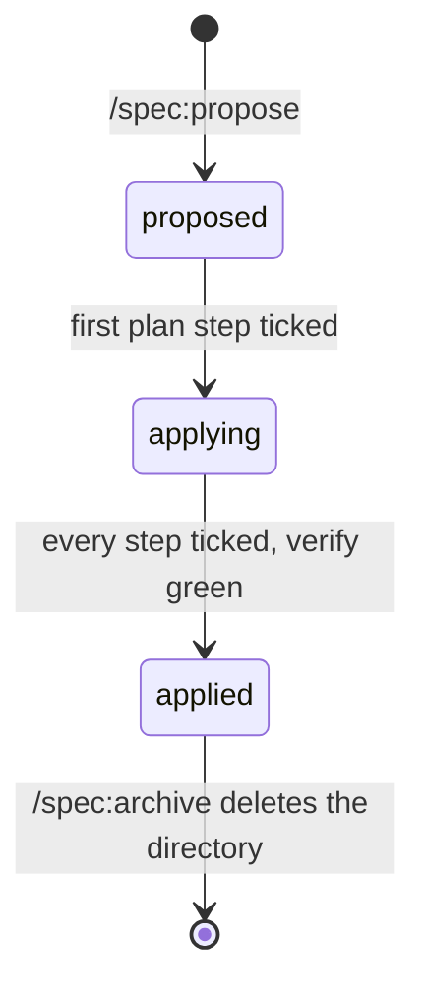

# Spec frontmatter

The one definition of the YAML block every spec file starts with. All spec skills follow it.

## Change files (`specs/changes/<name>/*.md`)

```yaml
---
feature: add-auth
title: "Proposal: add authentication"
status: proposed
order: 1
created: 2026-09-30
edited: 2026-10-01
---
```

Exactly these keys, in this order.

| Key | Required | Allowed values | Meaning |
|---|---|---|---|
| `feature` | yes | kebab-case, **= the directory name** | Which change the file belongs to. |
| `title` | yes | quoted string `"<Artifact>: <short title>"` | Same text as the file's `# …` heading. |
| `status` | yes | `exploring` · `proposed` · `applying` · `applied` | Where the **whole change** is. Identical in every file of the change. |
| `order` | no | integer ≥ 0 | `1` proposal, `2` domain, `3` architecture, `4` plan, `5` review; extra files `6`+ or omit. |
| `created` | yes | `YYYY-MM-DD` | Day the file was first written. Never changes. |
| `edited` | yes | `YYYY-MM-DD` ≥ `created` | Day of the last **content** change. A status-only change does not bump it. |

### `status` — the lifecycle of a change



| Value | Set by | True when… |
|---|---|---|
| `exploring` | a change dir with notes but not all four artifacts | The change is an idea being shaped. No code. |
| `proposed` | `/spec:propose`; `/spec:iterate` once all four artifacts exist | `proposal`, `domain`, `architecture`, `plan` exist; every plan step names its test and verify; nothing ticked. |
| `applying` | `/spec:apply` on the first ticked step | At least one step is `[x]`: its test was seen failing, now passes. |
| `applied` | `/spec:apply` on the last ticked step | Every step `[x]`, every `Verify:` passed, full suite green. `specs/system/` not yet updated — run `/spec:adversarial-code-review`, then `/spec:archive`. Short-lived. |

`/spec:grill` and `/spec:iterate` never change `status`. There is no `archived` value: `/spec:archive`
folds the change into `specs/system/`, commits, and deletes the directory — git history is the archive.
There is no `paused` value: a change on hold stays `applying`.

A skill that changes the status writes it to **every** file of the change in the same step. It never
downgrades.

### The review marker

`/spec:adversarial-code-review` writes `specs/changes/<name>/review.md` (`order: 5`). Its presence
is what tells the status pane and `/spec:overview` that the review step is done; `/spec:archive`
asks for it.

### When the files disagree

Take the value most files carry; on a tie, the file with the lowest `order`. Report the mismatch and
fix the outliers. The status must also match the plan's checkboxes: `proposed` has no `[x]`,
`applying` some, `applied` all — `/spec:overview` warns.

## System files (`specs/system/*.md`) and ADRs

```yaml
---
title: "Domain: Frechenlehen house model"
created: 2026-04-15
edited: 2026-10-01
---
```

Only `title`, `created`, `edited`. System docs describe what the system **is**; they have no
lifecycle, so never copy `feature`, `status` or `order` into them. ADRs have their own frontmatter (`adr.md` in
this directory).

## Bug files (`specs/bugs/*.md`)

One known, unfixed bug per file, named `<slug>.md` (kebab-case, what is broken). Template:
`specs/templates/bug.md`.

```yaml
---
title: "Bug: first Phone \"Add\" click does nothing"
priority: medium
areas: [clerk]
created: 2026-10-29
edited: 2026-10-29
---
```

Exactly these keys, in this order.

| Key | Required | Allowed values | Meaning |
|---|---|---|---|
| `title` | yes | quoted string `"Bug: <short title>"` | Same text as the file's `# …` heading. |
| `priority` | yes | `critical` · `high` · `medium` · `low` | How soon to fix it. `critical` = a core journey is blocked. |
| `areas` | yes | list, one or more of `usermanagement` · `clerk` · `inmate` · `antraege` · `ui` · `security` (add new ones here) | Which parts of the app the bug shows in; `ui` = layout, navigation, rendering; `security` = sessions, access, data exposure. |
| `created` | yes | `YYYY-MM-DD` | Day the bug was recorded. |
| `edited` | yes | `YYYY-MM-DD` ≥ `created` | Day of the last content change. |

There is no `status`: the commit that fixes a bug deletes its file — git history is the archive.
A bug accepted as a known gap moves to `specs/system/limitations.md` instead.

## Writing rules for every skill

- New file: `created` = `edited` = today (`date +%F`). A file without frontmatter gets it now.
- Changed content: set `edited` to today on that file only.
- Edit spec files with the Edit/Write tools, not sed/python in Bash — the status pane watches those
  tool calls.
