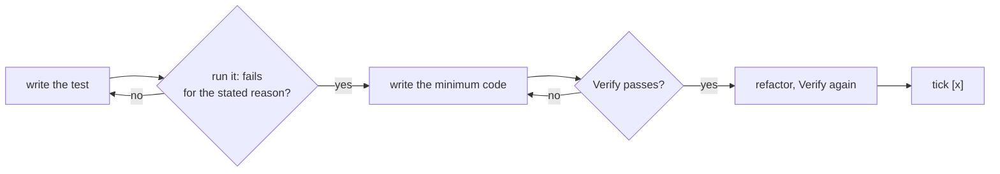

# Plan steps and test-first

How `plan.md` steps are written (`/spec:propose`, `/spec:grill`, `/spec:iterate`) and executed
(`/spec:apply`, `/spec:tweak`). The rule behind both: **a test is written and seen failing before
the code that makes it pass.** A step is done when its verify command passes, not when the code
"looks right".

## Step format

```markdown
- [ ] [python] Record every gable window in `GABLE_WIN`
  - Test first: `tests/test_core.py` › "gable windows are recorded" — fails today: list stays empty
  - Verify: `python3 -m pytest -q` → green
```

Every checkbox step carries both sub-bullets. They are plain bullets, not checkboxes, so progress
(`N/M`) counts only the `- [ ]` / `- [x]` lines.

| Line | Content |
|---|---|
| `- [ ] [kind] <step>` | One small, imperative unit of behaviour — one red → green cycle. `[kind]` is one of the kinds below. |
| `Test first:` | The test to write before any code: file › case, what it asserts, why it fails today. |
| `Verify:` | A command that exits 0 only when the step is done, and what passing looks like. Usually the targeted test plus the full suite. |

## Step kinds

The kind tells `/spec:apply` which harness applies. Commands per kind: `project.md` in this
directory.

| Kind | What it changes | Test first | Verify |
|---|---|---|---|
| `[python]` | Pure-Python code under `code/` that runs without bpy (shared core, exporters) | pytest test in `tests/` | `python3 -m pytest -q` |
| `[blender]` | bpy build scripts (`build_house.py`, `paint.py`, `garden.py`, `film.py`, …) | a check run in Blender via the MCP server (object/vertex counts, clash or clearance check), else `none — visual only` | rebuild in order, then render a still to `tmp/details/` and read it; film route: camera clearance check |
| `[web]` | three.js viewer under `web/` | Vitest/Node unit test or Playwright spec | `cd web && npm test && npx playwright test`, screenshots read at 1× |
| `[docs]` / `[config]` | No runtime surface (README, settings, …) | `none — <why>` | the strongest mechanical check: a `grep` that must match, a JSON parse |

By kind of change:

- **Feature / behaviour** — a test for the new behaviour, failing because the behaviour is missing.
- **Bug fix** — a test that reproduces the bug, failing for the bug's reason.
- **Refactor** — `Test first: existing <tests> pass before and after`; if the area has no coverage,
  the step before adds it.
- **No test harness yet** — the first step sets one up and its verify runs one trivial test. This
  project has no test suite yet: Blender changes are verified by rendered stills (`project.md`).

Order steps so each test can be written against what earlier steps built; a `[python]` core step comes
before the `[blender]`/`[web]` steps that use it. The plan ends with a plain note (not a checkbox): "System docs
are updated at `/spec:archive`."

## The cycle `/spec:apply` runs per step



1. **Red** — write the test from `Test first`. Run it and see it fail for the reason the plan
   states. A test that passes before the code exists tests nothing: fix the test.
2. **Green** — write the least code that makes it pass. Surgical: `principles.md`.
3. **Refactor** — clean up with the test green. Only what the step touched.
4. **Verify** — run the step's `Verify` command and the project's full suite. Both must pass.
5. **Tick** — only now `- [ ]` → `- [x]`.

Never make a test pass by weakening, skipping or deleting it, or by mocking what the step is meant
to exercise, unless the user explicitly agrees.

**Legacy steps** without `Test first` / `Verify`: derive both from the step and the architecture,
write them into `plan.md` first, then run the cycle.
