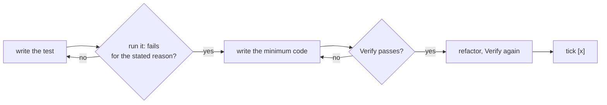

# Plan steps and test-first

How `plan.md` steps are written (`/spec:propose`, `/spec:grill`, `/spec:iterate`) and executed
(`/spec:apply`, `/spec:tweak`). The rule behind both: **a test is written and seen failing before
the code that makes it pass.** A step is done when its verify command passes, not when the code
"looks right".

## Step format

```markdown
- [ ] [server] Reject a Person without a last name
  - Test first: `server/app/src/test/java/.../PersonValidationTest.java` › `rejectsMissingLastName` — fails today: no validator
  - Verify: `gradle test` → green
```

Every checkbox step carries both sub-bullets. They are plain bullets, not checkboxes, so progress
(`N/M`) counts only the `- [ ]` / `- [x]` lines.

| Line | Content |
|---|---|
| `- [ ] [kind] <step>` | One small, imperative unit of behaviour — one red → green cycle. `[kind]` is one of the kinds below. |
| `Test first:` | The test to write before any code: file › case, what it asserts, why it fails today. |
| `Verify:` | A command that exits 0 only when the step is done, and what passing looks like. Usually the targeted test plus the full suite. |

## Step kinds (A12)

The kind tells `/spec:apply` which harness and which helpers apply. Commands and skills per kind:
`a12.md` in this directory.

| Kind | What it changes | Test first | Verify |
|---|---|---|---|
| `[model]` | A12 model files under `import/models/` (DM, FM, OM, RM, CDM, QM, AM, …) | `none — models have no unit harness`; the behaviour is asserted by the `[server]`/`[client]`/`[e2e]` step that uses the model, or by seed data that must import | model validation green (`validate-a12-models` skill if available, else `gradle :import:build`), plus the dependent step's test |
| `[server]` | Java under `server/app` (listeners, services, authorization) | JUnit test in `server/app/src/test/java` | `gradle test` |
| `[client]` | TypeScript under `client/src` (modules, sagas, components) | Vitest test once the harness exists; until then `none — no client unit harness, see harness step` | `npm run compile` in `client/` (+ `npx vitest run` when present) |
| `[e2e]` | User journeys through the running app | Playwright spec in `e2e/tests/base/` | `cd e2e && npm run e2e:test` |
| `[docs]` / `[config]` | No runtime surface (README, properties, roles.yaml, …) | `none — <why>` | the strongest mechanical check: build, lint, a `grep` that must match |

By kind of change:

- **Feature / behaviour** — a test for the new behaviour, failing because the behaviour is missing.
- **Bug fix** — a test that reproduces the bug, failing for the bug's reason.
- **Refactor** — `Test first: existing <tests> pass before and after`; if the area has no coverage,
  the step before adds it.
- **No test harness yet** — the first step sets one up and its verify runs one trivial test. This
  project has JUnit on the server, Playwright e2e in `e2e/`, and no client unit harness yet
  (`a12.md`).

Order steps so each test can be written against what earlier steps built; a `[model]` step comes
before the steps that use the model. The plan ends with a plain note (not a checkbox): "System docs
are updated at `/spec:archive`."

## The cycle `/spec:apply` runs per step



1. **Red** — write the test from `Test first`. Run it and see it fail for the reason the plan
   states. A test that passes before the code exists tests nothing: fix the test.
2. **Green** — write the least code that makes it pass. Surgical: `principles.md`.
3. **Refactor** — clean up with the test green. Only what the step touched.
4. **Verify** — run the step's `Verify` command and the project's full suite. Both must pass.
5. **Tick** — only now `- [ ]` → `- [x]`.

Never make a test pass by weakening, skipping or deleting it, or by mocking what the step is meant
to exercise, unless the user explicitly agrees.

**Legacy steps** without `Test first` / `Verify`: derive both from the step and the architecture,
write them into `plan.md` first, then run the cycle.
