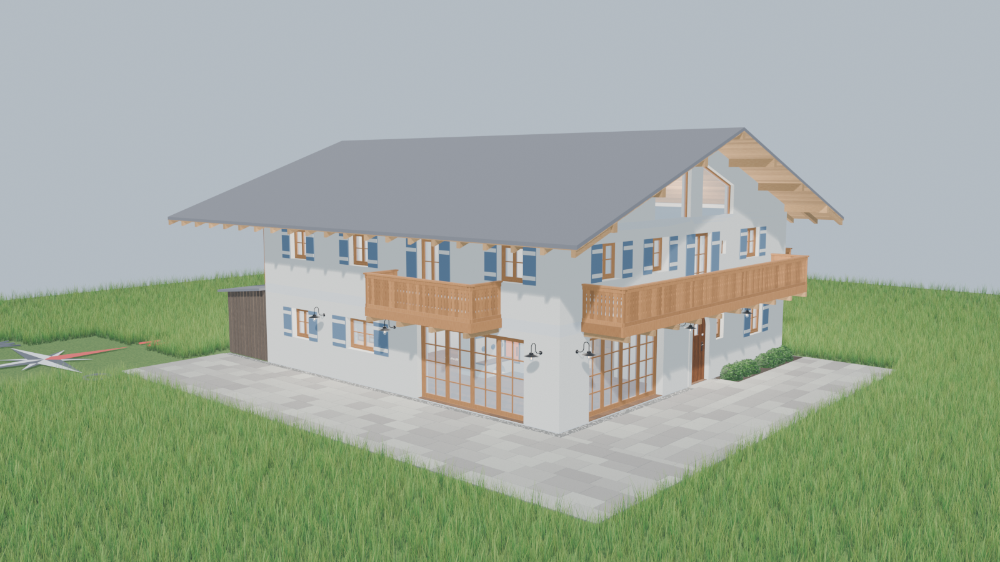
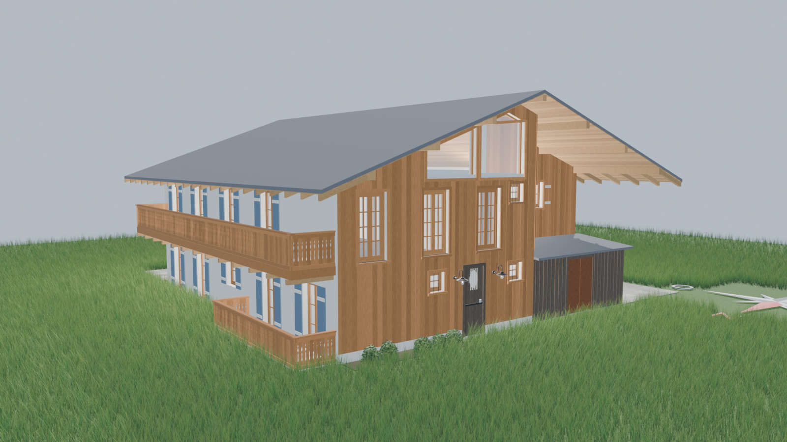

# Frechenlehen – Blender-Modell und Web-Ansicht

**[▶ Film: Rundgang durchs Haus](https://tillg.github.io/frechen_blender/rundgang.mp4)** (der neueste, läuft direkt im Browser)

3D-Modell des Hauses, erzeugt aus den Architekten-Plänen (Grundriss EG/OG, Ansichten, M 1:100).
Ein gemeinsamer Python-Kern (`code/house_core.py`, die Öfen in `code/ofen.py`, der Schreibtisch in `code/desk.py`, das Bad der Großeltern in `code/bad.py`, die Küche in `code/kueche.py`, das Gäste-WC am Hintereingang in `code/gaeste_wc.py`, das Regal im Büro in `code/regal.py`) beschreibt das Haus; daraus entstehen das
Blender-Modell und die interaktive Web-Ansicht im Browser.

## Struktur

| Pfad | Inhalt |
|---|---|
| `input/` | Eingangsdaten: die aktuellen Pläne in `2026-11-03 input/` (3 PDFs, daraus gerenderte Grundriss-Bilder `grundriss_eg/og.png`, im Modell als ausgeblendete Referenz), in `processed/` ältere Pläne, Farbvorlagen (`farben_*.png`) und Detailfotos (Dateiname = Bauteil, z. B. `entrance_door_from_outside.png`); was sich zwischen den Planständen geändert hat, steht in `LOG.md` |
| `code/` | Python: der Kern `house_core.py` (ohne Blender), die Blender-Skripte (laufen in Blender, z. B. über den Blender-MCP-Server) und der glTF-Export |
| `web/` | Web-Ansicht mit three.js (Vite); `web/public/frechenlehen.glb` wird aus dem Kern erzeugt, nicht eingecheckt |
| `plans/` | Pläne für den Architekten, aus dem Modell erzeugt und eingecheckt (siehe Pläne): `eg.svg`, `og.svg`, `nord.svg`, `ost.svg`, `sued.svg`, `west.svg` |
| `tests/` | Python-Tests (`pytest`), u. a. Vergleich des Blender-Neubaus mit einem gespeicherten Fingerabdruck |
| `frechenlehen.blend` | das Modell (erzeugt; nach Änderungen neu bauen und speichern) |
| `JJJJ-MM-TT_frechen_rundgang_blender.mp4`, `…_threejs.mp4` | Film: Rundgang außen, dann EG und OG (Blender-Render bzw. Web-Ansicht); der neueste `…_threejs.mp4` liegt auch auf GitHub Pages als [`rundgang.mp4`](https://tillg.github.io/frechen_blender/rundgang.mp4) und läuft dort im Browser |
| `justfile` | `just film`: nimmt den Rundgang der Web-Ansicht Bild für Bild auf (`web/film.mjs`, ca. 26 min, Dev-Server dieses Checkouts auf 5377), kodiert ihn mit 25 fps auf knapp 90 MB, löscht alle Filme außer dem neuen und dem davor – auch aus der Git-Historie von `main` –, committet und pusht mit Force-Push. Einzeln: `film-capture`, `film-encode`, `film-publish` |
| `docs/images/` | Ansichten für dieses README |
| `tmp/` | Zwischenstände (Einzelbilder, Testrender, Logs) – kann gelöscht werden |

## Skripte (`code/`)

| Skript | Macht |
|---|---|
| `house_core.py` | der Kern, ohne Blender: Maße, Materialdefinitionen (`MAT_DEF`), RAL-Farben, Raumlicht-Positionen, Bauteil-Funktionen und Gartenplan (Wiesenflächen, Dichte, Grasbüschel, Strauchplätze, Windrosen-Lage). Enthält alle Details nach den Fotos: Rundbogen-Haustür, Hintertür mit Ovalfenster und schwarzer Klinke innen und außen, Stuben-Nische mit Segmentbogen, Kassettentüren innen (geöffnet, mit schwarzen Drückern auf beiden Seiten; Schiebetüren mit Griffmulden, Fenster- und Terrassentüren innen mit Oliven), verglaste Doppeltür zum Windfang (ebenso verglast die Tür zum hinteren Windfang), Fenster mit Lärchenrahmen und Sprossen, Westfenster im OG (Yoga, Bad) mit 75 cm Brüstung und bis unter die Decke, Terrassentüren in Lärche, Lärchenschalung der ganzen Westseite und des Ostgiebels (über den Giebelfenstern als Lattung), Anbau mit Elektroraum und Heizung (Holzwände mit Lärchenschalung, Flachdach), Balkone in Lärche mit Baluster-Ausschnitten, Treppe mit gedrechseltem Geländer (auch um das Treppenloch im OG, darunter frei), Kalksteinplatten im EG-Flur (durchgehend, ohne Schwelle, durch die Tür zum hinteren Windfang), in den Bädern (im Bad der Großeltern als Streifen an der Westwand) und allen vier WCs (auch in der Garderobe neben dem Gäste-WC), sonst Eichendielen (auch im OG-Flur), Esstisch im Stil des Briol-Tischs (2 m lang, Brettplatte, gespreizte Beine auf flachem Fußrahmen) mit 8 Stühlen in Küche/Essen, alle Stühle im Haus als Brettstühle nach Foto (dicke Sitzplanke, vier gespreizte Stabbeine, hohe geneigte Lehne mit Herz-Ausschnitt), Küche aus `kueche.py` (siehe Teilmodell Küche), Küchentür zum Flur an ihrer echten Stelle (nach Foto, links angeschlagen, in die Küche geöffnet), Eck-Ofen in der NW-Ecke der Stube (aus `ofen.py`), Möbel nach Plan (in der Stube eine Sitzecke zwischen den beiden großen Fenstern: rundes Tischchen mit gedrechselter Säule und zwei kleine Bouclé-Sessel nach Foto, dazu ein Dreisitzer-Sofa in Leinen nach Foto zwischen Ofen und Sitzecke, mit Blick auf den Eckpfeiler; Betten mit Nachttischen, Schränke, in der Bibliothek Flügel (30° nach links gedreht, dann um 180° gewendet: Tastatur und Bank nach Norden), Schreibtisch zwischen den beiden Fenstertüren der Nordwand (aus `desk.py`, siehe Teilmodell Schreibtisch), um das Ostfenster das Regal vom Tegernsee (aus `regal.py`, siehe Teilmodell Schrank im Büro; dafür die Bürotür 50 cm nach Westen versetzt), dessen Vitrine 52 im NW-Eck hinter dem Klavier und ein kleiner Werkstattofen nach Foto in der Ecke von Flurwand und Mauerstück, um 45° zum Raum gedreht; bei Oma & Opa derselbe Werkstattofen in der NW-Ecke (Nordwand und Mauerstummel neben der Bad-Öffnung), ebenso um 45° gedreht; im Schlafzimmer SE (OG) eine 15 cm starke Wand am Kopfende des Bettes und ein dritter Werkstattofen in der Ecke Bad/WC, in der Waschküche zwei Waschmaschinen (auf einer ein Trockner) und ein 80 cm tiefer Tisch über die ganze Rückwand mit zwei Stapeln gefalteter Kleidung, an der rechten Wand ein offener Schrank mit durchgehenden Böden und je drei grob geflochtenen Weidekörben; in der Jugend zwei Stockbetten), Speis nach `input/2026-11-09 input/speis_kueche_v6.svg` (an der Flurwand ein offenes Regal, 91,9 cm Gang, ein offenes Regal zum Gang und Rücken an Rücken damit ein Schrank zum Esstisch statt der Wand (Fronten wie die Küche: Mallnitz-Stil in RAL 5014; vier Flügel, je oben eine Tür, darunter eine Tür über die halbe Höhe und unten drei Schubladen), alles bis zur Decke; die offenen Regale zur Illustration befüllt (Spaghetti-, Müsli- und Reispackungen, Mehl, Gläser mit Tomatensauce und Essiggurken, Dosen, dazwischen graue Kunststoffkisten mit Deckel); Schiebetür auf der Küchenseite, nach Süden offen), Bad der Großeltern aus `bad.py` (siehe Teilmodell Bad Oma & Opa), Gäste-WC mit Garderobe am Hintereingang aus `gaeste_wc.py` (siehe Teilmodell Gäste-WC), die übrigen Bäder mit Dusche nach Plan, alle sechs Waschbecken nach Foto (`input/2026-11-12 input/`) als rechteckige, strahlend weiße Keramikbecken, 85 hoch, auf einem verchromten Waschbeckenständer (zwei Beine mit Fußkappen, Querstange auf 52 cm, Seitenstangen mit Kugeln zur Wand, Flaschensiphon): Doppelwaschbecken 120 × 47 im OG-Bad im Nordwesten und 100 × 47 im Bad Nadine & Till, je unter einem Spiegel in Beckenbreite, die vier WCs (auch das der Großeltern) nach Foto mit Metro-Fliesen in RAL 5014 Taubenblau bis etwa 1,1 m samt Abschlussleiste, Stand-WC mit aufgesetztem Spülkasten, im WC neben dem Hauswirtschaftsraum ein Waschbecken 50 × 40 unter einem Spiegel mit schwarzem Rahmen, im OG-Flur genau mittig zwischen den Türen zu Saschi und Waschküche ein Waschbecken 60 × 47 auf taubenblauen Fliesen (je 15 cm breiter als das Becken), darüber ein Spiegel 110 × 95 in 10 cm breitem Holzrahmen (wie im hinteren Windfang, dort 54 × 74 mit 7 cm), Raumnamen auf dem Boden (Stube, Küche, Bibliothek, Speis, Oma & Opa; OG: Nadine & Till, Waschküche, Saschi, Bichlach, Jugend, Yoga), Sparren/Pfetten und Untersicht, Granit-Terrasse mit Kiesstreifen und Beeten, Außenleuchten, weiße Querbretter an den Läden |
| `ofen.py` | Teil des Kerns, ohne Blender: die Öfen – Eck-Ofen der Stube nach den Skizzen in `input/ofen/` (weiß verputzt, Feuer hinter Glastür in der Schräge und hinten eine zweite Feuertür in der Flurwand, zwei Bänke, Liege darüber mit dünner cremefarbener Matratze, drei Leitersprossen am Fußende und kleiner, eingeschalteter Schwanenhals-Leuchte über dem Kopfende wie auf dem Foto; siehe Teilmodell Ofen), seine Lage in der Stube, der kleine Werkstattofen (dreimal: Bibliothek, Oma & Opa, Schlafen SE) und der Wamsler-Küchenherd nach Foto. `house_core.py` ruft ihn auf, damit am Ofen getrennt vom übrigen Haus gearbeitet werden kann |
| `desk.py` | Teil des Kerns, ohne Blender: der Schreibtisch der Bibliothek (Tisch und Stuhl wie bisher) mit zwei LG-32″-Bildschirmen (Kante an Kante, ca. 170° zueinander, zum Stuhl gedreht; sie zeigen die Screenshots aus `input/2026-11-06 input/`, verkleinert in `web/public/textures/`), links darunter das geschlossene MacBook Pro mit leicht leuchtendem Apfel, davor weiße Tastatur und weißes Trackpad; dazu der schlichte Tisch, den auch die Waschküche nutzt. Wie `ofen.py` getrennt vom Haus bearbeitbar (Teilmodell Schreibtisch) |
| `bad.py` | Teil des Kerns, ohne Blender: das Bad der Großeltern (EG, NW-Ecke) nach der Skizze `input/2026-11-08 input/plan_grosseltern_bad.jpeg`: bodengleiche Dusche 80 cm breit in der NW-Ecke mit Kalkstein bis 2 m und Regenbrause, daneben eine 1,20 m lange, 1 m hohe Mauer mit einer L-förmigen Klarglasscheibe (an der Duschseite der Mauer, bündig mit der Laibung der Nord-Fenstertür; auf der Mauer bis zur Decke, an der Nordwand 35 cm breit bis zum Boden), an ihr ein Doppelwaschbecken 100 × 47 mit zwei Armaturen auf dem Waschbeckenständer; im Süden eine 1,20 m tiefe Nische, durch eine 12-cm-Wand geteilt in WC (Stand-WC, taubenblaue Fliesen) und offenen weißen Schrank (60 cm tief über die ganze Breite mit Böden, davor frei), geschlossen von zwei verschränkten Schiebetüren (WC-Tür offen, hinter der Schranktür), 96,7 cm Durchgang zwischen Schiebetür und Mauer; Boden: ein Kalkstein-Streifen so breit wie das WC an der Westwand (WC, Dusche), sonst Eichendielen. Das Bad ist zum Schlafzimmer offen. Wie `ofen.py` getrennt vom Haus bearbeitbar (Teilmodell Bad Oma & Opa) |
| `gaeste_wc.py` | Teil des Kerns, ohne Blender: das Gäste-WC am Hintereingang nach der vereinbarten Zeichnung `input/2026-11-10 input/gaeste_wc_v3.svg` (Variante v3): eine neue 10-cm-Trennwand teilt das alte WC in WC (101 cm, Westen) und Garderobe (94 cm, Osten); das WC bekommt eine neue 76-cm-Tür in der Nordwand, nach außen in den Flur geöffnet (Band an der Trennwand), Stand-WC mittig an der Südwand, taubenblaue Fliesen nur im WC; die Garderobe ist durch die alte 80-cm-Öffnung ohne Tür offen, mit Bank 35 × 110 cm (45 hoch, von Wand zu Wand, mit geschwungenen Armlehnen), Hakenbrett mit sechs Eisenhaken (165) und Hutablage (185) im Stil der Garderobe in Mallnitz (`garderobe mallnitz.jpeg`); das Handwaschbecken 40/28 steht auf dem Waschbeckenständer im Flur an der Ostwand mittig zwischen WC-Wand und Windfangtür (85 hoch), dahinter taubenblaue Fliesen bis zur Türbekleidung, darüber ein Spiegel 40 × 60 in 7 cm breitem Holzrahmen ab 120 cm. Wie `ofen.py` getrennt vom Haus bearbeitbar (Teilmodell Gäste-WC) |
| `regal.py` | Teil des Kerns, ohne Blender: der Schrank im Büro, das Regal vom Tegernsee um das Ostfenster der Bibliothek nach der Zeichnung `input/2026-11-11 input/buero_regal_v2.svg` (zwei Säulen 94, Mitte geteilt in Unterteil und Brücke, Gesims, Bücher), dazu die gemeinsamen Öffnungen Fenster, Balkontür und Bürotür (50 cm nach Westen versetzt). Wie `ofen.py` getrennt vom Haus bearbeitbar (Teilmodell Schrank im Büro) |
| `kueche.py` | Teil des Kerns, ohne Blender: die Küche nach der vereinbarten Zeichnung `input/2026-11-09 input/speis_kueche_v6.svg` (Küchentür nach Foto): Spülzeile von der Küchentür bis ins Eck (ca. 150 cm, Spüle mit Hahn in Edelstahl beim heutigen Wasseranschluss) unter dem Abzug (Kaminanschluss im NO-Eck ab 1,80 m), rechts der Spüle vor dem Herd ein blinder Eckschrank ohne Schubladen, an der Ostwand 60 cm Unterschrank, dann der Wamsler-Holzherd nach Foto in Edelstahl mit Feuer hinter der Scheibe und Rauchrohr in die Wand, darüber die stählerne Abzugshaube in alter Form, die Granitplatten beidseits bündig an den Herd; keine Hängeschränke; alle Schränke im Stil der Küche in Mallnitz (`input/2026-11-10 input/kueche_mallnitz.png`: Rahmenfronten mit vertiefter Füllung, verchromte Muschelgriffe an allen Schubladen und Türen) in RAL 5014 Taubenblau; unter dem Kochfeld Schubladen zur Küche und zum Esstisch hin; Halbinsel mit Induktionskochfeld zum Esstisch; Besenschrank 51 × 55 cm hinter der geöffneten Küchentür. Wie `ofen.py` getrennt vom Haus bearbeitbar (Teilmodell Küche) |
| `build_house.py` | Blender-Seite: baut aus dem Kern das Haus komplett neu (Collection „Haus“), mit Materialien, Raumnamen und ausgeblendeten Referenzplänen. **Achtung:** überschreibt Handänderungen im Modell |
| `mesh_ops.py` | Dreieckszerlegung und Ausrichtung der Flächen für den glTF-Export (das macht in Blender bmesh) |
| `export_gltf.py` | schreibt den Kern als `.glb` für die Web-Ansicht: `python3 code/export_gltf.py web/public/frechenlehen.glb` (nur Standardbibliothek); mit `--ofen`, `--desk`, `--bad`, `--kueche`, `--gaeste-wc` bzw. `--regal` nur das Ofen-, Schreibtisch-, Bad-, Küchen-, Gäste-WC- bzw. Regal-Teilmodell |
| `export_plans.py` | schreibt den Kern als sechs Planblätter (SVG, A3 quer, M 1:100) nach `plans/`: `python3 code/export_plans.py plans/` (nur Standardbibliothek, ohne Blender; siehe Pläne) |
| `paint.py` | Farben aus dem Kern (Putz/Fenster RAL 9010, Läden RAL 5014; Türen bleiben Naturholz) – nach `build_house.py` erneut ausführen |
| `fire.py` | loderndes Feuer als Komponente (eigene Collection `Feuer`): Flammenzungen pro Feuerstelle, skaliert auf deren Breite und Höhe, bewegt über F-Curve-Rauschen, dazu ein flackerndes Licht; dieselben Zungen zeigt die Web-Ansicht (`fire.js`). Brennt im Eck-Ofen (vorn und hinten zum Flur), in den drei Werkstattöfen (Bibliothek, Oma & Opa, Schlafen SE) und im Küchenherd |
| `windrose.py` | Windrose (eigene Collection, bleibt bei Neubau erhalten) |
| `garden.py` | Wiese (Geometry-Nodes-Streuung, im Viewport 10 %) und grüne Laubsträucher in den Erd-Beeten nach dem Gartenplan des Kerns (eigene Collection „Garten“) – nach `build_house.py` erneut ausführen. Seit der Web-Ansicht stehen die Sträucher um wenige Zentimeter anders |
| `tour.py` | die Route des Rundgangs (ohne Blender): außen herum, durch EG und OG (langsame Drehungen und Blicke in die Räume, auch in Dusche und WC der Großeltern; Drehgeschwindigkeit `TURN`, Pausendauer `PAUSE` und Kamerahöhe `EYE` = 1,60 m über dem Boden sind je eine Variable), über Treppe und Haustür zurück zum Startpunkt; daraus die Kamera pro Bild – für den Film und den Rundgang in der Web-Ansicht. Dazu die kürzeren Routen der Web-Ansicht (`ROUTES`, z. B. „Durch die Stube & Küche“) und ihre Standpunkte (`SPOTS`: Name, Gruppe, Modelle, Kamera, Blickpunkt, Blickwinkel; je eine Zeile) |
| `film.py` | Kamerafahrt nach `tour.py`, Raumlichter, geöffnete Haustür; Renderausgabe nach `tmp/film/` |
| `show.py` | ohne Blender: berechnet aus dem Kern einen Blickpunkt auf die genannten Objekte und öffnet die Web-Ansicht dort im Browser (siehe Tests) |
| `film_release.py` | für `just film` (ohne Blender): welche alten Filme weg können (es bleiben der neue und der davor), die Bitrate für knapp 90 MB (GitHub nimmt nur Dateien unter 100 MB), das Entfernen alter Filme aus der Git-Historie und welcher Film der neueste ist (für GitHub Pages) |

Ausführen in Blender: `exec(open("/Users/tgartner/git/frechen_blender/code/<skript>.py").read())`
Reihenfolge beim Neubau: `build_house` → `fire` → `paint` → `windrose` → `garden` → `film`.

Koordinaten: Ursprung = äußere SW-Ecke, +X = Osten, +Y = Norden, Meter.

## Pläne (`plans/`)

`python3 code/export_plans.py plans/` zeichnet aus dem Kern sechs Planblätter für den Architekten: Grundriss EG und OG, Ansicht Nord, Ost, Süd und West. Jedes Blatt ist ein SVG in A3 quer, im Maßstab 1:100 und in Millimetern angelegt: bei 100 % gedruckt misst 1 m im Modell 10 mm (der Maßstabsbalken prüft es). Im Schriftfeld stehen Projekt, Blatt, Maßstab und der Modellstand (ein Hash der Geometrie statt eines Datums). Dasselbe Modell ergibt immer dieselben Dateien, so zeigt `git diff plans/`, was eine Änderung an den Plänen bewirkt hat.

- **Grundrisse:** Schnitt in 1,80 m (EG) bzw. 1,55 m über dem Boden (OG), also über jeder Brüstung und unter jedem Sturz. Geschnittene Wände schraffiert mit einer durchgehenden kräftigen Umrisslinie, dünn die Lärchenschalung der Westseite, darunter in dünnen Linien die Einbauten (Küche, Bäder, Öfen, Speis, Schränke); lose Möbel fehlen. Die Treppe wie im Architektenplan, in EG und OG gleich: Umriss, ein Strich an jeder Steigung, Lauflinie mit Kreis am Antritt und Pfeil immer nach oben, im EG dazu „15 STG 18.0/25.5“. Türen mit dem üblichen Aufschlag (Blatt 90° geöffnet und Viertelkreis), egal wie weit die Tür im Modell offen steht, jeder Raum mit dem Namen aus dem Architektenplan und der aus dem Modell berechneten Fläche (Musikraum und Büro sind im Modell ein offener Raum, „Bibliothek“; die WC-Nische des Bads der Großeltern ist „WC Großeltern“). Maßketten auf allen vier Seiten wie beim Architekten (Schrägstriche, unter 1 m in cm, halbe Zentimeter als hochgestellte 5): Öffnungen, Wände und Räume, Gesamtmaß.
- **Ansichten:** die Fassade senkrecht von außen, verdeckte Kanten entfernt, unter ±0,00 ein grauer Geländestreifen; Höhenkoten (±0,00 OK FFB EG, OK FFB OG, Traufe, First) und die Gesamtbreite.
- Die Pläne sind eingecheckt; ein Test meldet, wenn sie nicht mehr zum Modell passen. Nach einer Änderung am Kern also `python3 code/export_plans.py plans/` ausführen. GitHub Pages erzeugt sie beim Bauen ohnehin neu, zeigt also immer die Pläne zum Modell auf `main`.

## Web-Ansicht (three.js)

Das Haus im Browser, frei drehbar, in fünf Stufen „Vom Strich zum Haus“: **Skizze** (Tuschelinien
auf Papier), **Massenmodell** (weißes Modell mit Schatten), **Detailmodell** (echte Materialien,
Tag), **Gebaut** (Abend; warmes Licht nur in den Räumen und Außenleuchten, die der Kamera am nächsten sind – tagsüber sind alle aus) und **Eingerichtet** (wie Gebaut, mit Möbeln nach Plan). Für Desktop-Browser.

**Navigation** (oben rechts, auf jeder Seite gleich): drei Auswahlfelder, die immer nach unten aufklappen,
dazu Tag/Abend (nur Haus, ab Detailmodell) und **Reset**.

- **Modell:** Ganzes Haus, Erdgeschoss (ohne Dach und 1. Stock), 1. Stock (ohne Dach) – ein Strich –
  Ofen, Schreibtisch, Bad Oma & Opa, Küche, Gäste-WC, Schrank im Büro (springt zur gewählten Seite).
- **Darstellung:** im Haus die fünf Stufen, in den Teilmodellen Drahtmodell, Masse, Gerendert.
  Bei Ganzes Haus folgt der Abschnitt **Pläne** mit den sechs Planblättern aus `plans/` (Grundriss
  EG und OG, Ansicht Nord, Ost, Süd, West): das Blatt ersetzt die 3D-Ansicht, Mausrad zoomt, Ziehen
  verschiebt, „SVG herunterladen“ speichert es; die URL hält das Blatt (`?plan=eg`). Eine Stufe,
  ein anderes Modell, Reset oder eine Route führen zurück zur 3D-Ansicht.
- **Standpunkt:** benannte Blickpunkte aus `tour.py` – außen von den vier Ecken, im Erdgeschoss und
  1. Stock von oben und schräg, in jedem Raum aus einer Ecke in Augenhöhe (1,60 m), z. B.
  „Bibliothek - Ecke hinten rechts“ im Eck hinter dem Schreibtisch; dazu „Bibliothek - Klavierspieler“,
  sitzend auf der Klavierbank (Augen auf 1,25 m) über die Tasten und den Flügel in den Raum; drinnen schaut man sich mit der Maus um, statt um
  einen Punkt zu kreisen. Wer die Kamera selbst bewegt, sieht „Eigene Ansicht“. In „Ganzes Haus“
  folgen die **Routen**: „Um und durch das Haus“ (die Kamerafahrt des Films) und „Durch die Stube &
  Küche“.
- Jedes Modell merkt sich im Browser seine Darstellung und seinen Standpunkt und öffnet beim
  nächsten Mal wieder dort (ein Link mit `?cam=…` geht vor). **Reset** führt zur niedrigsten
  Darstellung und zum Standard-Standpunkt zurück und vergisst das Gemerkte.

**Routen**: live im Browser mit 0,75-facher Geschwindigkeit (Stufe Eingerichtet, ganzes Haus,
Haustür offen). Jede Route endet, wo sie beginnt; mit „Endlos“ läuft sie ohne Sprung immer wieder.
Unten Abspielen/Anhalten, Zeitleiste, „Endlos“ und „Beenden“ (zurück zur vorigen Kameraposition);
angehalten kann man sich mit der Maus umschauen. Ein anderer Standpunkt oder ein anderes Modell
beendet die Route.

Teilmodell **Ofen** (`ofen.html`): der Eck-Ofen der Stube nach den Skizzen in `input/ofen/` mit
Feuertür (Feuer hinter Glas), unten hohl auf vier Beinen mit Bögen auf allen drei Seiten, zwei
Bänken (lange Bank 1,60 m) und Liege darüber (1,90 m; Rand nur an den freien Kanten: einzelne
senkrechte 5-cm-Bretter mit 10 cm Luft an Wand, Ecken und Fußende; darauf eine dünne cremefarbene
Matratze), mit Maßen (angenommene Maße kursiv).
Standpunkte schräg, von oben und auf die Feuertür; Darstellung als Drahtmodell (10-cm-Raster),
Masse oder gerendert; das Auswahlfeld „Modell“ führt zurück zum Haus. Schlichte Bankbeine (Vierkant mit Querriegel, nach bank-schlicht.png), Oberkante des Ofens gerundet. Derselbe Ofen steht im Haus (ohne Maße) in allen Stufen.

Teilmodell **Schreibtisch** (`desk.html`): der Schreibtisch der Bibliothek mit Stuhl, den zwei
Bildschirmen (mit den Screenshots), dem geschlossenen MacBook, Tastatur und Trackpad, mit Maßen;
Standpunkte schräg, von oben und auf die Bildschirme, Darstellung wie beim Ofen. Im Haus steht er
mit seinen Geräten in der Stufe Eingerichtet.

Teilmodell **Bad Oma & Opa** (`bad.html`): das Bad der Großeltern mit Dusche, Mauer mit Glas,
Doppelwaschbecken und der Nische mit WC, Schrank und den zwei verschränkten Schiebetüren, mit Maßen;
Standpunkte schräg, von oben und in die Nische, Darstellung wie beim Ofen. Damit man sieht, wie die
Schiebetüren funktionieren, rollt alle 4 Sekunden ein zufällig gewähltes Türblatt in 2 Sekunden
auf die andere Seite seiner Schiene. Im Haus steht dasselbe Bad, zum Schlafzimmer offen; dort
rollen die Türen genauso in der Stufe „Eingerichtet“, nur im Rundgang stehen sie still (WC offen).

Teilmodell **Küche** (`kueche.html`): Spülzeile bis ins Eck unter dem Abzug, Ostzeile 60 cm,
Wamsler-Holzherd mit Haube, Halbinsel mit Kochfeld und Besenschrank (Mallnitz-Fronten in RAL 5014), mit Maßen;
Darstellung wie beim Ofen. Im Haus steht dieselbe Küche.

Teilmodell **Gäste-WC** (`gaeste_wc.html`): WC und Garderobe am Hintereingang mit Trennwand, der
nach außen geöffneten WC-Tür, Bank mit Hakenbrett und Hutablage und dem Handwaschbecken auf seinem Ständer mit Spiegel
an der Flurwand, mit den Maßen der Zeichnung v3 (vor dem WC 40 statt 41 cm frei: das WC des Modells
ist 1 cm tiefer); Standpunkte schräg, von oben und vom Flur, Darstellung wie beim Ofen. Dazu die
Hintertür und die Windfangtür. Damit man sieht, wo sich die drei Türen in die Quere kommen, schwenkt
alle 3 Sekunden eine zufällig gewählte Tür in 3 Sekunden auf oder zu. Im Haus steht dasselbe; dort
schwenken die Türen genauso in der Stufe „Eingerichtet“, nur im Rundgang und im Film stehen sie wie
gebaut (WC- und Windfangtür offen, Hintertür zu).

Teilmodell **Schrank im Büro** (`regal.html`): das Regal vom Tegernsee (`input/2026-11-11 input/regal_tegernsee.jpeg`,
2,38 m hoch) um das Ostfenster der Bibliothek nach der Zeichnung `input/2026-11-11 input/buero_regal_v2.svg`:
links und rechts vom Fenster je eine Säule 94, das mittlere 94er-Element geteilt in ein Unterteil bis 95 cm
(5 cm unter der Brüstung) und eine Brücke ab 2,02 m über dem Fenster, Gesims durchgehend; Tiefe 42 cm,
Unterteil 48 cm (nach Foto geschätzt), mit Büchern. Dazu die Stücke der drei Wände: Ostwand mit Fenster,
Nordwand mit Balkontür, Flurwand mit der Bürotür, die dafür 50 cm nach Westen rückt (damit auch die Klinke
Luft hat): 90° geöffnet steht ihr Blatt 10,5 cm vor der rechten Säule.
Damit man die Tür versteht, schwenkt sie in 2 Sekunden zu, bleibt 4 Sekunden zu, schwenkt wieder auf, bleibt
4 Sekunden offen und so fort; im Haus genauso in der Stufe „Eingerichtet“, im Rundgang und im Film steht sie offen.
Standpunkte schräg, von vorn und von oben, Darstellung wie beim Ofen. Im Haus steht dasselbe Regal (statt
der früheren Bücherwand an der Flurwand); das schmale 52er-Element, eine Vitrine mit Glastür, Glasböden und
Weingläsern, steht gegenüber an der Westwand im Eck zur Außenwand, hinter dem Klavier (nur im Haus).

- Online: <https://tillg.github.io/frechen_blender/> (wird bei jedem Push auf `main` neu gebaut)
- Lokal: `cd web && npm install && npm run dev` – erzeugt zuerst das `.glb` aus dem Kern; danach Haus unter `http://localhost:5377/`, Ofen unter `http://localhost:5377/ofen.html`, Schreibtisch unter `http://localhost:5377/desk.html`, Bad unter `http://localhost:5377/bad.html`, Küche unter `http://localhost:5377/kueche.html`, Gäste-WC unter `http://localhost:5377/gaeste_wc.html`, Schrank im Büro unter `http://localhost:5377/regal.html`, der Produktions-Build (`npm run build`, wie auf GitHub Pages) unter `http://localhost:5377/frechen_blender/` (immer nur ein Server, fester Port 5377; auch die Tests laufen gegen ihn). Wird eine Datei in `code/` gespeichert, erzeugt der Server das `.glb` neu und lädt die Seite nach – an derselben Stelle, denn die Ansicht steht in der URL (Haus: Kamera, Blickpunkt, Stufe, Schnitt, optional `fov=` als vertikales Sichtfeld in Grad, Standard 28, und `hires=on` für volle Qualität bei der Filmaufnahme: alle Lichter, volle Pixeldichte, Gras auch von innen – sonst gelten die Abkürzungen für flüssiges Drehen, auch im Rundgang; Teilmodelle: Kamera, Blickpunkt, Darstellung). So lässt sich eine Ansicht auch als Link weitergeben.
  (braucht `python3`) und öffnet dann die Seite.

Jede Änderung am Haus geschieht einmal im Kern (`code/house_core.py`, Öfen in `code/ofen.py`) und erscheint in Blender und im
Browser.

## Tests

- Einmalig: `python3 -m venv .venv && .venv/bin/pip install -r requirements-dev.txt` und
  `cd web && npm install`
- Schnell (nach jeder Änderung, ≤ 60 s): `bash scripts/check.sh quick` – Python-Tests ohne
  Blender (`pytest -m "not slow"`) und Vitest, mit Zeit pro Teil
- Vollständig: `bash scripts/check.sh full` – alle Python-Tests (der Paritätstest startet Blender
  selbst im Hintergrund), Vitest und alle Playwright-Tests (Screenshots nach `tmp/web/`); die
  Bildstrecke entlang des Rundgangs nur auf Wunsch: `cd web && npx playwright test --grep @eye`
- Eine Änderung ansehen: `.venv/bin/python code/show.py EG_Haustuer` öffnet den Browser auf dem
  Dev-Server mit Blick auf die genannten Objekte (außen von der nächsten Fassade, innen von oben
  mit abgeschnittenen Geschossen darüber; `--from n|e|s|w|top`, `--page ofen|desk|bad|kueche|gaeste_wc|regal`,
  `--at x,y,z` für einen Punkt statt Objekten, `--p 0…4` für eine andere Stufe als Eingerichtet
  (nur Haus), `--print` gibt nur den Link aus). `cd web && node shot.js '<url>' ../tmp/web/bild.png` macht davon ein
  Bildschirmfoto.
