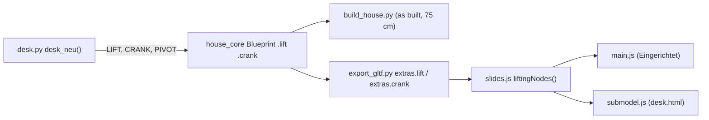

# Architecture: Höhenverstellbarer Schreibtisch

## Approach

`desk.desk_neu()` builds the Büro desk anew (the plain `desk()` stays for the OG table): the
static frame into `<c>_Moebel`, the lifted parts into `<c>_Schreibtisch`, the hand wheel into
`<c>_Handrad` (its `PIVOT` at the hub). It records `LIFT[o] = 0.30` for `_Schreibtisch`,
`_Geraete`, `_Bildschirm_L/R` (the wheel stays on its leg), and `CRANK["<c>_Handrad"] = ((1, 0, 0), 4 × 360)`.
All its parts draw `rnd` from its own `random.Random(18)`; it burns exactly the five global draws
the old table made, so every later part keeps its `rnd`. The core passes `LIFT`/`CRANK` on as
`Blueprint.lift`/`.crank`; `export_gltf.py` writes `extras.lift` (glTF up) and `extras.crank`
(glTF axis, radians). The viewer's `slides.js` gets `liftingNodes()` with one clock for all of them
(3 s up, 4 s rest, 3 s down, 4 s rest); `main.js` (Eingerichtet, not in the Rundgang, with travel
boxes for draw-on-demand) and `submodel.js` (edge lines move/turn with the nodes) call it.

## Impact

- **Build scripts:** `desk.py` (`desk_neu`, constants `DESK_AT` = (10.943, 11.471), `DESK_W/D` =
  1.90/1.00, `CHAIR`, `LIFT_DZ`), `house_core` (`LIFT`, `CRANK` registries, Blueprint fields,
  `FURNITURE` + `EG_Schreibtisch`, `EG_Handrad`, material `Kirschbaum`), `export_gltf.py`.
- **Materials:** new `FL_Kirschbaum` (wood, along x); the frame uses `Eisen`.
- **Garden / film:** none for the route; the Rundgang camera clearance is re-checked (the desk
  sits by the route in the Bibliothek). Expected golden changes: `EG_Moebel`, `EG_Geraete`,
  `EG_Bildschirm_L/R`, `EG_Stuehle` (chair 9 mm south), new `EG_Schreibtisch`, `EG_Handrad`.
- **Web viewer:** `slides.js`, `main.js`, `submodel.js`, `desk.js` (views, wall, grid for the new
  size); test hooks `lift`.
- **Render / output:** Blender rebuild + save, parity golden regenerated; plan sheets unchanged
  (furniture is not projected); no film re-render needed.

## Key decisions

| Decision | Alternatives considered | Why |
|---|---|---|
| Own registry `LIFT` + `CRANK`, one shared clock | reuse `SLIDE` (dz) | `slides.js` moves one random slide node at a time: top and devices would part; the Bad e2e counts slide nodes |
| Spindles ride with the top, reaching 30 cm into the housings | separate telescoping parts | one rigid group; hidden inside the solid housing/leg when low, still 5 mm inside when high |
| Keep x-centre and back edge of today's desk | keep the SW corner | stays centred between the french doors, 2 mm off the wall |
| Own `random.Random(18)`, burn the five old global draws | draw globally | no `rnd` shift for any part built later (as #4, #8) |

No ADR: follows ADR-001-XEWL (model facts only in the core), ADR-002-MLQS (extras), ADR-003-SKGB.

## Integration points

`house_core.build_furniture()` (calls `desk_neu`, `stuhl`), `build_desk()`, `PIVOT` in
`build_house.py`/`export_gltf.py`, `slides.js` patterns of `slidingNodes`/`swingingNodes`, test
hooks `window.__fl` / `window.__desk`. Existing tests that pin the old desk and change with it:
`tests/test_core.py` (desk sub-model, `DESK_AT`), `tests/test_gltf.py` (desk node names),
`web/e2e/desk.spec.js` ("Tisch 194.8").
