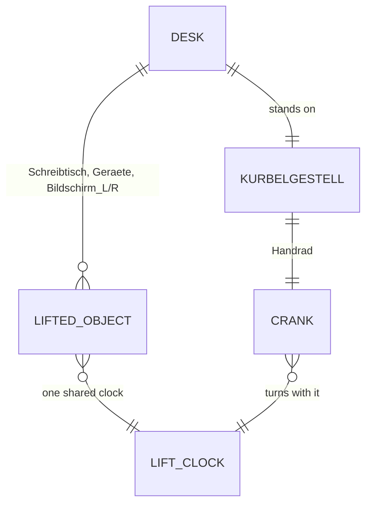

# Domain: Höhenverstellbarer Schreibtisch

## Concepts

**Lift** (new): objects that move straight up together by one travel to their other state (the
desk top with its devices: `LIFT`, object → metres), and a **crank** (object → axis and angle)
that turns about its pivot while they move. Like slide and swing, the viewer animates it in
Eingerichtet only, outside the Rundgang; Blender and the film keep it as built (low).

**Kurbelgestell** (new): the desk's cast-iron crank frame after the photo; static parts are
furniture in `<c>_Moebel`, the lifted parts (top, top bars, spindles) are `<c>_Schreibtisch`, the
hand wheel is `<c>_Handrad`.

## Vocabulary

| Term | Meaning |
|---|---|
| Lift | Straight vertical travel shared by a group of objects (`LIFT` → `extras.lift`) |
| Crank | Turn about an object's pivot along a given axis while the lift moves (`CRANK` → `extras.crank`) |
| Kirschbaum | Cherry wood material of the desk top |
