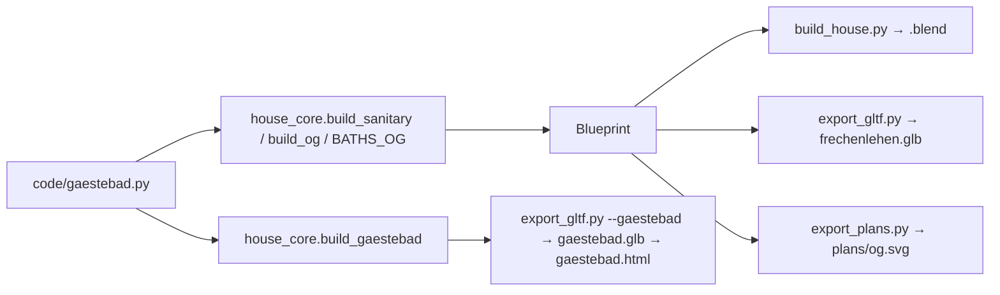

# Architecture: Gästebad im 1. Stock

## Approach

This change stays in the core (ADR-001-XEWL). The Gästebad gets its own module, `code/gaestebad.py`,
following `gaeste_wc.py` and `schrankbett.py`.

`gaestebad_neu(c, x0, y0, z=0, walls=False)` builds into collection `c`, with the room's inner SW
corner at (x0, y0) on floor z:
- the partition: x `PA..PB` (over `gaeste_wc.PA/PB`), y 5.46–6.54
- the toilet at the niche's centre, facing north, and its tiles (`wainscot`, the north side open)
- the shower to `SN` 6.85, the glass `GA` 1.92 to the east wall, the head behind it
- the basin and the `wood_mirror` 140 × 95 at x 1.44

It returns the dimension lines. With `walls=True` (the sub-model) `waende()` adds the pieces of the
west, south, east (Flur door) and north walls.

The house uses it as follows:
- `build_sanitary()` calls `gaestebad_neu("OG", *GAESTEBAD_AT, z=Z_OG)`.
- `build_og()` drops the WC 2,26 wall with its door and the old partition, and takes the Flur door
  from `gaestebad.TUER`.
- `WCS` drops the niche, which tiles itself.
- `BATHS_OG` lists the room, the WC niche and the shower niche, with no stone under the partition.
- `PLAN_ROOMS` drops `("WC", "OG", 0.94, 5.95)`.

`build_gaestebad()` wraps the module at the origin with walls as a sub-model Blueprint. The rest
follows the existing sub-model wiring:
- `export_gltf.py --gaestebad` and `npm run blueprint`
- `web/gaestebad.html` with `web/src/gaestebad.js` (views Schräg, Von oben, Von der Tür)
- the toolbar's Modell entry "Gästebad" and `vite.config.js`
- `show.py --page gaestebad`, which faces `top`, since the four walls stand full height
- the module reloads in the Blender scripts

## Impact

- **Build scripts**:
  - new `code/gaestebad.py`
  - `build_og()`: partition and WC wall removed (one entry fewer in `LEAVES` and `DOORS`), `TUER`
  - `build_sanitary()`, `WCS`, `BATHS_OG`, `PLAN_ROOMS`, `build_gaestebad()`
  - the reload lists in `build_house.py`, `film.py`, `fire.py` and `garden.py`

  The global `random` stream shifts after the removed door, so per-part `rnd`, the oak and limestone
  joints and the gravel scatter (random lengths and positions) change house-wide. Everything else in
  the geometry changes only in the Gästebad.
- **Materials**: none (`Kiefer`, `Spiegel`, `Keramik`, `Glas`, `Fliese`, `Kalkstein` exist).
- **Garden / film**: none. The Rundgang only looks in from the Flur door at (2.8, 8.07), so
  `tests/golden/tour.json` is unchanged.
- **Web viewer**:
  - new page `gaestebad.html`, `src/gaestebad.js` and the Modell entry
  - `vite.config.js`, `package.json` (blueprint), `shot.js`, `.gitignore`
- **Render / output**: Blender rebuild and save, parity golden regenerated, `plans/` regenerated.
  No film re-render needed.

## Key decisions

| Decision | Alternatives considered | Why |
|---|---|---|
| Partition over the EG one (x 1.319–1.419) | Keep it at 1.57–1.67 with an L-shaped glass | The user's choice. It matches "wie im EG", and the 115 cm shower takes a 65 cm glass with a 50 cm entry. |
| WC wall removed, WC an open niche | Keep the wall stubs with a doorless passage | The user's choice. The architect's OG plan draws no wall there either. |
| Shower to 6.85, 5 cm short of the open leaf (6.906); glass on its north edge | Glass along the shower's west side; also lengthen the partition | The user's request ("die halbe Glas-Wand kurz vor der offenen Türe"). The partition keeps the WC niche 108 deep, so 31 cm beside the shower stay open towards the Bad. |
| Own module + sub-model like `gaeste_wc.py` | Keep it inline in `build_sanitary()` | The user asked for a sub-model with dimensions. One description serves the house and the page (ADR-001-XEWL). |
| Show faces `top` | `e` (Flur side), like other pages | The sub-model's four walls stand full height, so any side view hits a wall. |
| Mirror 140 × 95, 10 cm frame, from 1.17 | 130 or 150 wide | It is 10 cm wider than the basin on each side and as high and as framed as the OG Flur mirror ("ähnlich"). |
| Drop the "WC" label of the OG NW from `PLAN_ROOMS` | Keep it | The niche is no longer its own region. `test_each_plan_room_is_its_own_region` would fail. |

No ADR needed.

## Integration points

- `gaeste_wc.PA/PB`, which the OG partition stands on.
- `wainscot()`, `toilet()`, `shower()`, `waschbecken()`, `wood_mirror()`, `interior()`, `wall()` and `floor_cover()`.
- The sub-model plumbing of `gaeste_wc` and `schrankbett`: `export_gltf.py`, `show.py`, `submodel.js`, `toolbar.js`.
- Tests that pin the old layout get the new values (named in the plan). The parity golden is
  `tests/golden/blender_snapshot.json`.
- ADR-001-XEWL (one core, three backends).
