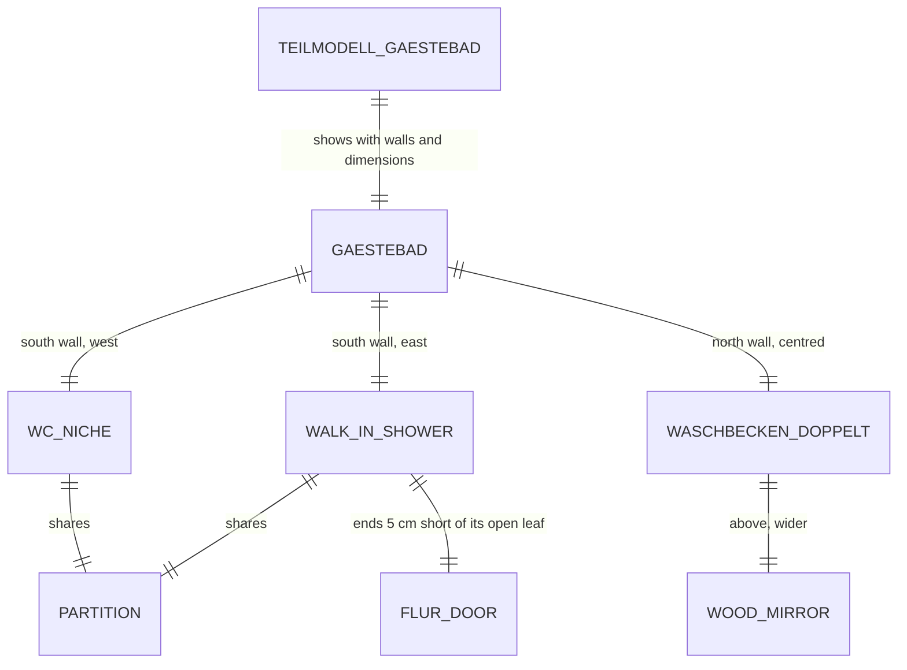

# Domain: Gästebad im 1. Stock

## Concepts

**Gästebad (OG).** This changes the system term *OG Bad NW*. It is the guest bathroom at the end of
the OG Flur and is one room.

Along its south wall are two niches, split by a 10 cm partition that stands over the EG Gäste-WC's
partition:
- a **WC niche** (west, 101 cm, open to the Bad, toilet centred on the south wall, Taubenblau tiles)
- a **walk-in shower** (east, 115 × 139 cm). It reaches to 5 cm short of the leaf of the Flur door,
  which lies open flat against the east wall. A fixed glass panel of 65 cm runs on its north edge
  from the east wall, with 50 cm open beside the partition.

The **WC 2,26** of the architect's plan is no longer a room of its own, so the plan has no separate
label for it.

The **Waschbecken doppelt 120** sits in the middle of the north wall. Above it hangs a **wood-framed
mirror** (`wood_mirror`, as in the OG Flur and the back hall) that is wider than the basin.

**Teilmodell Gästebad.** This is a new sub-model page (`gaestebad.html`), like Gäste-WC and
Schrankbett. It shows the Gästebad alone, with the pieces of its four walls and its dimension lines.

## Vocabulary

| Term | Meaning |
|---|---|
| Gästebad | The OG Bad at the end of the Flur (NW), with WC niche and walk-in shower; this was *OG Bad NW* with *WC 2,26*. |
| WC niche | The open west niche of the Gästebad with the toilet; tiled like a WC, with no door. |
| Walk-in shower | A shower with a fixed glass panel and an open entry, without a door. |
| Teilmodell Gästebad | The sub-model page `gaestebad.html` (Modell entry "Gästebad"). |
