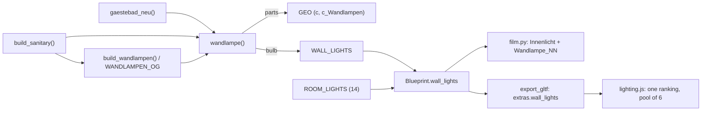

# Architecture: Wandlampen im 1. Stock

## Approach

The core gains one builder and one registry.

- **`wandlampe(coll, wx, wy, fx, fy, z)`**, next to the outside `lamp()`, builds one lamp into
  `<coll>_Wandlampen`. Its rosette centre sits on the wall point `(wx, wy)` at height `z`, and
  it faces `(fx, fy)`, like `at_wall`. It appends the bulb centre to `WALL_LIGHTS`. Its parts:
  - the rosette, the gallery and three set screws: `turned()` solids;
  - the arm: a tube lofted along a path in the wall's normal plane (out, quarter bend up, arch,
    down);
  - the shade: a closed lathe of the bell, outer and inner surface 3 mm apart.

  Every part gets the fixed `rnd` 0.5 and draws nothing from any random stream, so no other part
  shifts.
- **Heights:** the lamps over mirrors take the one constant `WANDLAMPE_SPIEGEL_H` (proposal,
  readings); the mirror helpers stay as they are.
- **Placements:**
  - Gästebad (4 over the mirror, 1 between the windows): built in `gaestebad.gaestebad_neu()`, so
    the sub-model shows them.
  - Flur mirror (2) and WC (2): in `build_sanitary()`, beside their mirrors.
  - The other 21 (at 1.70): in a list `WANDLAMPEN_OG` of `(wx, wy, fx, fy)`, built by
    `build_wandlampen()` at `WANDLAMPE_H`. Each entry is written as the midpoint of the named
    span, from the openings' numbers in `build_og()` and the furniture's in `build_furniture()`.
  - `build()` calls `build_wandlampen()` at the end of `build_sanitary()`.
- **Lights.** The OG entries of `ROOM_LIGHTS` go, except Bad S `(7.0, 1.5, Z_OG)`: 23 → 14.
  - `Blueprint.wall_lights` carries `WALL_LIGHTS`. `build()` and every `build_*()` clear it.
  - `export_gltf.py` writes `scene.extras.wall_lights`.
  - `film.py` adds one point light `Wandlampe_NN` per bulb to `Innenlicht`: 30 W, no shadow,
    soft size 0.03.
  - `lighting.js` ranks room sites and bulb sites together. Each site carries its base (room 9,
    lamp `LAMP_BASE` ≈ 2.5, tuned on a dusk screenshot); the shared `ROOM_N` = 6 pool and the
    hires one-light-per-site behave as before.
- **Materials.**
  - `Messing`: brass, `metal` 0.45 (< 0.5: the viewer has no env map), `rough` 0.35.
  - `Opalglas`: warm white, opaque, `emit` ≈ 1.0, `night=True`.
  - In Blender `night` is not read, so the shade always glows, like the outside filaments.

## Impact

- **Build scripts:**
  - `house_core.py`: `wandlampe()`, `WANDLAMPE_H`, `WANDLAMPE_SPIEGEL_H`, `WALL_LIGHTS`,
    `WANDLAMPEN_OG` and `build_wandlampen()`; the Flur mirror becomes 0.85 high; `ROOM_LIGHTS` 23 → 14; `Blueprint.wall_lights`; registries cleared
    in `build*()`.
  - `gaestebad.py`: `MH` 0.85 and its five lamps.
  - `film.py`: bulb lights.
  - `export_gltf.py`: `wall_lights`.
  - New objects `OG_Wandlampen` and `Gaestebad_Wandlampen`, built-ins (not `FURNITURE`).
- **Materials:** new `FL_Messing` and `FL_Opalglas`; `PAINT` is unchanged.
- **Garden / film:**
  - `NO_GRASS`: none.
  - `ROUTE`: unchanged, but the lamps stand 21 cm proud of walls the camera passes, so the
    camera clearance check (≥ 0.25 m) is rerun.
  - Lights: 9 OG fill lights out, 29 `Wandlampe_NN` in.
- **Web viewer:**
  - `lighting.js`: per-site base, room and bulb sites ranked together.
  - `gaestebad.js`: a colour for `Gaestebad_Wandlampen`.
  - No new stage or asset.
- **Render / output:**
  - plan sheets regenerated (model hash; the mirrors are below the cut, the lamps above it);
  - Blender golden regenerated (`_room_lights`, new objects, mirrors);
  - `.blend` rebuilt;
  - no film re-render in this change.

## Key decisions

| Decision | Alternatives considered | Why |
|---|---|---|
| Builder in `house_core.py` beside `lamp()`; placements where their room is built | New module `code/wandlampe.py` with every placement | A module means `reload()` lines in every Blender script and an ADR-001 list entry for ~100 lines. The Gästebad lamps belong to its sub-model anyway. Move it out when the EG lamps come. |
| One height over all mirrors (2.10) | Mirror top + 5 cm per mirror (2.07 / 2.10) | One constant, as the request asks for the 1.70 lamps. The WC mirror sets it, and it fits under the 2.20 ceiling with 1.5 cm to spare. |
| Bulbs in their own registry `WALL_LIGHTS` (absolute x, y, z) | Encode them in `ROOM_LIGHTS` as floor z with `ROOM_LIGHT_H` | Lamps hang at two heights; `ROOM_LIGHTS` means fill lights at one height. |
| One ranking for fill and lamp sites in the viewer, per-site base intensity | A separate lamp pool | Both are `PointLight`s, so they can share pooled objects; a second pool costs fragment work in every material. |
| Opaque opal shade, light without shadows | Translucent `Milchglas` with a visible bulb | Room lights cast no shadows in either backend, so the closed shade doesn't block them; alpha would show the gallery inside. |
| Fixed `rnd` 0.5, no random draws | `random.Random(19)` | Brass and opal are plain colours; one value keeps overlapping parts from z-fighting, and no stream moves. |

No ADR: the decisions follow ADR-001-XEWL and existing patterns, and none is hard to reverse.

## Integration points

- **Live ADRs:**
  - ADR-001-XEWL: every fact lives in the core; film and viewer read the Blueprint.
  - ADR-002-MLQS: materials through extras.
  - ADR-003-SKGB: TSL, `night` emission.
- **Code:** `build_og()` (door openings), `build_furniture()` (beds, machines, table,
  nightstands), `build_sanitary()`, `gaestebad.py`, `export_plans.py` (`CUT["OG"]` 1.55,
  `ROOM_CUT` 2.15: the lamps over mirrors reach 2.185, so the room areas are checked),
  `film.py`, `lighting.js`, `main.js` (pool `update`).
- **Tests whose numbers change by request** (each changed in its step's Red, never dropped):
  - `test_core.py`:
    - `test_paint_and_room_lights_live_in_the_core` (23 → 14)
    - `test_og_flur_basin…` (frame 0.95 → 0.85, glass 0.75 → 0.65)
    - `test_waschbecken_og_baeder` (Gästebad frame top 2.12 → 2.02)
    - `test_gaestebad_submodel` (label "Spiegel 140 × 85")
  - `test_gltf.py` (23 → 14)
  - `web/src/blueprint.test.js` (23 → 14)
  - `web/src/lighting.test.js`: the index-pinned nearest-site cases are recomputed for the new
    sites; the OG camera case now expects bulbs.
  - `tests/golden/blender_snapshot.json`, regenerated.
