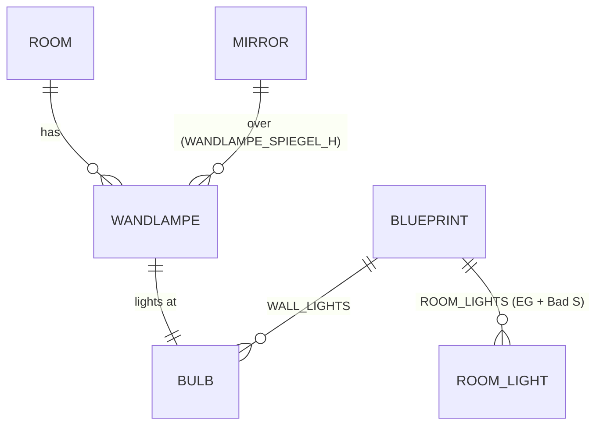

# Domain: Wandlampen im 1. Stock

## Concepts

**Wandlampe.** An interior wall lamp after `input/2026-11-13 input/wandlampe.png`: a brass
rosette on the wall, a gooseneck arm, a stepped brass gallery and an opal-glass bell (Ø 16,
11 high, 21 from the wall). Its **height** is the height of its rosette centre (the wall outlet)
above its floor: `WANDLAMPE_H` = 1.70, or `WANDLAMPE_SPIEGEL_H` = 2.10 for a lamp over a mirror.
Each lamp has a **bulb**, the light site in the shade's axis.

**Wall-lamp light.** The light of one Wandlampe bulb, part of the house's evening light. It
changes system term *Room light*: room lights now come in two kinds.
- **Fill lights** stay at the `ROOM_LIGHTS` sites, now 14: the EG and Bad S.
- **Wall-lamp lights** sit at the bulbs, recorded in `WALL_LIGHTS`, with a lower intensity per
  lamp.

In the viewer both kinds share one ranking and one light pool. This changes system term
*Light site*: a light site can now also be a Wandlampe bulb.

## Vocabulary

| Term | Meaning |
|---|---|
| **Wandlampe** | Brass wall lamp with an opal bell, after `wandlampe.png`. Object `<storey>_Wandlampen`, built-in (not furniture). |
| **Wandlampen-Höhe** (`WANDLAMPE_H`) | 1.70: rosette centre above the floor, for every lamp not over a mirror. |
| **Spiegel-Höhe** (`WANDLAMPE_SPIEGEL_H`) | 2.10: rosette centre of the lamps over a mirror, and of the Gästebad lamp level with them. |
| **Wall-lamp light** | Warm light at a Wandlampe bulb (`WALL_LIGHTS`): lit at dusk in the viewer, always in the Blender film. |
| **Opalglas** | Material of the shade: warm white, glowing at dusk. |
| **Messing** | Material of rosette, arm and gallery: antique brass. |
