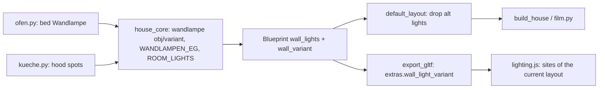

# Architecture: Lampen im EG

## Approach

All in the core, like #19. `wandlampe()` gets an object name and a layout tag (`obj=`, `variant=`); a
tagged lamp records its light's index in `WALL_LIGHT_VARIANT`. `WANDLAMPEN_EG` lists the placements
(wall point, facing, height, layout) with one comment per lamp; `build_wandlampen()` builds them into
`EG_Wandlampen` (both layouts), `EG_Wandlampen_Essen` (`VARIANT` main) and `EG_Alt_Wandlampen` (alt).
Every `*Wandlampen*` object stays off the plan sheets (`PLAN["skip_words"]`: the EG ones hang below the plan cut).
`ofen.py` builds a Wandlampe over the bed instead of `lamp()`; `ofen_im_haus()` moves its light like the
fires. `kueche.py` adds the spot strip to the hood (`<c>_Haube`), its 4 lights to `WALL_LIGHTS`.
`ROOM_LIGHTS` keeps the Speis only. `Blueprint.wall_variant` carries the tags; `default_layout()`
drops the alt lights; glTF writes `scene.extras.wall_light_variant`; `lighting.js` uses only the
current layout's sites.

## Impact

- **Build scripts:** `wandlampe()` (`obj`, `variant`), new `WANDLAMPEN_EG`, `WALL_LIGHT_VARIANT`,
  `build_wandlampen()`, `ROOM_LIGHTS`, `PLAN`, `VARIANT`, `default_layout()`, `Blueprint`;
  `ofen.py` bed lamp (`LAMP_LIGHTS` empty); `kueche.py` hood. Global random stream untouched (lamps
  draw nothing).
- **Materials:** none new (Messing, Opalglas, Metall exist).
- **Garden / film:** film lights follow `wall_lights` (default layout); route unchanged, clearance
  re-checked against the EG lamps.
- **Web viewer:** `lighting.js` (layout-aware sites; `update` gets the layout); `main.js` passes it.
- **Render / output:** Blender rebuild + parity golden (rnd shifts after the removed reading lamp's draws);
  Grundrisse without lamps (only the hood's strip under the cut), Ansichten show the EG lamps through the
  openings like the OG's; no film re-render in this change.

## Key decisions

| Decision | Alternatives considered | Why |
|---|---|---|
| Lamps replace the EG fill lights (Speis keeps its own) | add lamps on top | User's choice; same as #19 |
| Lamps off the plans via `PLAN["skip_words"]` | `FURNITURE` (like the mirrors) | `FURNITURE` also sets the viewer stage; OG lamps show from Gebaut, EG lamps should too |
| Layout tag per light (`WALL_LIGHT_VARIANT`) | ignore the variant for lights | Otherwise lights glow at hidden lamps (one inside Alt-C) |
| Placements as drawn (`lampen_eg_v1.svg`), user's picks for 4, 24/25, 33/34 | other readings | Agreed 2026-11-14 |

No ADR.

## Integration points

- `house_core`: `wandlampe`, `WANDLAMPE_H`, `WANDLAMPE_SPIEGEL_H`, `WALL_LIGHTS`, `VARIANT`,
  `default_layout`, `FURNITURE`, `ROOM_LIGHTS`; `ofen.py` (`ofen_neu`, `ofen_im_haus`); `kueche.py`.
- Tests that pin today's numbers, updated deliberately: lamp counts (35 wall lights, 14 room lights)
  in `test_core.py`, `test_gltf.py`, `test_tour.py`, `web/src/lighting.test.js`, e2e `stages.spec.js`
  (hires light count); Ofen lamp tests (`Ofen_Lampe`, `lamp_lights`).
- ADR-001-XEWL (facts only in the core), ADR-003-SKGB (viewer).
