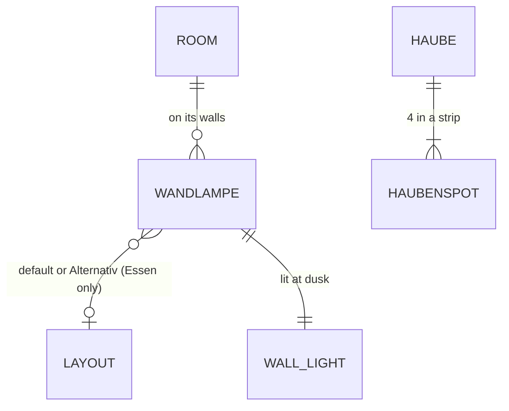

# Domain: Lampen im EG

## Concepts

**Wandlampe** (system term from #19): now also in the EG, over the Ofen bed (instead of the reading
lamp) and, in the Essen, tied to the layout: two lamps belong to the default layout, two to the
variant Alternativ, like the variant's furniture.

**Haubenspots**: four small spots built into a strip under the Küche hood's back edge, lit at dusk.

**Fill light** (ROOM_LIGHTS): only the Speis keeps one; every other room is lit by its lamps.

## Vocabulary

| Term | Meaning |
|---|---|
| Haubenspots | The four spots in a strip at the back edge of the Küche hood's underside. |
