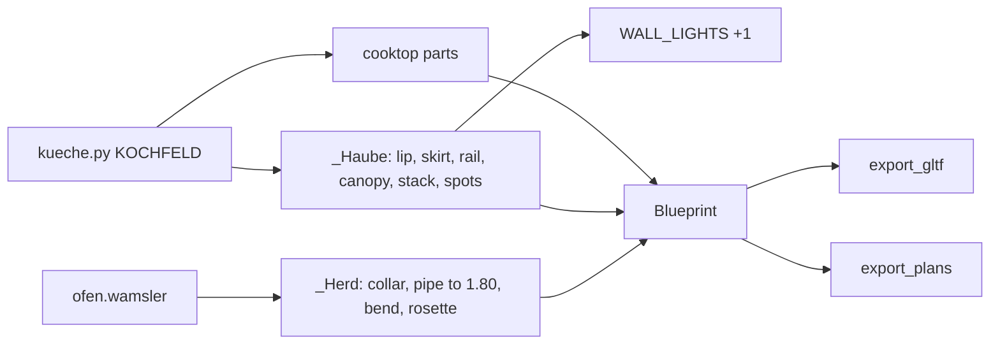

# Architecture: the hood over the cooktop, the Wamsler's pipe higher into the wall

## Approach

Both pieces stay where they are built today: the hood in `kueche_neu()` (object `<c>_Haube`, so
house, sub-model, glTF node names and `kueche.js` colours are unchanged), the pipe in
`ofen.wamsler()` (object `<c>_Herd`, which alone may reach into the east wall in the sub-model).
The hood's geometry is re-centred on the cooktop (constant `KOCHFELD` in `kueche.py`, used by the
cooktop and the hood) and made symmetric: skirt and canopy on four sides, the stack in the middle;
the rail on the cook's (north) side; the spot strip along the hood's middle under the lip; its one
`WALL_LIGHTS` entry under the hood's centre. The pipe's bend height becomes 1.80; a rosette
(prism, Eisen) on the east wall face around it.

## Impact

- **Models:** `code/kueche.py`, `code/ofen.py` (core geometry); plan sheets regenerated.
- **Client:** none (viewer reads the glTF; node names unchanged).
- **Server:** none.
- **Authorization:** none.
- **Data:** `plans/*.svg` regenerated.
- **Where it runs:** pure Python core → glTF viewer, plan sheets.

## Key decisions

| Decision | Alternatives considered | Why |
|---|---|---|
| Island hood hung from the ceiling over the Halbinsel (run-2026-11-15-1633-31) | wall chimney hood (the cooktop is 60 cm from the east wall, not at it); downdraft | the cooktop is free-standing on the peninsula; "same style" keeps the old form |
| Lip 65 cm above the cooktop, rail on the north (cook's) side | 70–75 cm | issue brief; the Rundgang passes south at 0.29 m |
| Pipe bend at 1.80 m with a rosette, still in `_Herd` | own object `_Ofenrohr` | object sets pinned by tests and the viewer; the pipe was already there at 1.30 |
| Rewrite the hood and Haubenspots tests to the new place (run-2026-11-15-1633-32) | keep and fail | the issue moves the hood; strength kept (taper, stack, 4 spots, 1 light) |

No ADR needed.

## Integration points

`tests/test_core.py` (hood, spots, sub-model, lamps), `tests/test_tour.py` (route clearance),
`tests/test_gltf.py` (node names), `web/src/kueche.js` (colours by name). ADR-001-XEWL: the change
lives only in the core.
