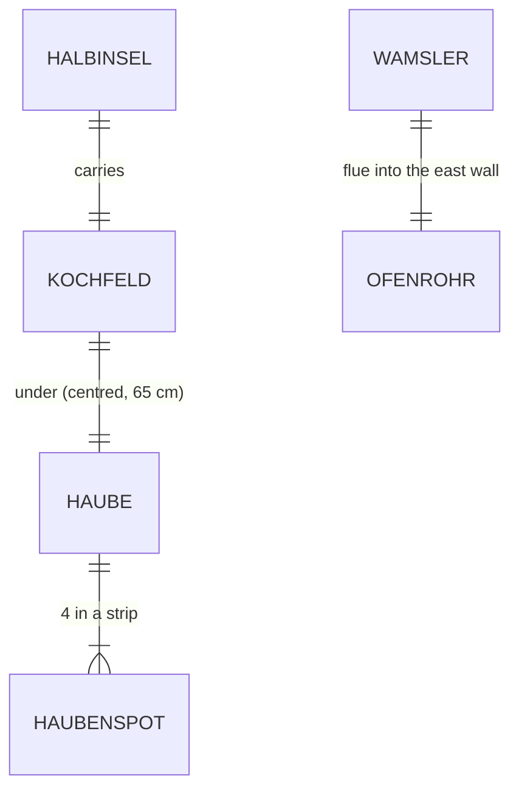

# Domain: the hood over the cooktop, the Wamsler's pipe higher into the wall

## Concepts

Changes system term **Haubenspots**: four spots in a strip under the Küche hood, which now hangs
over the Halbinsel's cooktop (along its middle, not at a wall); one wall light for the four, under
the hood's centre.

New term **Ofenrohr** (Wamsler): the Wamsler's black flue pipe, vertical from the flue collar to
1.80 m, then horizontal into the east wall, closed against the wall by a rosette.

## Vocabulary

| Term | Meaning |
|---|---|
| Haube (Küche) | Island hood of the old steel form over the Halbinsel's cooktop, hung from the ceiling. |
| Ofenrohr | The Wamsler's flue pipe: up to 1.80, 90° bend, into the east wall with a rosette. |
