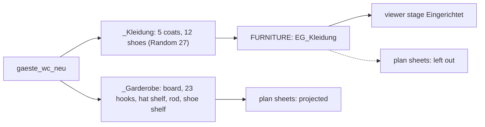

# Architecture: Garderobe für viele Jacken

## Approach

All in `gaeste_wc_neu()` (`code/gaeste_wc.py`), house coordinates shifted by (dx, dy) as before.
The niche is x 1.419 (partition) .. 2.358 (east wall), y 5.475 (south wall) .. 6.574; the open
passage is in the north wall, so "left" = east wall, "back end" = south wall.

Budget along x (the rod): Wandlampe 33 on the partition reaches x ≤ 1.63 → coats x 1.66 .. 2.16;
the hooks reach 12 cm off the east wall (x ≥ 2.238), the hat-shelf brackets 14 cm (x ≥ 2.218).
Along y: rod 27 cm from the south wall, coats ±25 cm round it (y ≈ 5.50 .. 5.99); shoe shelf 33
deep. Heights: shoe shelf boards at 4, 26, 48 cm (2 cm thick, 20 cm clear between), top 50; rod at
1.78; shoulders 1.70, coats 0.85 .. 1.05 long (hem ≥ 0.65); hooks at 1.50 and 1.65, hook board
1.35 .. 2.00, hat shelf at 1.95 (raised from 1.85 so the upper hook row clears its brackets).

`_Garderobe` (built-in, as before): hook board, 23 hooks (12 + 11 staggered), hat shelf with
three brackets, rod (`Stahl`, `turned`) with two wall flanges, shoe shelf (two sides, three boards,
recessed plinth). New object `<c>_Kleidung`: five coats (hanger: wooden bar + steel hook over the
rod; body as a (y, z) profile extruded along x by `prism_x`, two sleeves, a collar) and 6 pairs of
shoes (sole + upper profile, three kinds: Halbschuh, Turnschuh, Stiefel), drawn from an own
`random.Random(27)`; every part gets an explicit `rnd`, so no other object's shading changes.

## Impact

- **Build scripts**: `gaeste_wc.py` (bench gone, constants `BK`/`BZ` replaced, new constants for
  rod, shoe shelf, hooks); `house_core.FURNITURE` + `EG_Kleidung`; `MAT_DEF` new materials. No
  change to `LEAVES`, `OPENINGS`, Wandlampen.
- **Materials**: new `FL_Loden`, `FL_Kamel`, `FL_Anthrazit` (coat fabrics), `FL_Leder`,
  `FL_Gummi` (shoes); reused `Jeans`, `Wolle`, `Leinen`, `Stahl`, `Kiefer`, `FichteY/Z`, `Eisen`.
- **Garden / film**: none (`NO_GRASS` unchanged; the Rundgang stays ≥ 1.35 m from the niche).
- **Web viewer**: `web/src/gaeste_wc.js` colour map (+ `GaesteWC_Kleidung`) and comment; the e2e
  label list in `web/e2e/gaeste_wc.spec.js`.
- **Render / output**: plan sheets `eg` (and sections if visible) regenerated; Blender dormant.

## Key decisions

| Decision | Alternatives considered | Why |
|---|---|---|
| Hooks over the whole east wall, coats kept 8 cm clear of the hook tips | hooks only in front of the coat zone (≈ 55 cm, too few hooks) | the issue asks for "viele viele Haken"; jackets on hooks hang flat (x ≥ 2.21) beside the coats |
| Keep Wandlampen 33/34; coats start at x 1.66 | move lamp 33 out of the coat zone | surgical; lamp positions come from an agreed lamp plan |
| 12 shoes = 6 pairs, 3 per level | 12 pairs | "ein Dutzend Schuhe" read literally; 4 pairs would crowd 90 cm |
| Coats and shoes in their own furniture object | inside `_Garderobe` | keeps them off the plan sheets and out of the earlier viewer stages |

No ADR needed.

## Integration points

`hc.box`, `hc.prism`, `hc.prism_x`, `hc.turned`; `FURNITURE`; the sub-model tests
`tests/test_core.py::test_gaeste_wc_submodel` / `test_gaeste_wc_built_into_the_house`,
`tests/test_gltf.py`, `web/e2e/gaeste_wc.spec.js`; ADR-001-XEWL (model facts in the core only).
