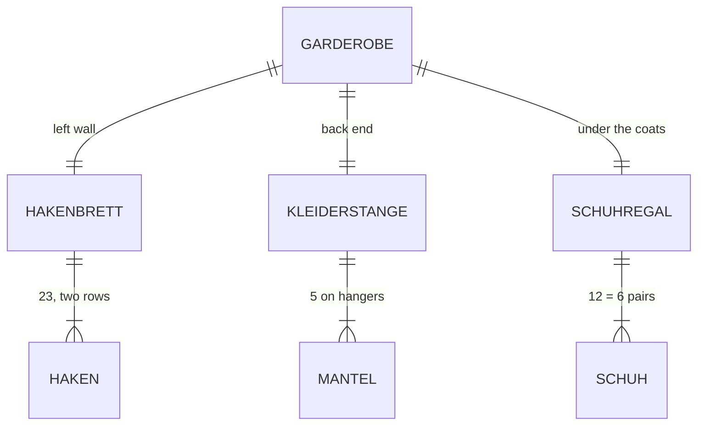

# Domain: Garderobe für viele Jacken

## Concepts

Changes system term **Garderobe** (Gäste-WC terms): no Bank any more. The Garderobe now has a
**Hakenbrett** over the whole left (east) wall with many hooks in two staggered rows, the
**Hutablage** above it, a **Kleiderstange** across the back end (south wall), and under it the
**Schuhregal** (two levels, 20 cm clear each).

New: **Kleidung** — the illustrating loose items, five **Mäntel** on **Bügel** on the rod and a
dozen **Schuhe** (6 pairs) in the shoe shelf. They are furnishings (viewer stage Eingerichtet, not
on the plan sheets).

## Vocabulary

| Term | Meaning |
|---|---|
| Kleiderstange | hanging rod from the partition to the east wall, near the south wall |
| Schuhregal | low open shelf along the south wall, two levels of 20 cm |
| Kleidung | object `<c>_Kleidung`: coats and shoes, furniture |
