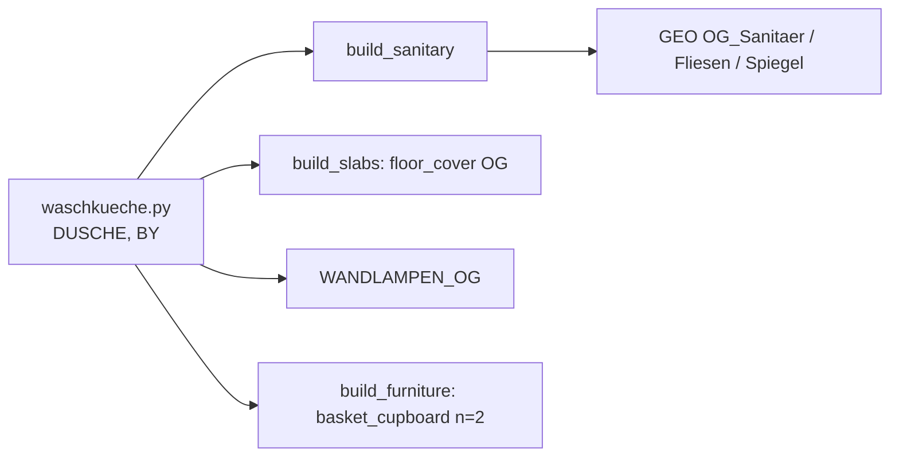

# Architecture: basin and shower in the Waschküche

## Approach

A new pure-Python module `code/waschkueche.py` (like `elternbad.py`, house only, no `waende()`, no page):
the room's numbers (`WI, WO, YS, YN`), the cabin (`DUSCHE` = outer rectangle), the basin axis `BY`, and
`waschkueche_neu(c, z)`, which builds the cabin (glass panes, rails, the door leaf with hinges and handles,
limestone on the west wall via `hc.limestone`, head and drain via `hc.shower(tray=False, glass=[])`) and the
basin (`hc.waschbecken`, `hc.wainscot(sides="e")`, `hc.wood_mirror`). `build_sanitary()` calls it last.
The cabin's floor is one more limestone rectangle in the OG's `floor_cover` call (the oak skips it).
`WANDLAMPEN_OG` entries may carry their height; the tower lamp's entry moves over the mirror in its slot,
so `WALL_LIGHTS` keeps its order. `basket_cupboard()` gets `n` (baskets per shelf; width fits).

## Impact

- **Build scripts:** new `waschkueche.py`; `build_sanitary`, `build_slabs`, `build_wandlampen`,
  `WANDLAMPEN_OG`, `basket_cupboard`, `build_furniture`; Blender reload lists in `build_house.py`, `garden.py`.
- **Materials:** none (Glas, Metall, Kalkstein, Fliese, Kiefer, Spiegel exist).
- **Garden / film:** none (route unchanged; clearance test added).
- **Web viewer:** none (the glb carries it).
- **Render / output:** plan sheets regenerated; Blender dormant.

## Key decisions

| Decision | Alternatives considered | Why |
|---|---|---|
| Cabin on the west wall north of the table, cupboard shortened (run-2026-11-15-1633-21) | NW corner with the door leaf at 90°; SE/SW corner on the south wall; moving the machines | no free 1.10 square exists; this keeps door, table and machines; the south wall stays free for #30 |
| Glass door built closed, no PIVOT/SWING (-22) | animated leaf | simpler; nothing else in the house animates shower glass |
| Module `waschkueche.py` without page (-23) | builder in house_core; sub-model page | #28/#30 need its numbers; a page is not required |

No ADR needed.

## Integration points

`hc.shower`, `hc.limestone`, `hc.waschbecken`, `hc.wainscot`, `hc.wood_mirror`, `floor_cover`, `DOORS`
(leaf sweep), `tests/test_core.py` (Waschküche tests, OG lamp tests), `tests/test_tour.py`. ADR-001-XEWL
(the core holds the model).
