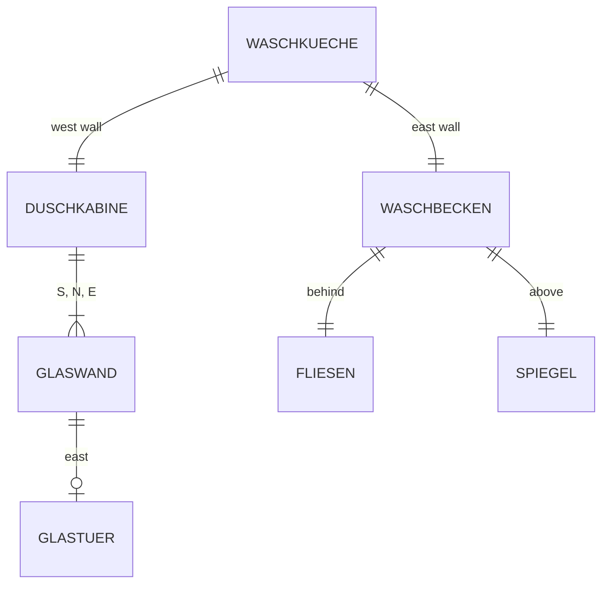

# Domain: basin and shower in the Waschküche

## Concepts

**Duschkabine (Waschküche)** — a small floor-level shower 1.10 × 1.10 against the Waschküche's west wall:
limestone slabs on the floor inside it only (in the plane of a tiled floor, no tray), limestone on the
wall, glass on its three open sides; the east glass holds a hinged **Glastür** (opens outward, built
closed).

**Waschbecken (Waschküche)** — a Waschbecken einzeln 60 on its Ständer on the east wall, on a strip of
Taubenblau tiles, under a wood-framed mirror with one Wandlampe; changes system term "Waschküche"
(functional.md): it also holds basin and shower; the basket cupboard has two baskets per shelf.

## Vocabulary

| Term | Meaning |
|---|---|
| Duschkabine | the Waschküche's 1.10 × 1.10 glass shower cabin |
| Glastür | its hinged glass door in the east glass |
