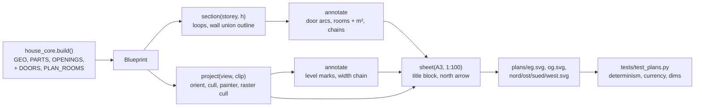

# Architecture: 2D plan export

## Approach

**A third backend.** `code/export_plans.py` is a third backend next to `build_house.py` and `export_gltf.py`. It is standard-library Python and runs without Blender. It calls `house_core.build()` and turns the Blueprint, together with a few core registries, into six SVG sheets. Every fact about the house stays in the core (ADR-001-XEWL). The exporter only knows how to draw: cut heights, line weights, sheet layout and dimension notation. The three facts the drawing needs and the core does not record yet go into the core:

- the door swings (`DOORS`);
- the architect's room names (`PLAN_ROOMS`);
- the object classes (`PLAN`): which objects are masonry, frames, floors and ceilings, ground, and what a Grundriss draws besides its storey (the balconies, the west cladding). The exporter names no model object (review 2026-11-11).

Four pieces, each a small set of pure functions:

1. **Section (Grundriss).** Every closed Part (`PARTS`) of the storey is sliced at its cut height. A face crossing the plane gives a segment, and the segments chain into loops.
   - Loops of wall objects (`PLAN`: `*_Waende`, `EG_Anbau`) are filled with a hatch pattern and drawn without a stroke. Their outline is stroked separately, as the union boundary: collinear edges are split at each other's end points, and a piece shared by two loops is interior and dropped. This leaves no seams between abutting wall boxes. The spike shows a clean result for the EG.
   - Other cut Parts (glazing bars, cabinets reaching the ceiling, the west cladding) get a thin outline. Door leaves as built are left out of section and projection (their `DOORS` box); the door swing draws the door.
   - **Cut height:** EG 1.80 m (sills ≤ 1.57, heads ≥ 2.00) and OG 1.55 m above `Z_OG` (sills ≤ 1.48, heads ≥ 1.60). A test asserts that every opening of the storey spans its cut height.
2. **Projection.** Plans and elevations share one hidden-line routine:
   - faces of all non-cut geometry are oriented outward with `mesh_ops.orient` per Part;
   - back faces and edge-on faces are culled;
   - the faces are sorted far to near and written as white-filled polygons with a thin stroke (painter's algorithm, glass included, so nothing shows through);
   - a coarse occupancy raster at 2 cm drops faces that are already fully covered;
   - edges shared by two coplanar faces of the same material are not stroked.

   A plan looks down from the cut height and takes only geometry below it, without loose furniture (`bp.furniture`); the built-ins stay. An elevation looks horizontally at one facade, takes all non-furniture house geometry, leaves out the garden (`PLAN` ground), and is fitted to what remains (user 2026-11-11: no extra clip). The spike of the south elevation kept 6.7k of 36k front faces, ran in about 3 s and wrote 0.5 MB.
3. **Annotation.**
   - **Door swings:** the conventional symbol, leaf line at 90° and quarter arc, from `DOORS` (user 2026-11-11), whatever the leaf's angle as built.
   - **Room labels:** from `PLAN_ROOMS`. The area is the region of a section just below the ceiling (EG 2.19 m, below the annex ceiling at 2.27; OG `Z_OG` + 2.15 m) that contains the anchor. Door openings are closed by their lintels, and exterior openings by a line on the wall's inner face. Besides the walls, built-ins reaching the ceiling divide rooms (the Speis cabinet C stands in place of the former Speis/Essen wall; 5 mm gaps to the walls are closed). The region is filled exactly on the grid of unique wall coordinates, plus loops for the few non-box walls. Two consequences, agreed with the user 2026-11-11: the Bad Großeltern's niche (lintel 2.05) is apart from the Bad, its WC labelled "WC Großeltern", the Schrank unlabelled; Musikraum and Büro are one open region in the model (the Kamin wall has only its ends), labelled "Bibliothek".
   - **Dimension chains:** scanned from the section along lines parallel to each facade.
   - **Level marks** on the elevations, from `Z_OG`, the eaves height and `RIDGE_Z`.
4. **Sheet.** An A3 landscape page:
   - `<svg width="420mm" height="297mm" viewBox="0 0 420 297">`, so 1 unit is 1 mm and 1 m is 10 units;
   - the drawing centred, with a frame, title block, scale bar and north arrow;
   - all numbers printed with fixed decimals (`-0` normalised);
   - elements in a stable order (sorted keys, never an unsorted set);
   - the model state is a hash of the sorted Blueprint geometry, and there is no date.

## Impact

- **Build scripts:**
  - `house_core.py` gets `DOORS`, filled by `panel_door`, `entrance_door` and `back_door`, and reached from `gaeste_wc.py` and `kueche.py` through them. It holds only records: no geometry, no `random` draws.
  - `house_core.py` also gets `PLAN_ROOMS`, a table of name, storey and anchor.
  - `house_core.py` also gets `PLAN`, the object classes of the plan sheets (names only).
  - The Blueprint gains `doors`, `plan_rooms` and `plan`.
  - `GEO`, `PARTS` and `OPENINGS` are unchanged, so the parity golden, `tour.json` and the `.glb` stay identical.
  - New `code/export_plans.py`.
- **Materials:** none. The exporter reads `MAT_DEF` names only, to find glass and to suppress seams.
- **Garden / film:** none.
- **Web viewer:** none. The `.glb` and the viewer are unchanged.
- **Render / output:** new committed output `plans/*.svg`. No Blender rebuild or re-render: the Blender output does not change, and the parity test confirms it.

## Key decisions

| Decision | Alternatives considered | Why |
|---|---|---|
| A third stdlib backend that reads the Blueprint | Blender Freestyle SVG export; a viewer-side export in three.js | ADR-001-XEWL: facts once in the core, backends only draw. It runs headless, is fast and testable in pytest, and is deterministic. Freestyle needs Blender, and its line output is hard to control and to diff. |
| Floor plans without loose furniture (`FURNITURE` left out of section and projection) | All geometry, as the architect's EG plan shows beds and tables | The user's choice: the sheets show the building and its built-ins. `FURNITURE` already separates loose items from built-ins (kitchen, sanitary, Ofen, Speis, Bad cabinets). |
| Floor plan = exact section of the closed Parts, plus projection below | A symbolic plan drawn from `wall()` records alone | Everything the model has (Bad walls, Küche, partitions, arches) shows up without a second description. Symbols only where geometry cannot carry the meaning: door arcs, labels. |
| Cut height per storey (EG 1.80, OG 1.55), asserted against all openings | The DIN default of about 1.00–1.20 m with high windows dashed | At 1.20 the WC windows (sill 1.57) would not show. The test keeps the rule when openings change. |
| Painter's algorithm with opaque fills, orientation from `mesh_ops`, raster culling | Exact hidden-line removal; z-buffer rendering to an image | It is vector output and readable for the architect. The spike gives 0.5 MB and 3 s per elevation. Exact HLR is a project of its own. |
| Dimension chains scanned from the section, rounded cumulatively | Chains typed per facade | They follow every model change and always sum to the overall dimension. |
| `PLAN_ROOMS` with the architect's names in the core; area computed | Reusing `ROOM_NAMES` (the family's names, viewer floor labels) | The user chose the architect's names: the sheets are for the architect. The two tables serve different readers. Areas are never typed. |
| `DOORS` registry recorded by the door builders | Deriving arcs from `LEAVES` corners | `LEAVES` has no hinge or width. Recording costs nothing and keeps `GEO` and the random sequence unchanged. |
| `plans/*.svg` committed, with a test that they equal a fresh export | Generated and git-ignored, like the `.glb` | The user chose committed: the files are ready to send, and `git diff plans/` shows what a change did to the drawings. The `.glb` rule (ADR-002-MLQS) concerns the viewer asset, not this output. The cost is that every core change regenerates `plans/`, as `CLAUDE.md` will say. |
| A3, 1:100, one view per sheet, mm `viewBox` | The architect's 1:128 sheet with all four elevations | The user's choice. True scale when printed at 100 %. |
| Model-state hash in the title block, no date | A date or a git SHA | A date breaks determinism, and the SHA is unknown before the commit. |
| Conventional 90° door symbol; the leaf as built left out | The leaf at its built angle (180° for the eight flat-opened leaves) | The user's choice (review 2026-11-11): the architect reads the standard symbol; how far a door stands open in the model is irrelevant on paper, and nothing shows twice. |
| Object classes in the core (`PLAN`) | Name rules in the exporter | ADR-001-XEWL (review 2026-11-11): what an object is, is a model fact. |

No ADR needed. The backend follows ADR-001-XEWL, and committing the output is a reversible row in this table.

## Integration points

- **`house_core.py`:**
  - `build()` and `Blueprint`;
  - `PARTS` (closed solids) and `GEO`;
  - `OPENINGS` (exterior openings, their sills and heads);
  - `panel_door()`, `entrance_door()`, `back_door()`, which gain the `DOORS` recording;
  - constants `W_OUT`, `D_OUT`, `Z_OG`, `Z_EG_TOP`, `Z_OG_TOP`, `RIDGE_Z`, `FOOT`, `ANNEX`, `EAVE_OH`, `GABLE_OH`;
  - `FURNITURE` and `SMOOTH`, both sets, so they are iterated sorted.
- **`mesh_ops.py`:** `orient`, `newell`, `triangulate`, reused unchanged.
- **Sub-model modules:** `bad.py`, `kueche.py`, `gaeste_wc.py`, `ofen.py`. Their walls (`_Waende`) and doors are covered through the same objects and builders. `bad.W`, `bad.D`, `bad.NICHE` are the reference for the area test.
- **Tests:**
  - new `tests/test_plans.py`;
  - `tests/test_blender_parity.py`, `tests/test_tour.py` and `tests/test_gltf.py` must stay green unchanged, which proves the core additions changed nothing;
  - the currency test is marked `slow`.
- **Docs:** the README component list and script table; the `CLAUDE.md` Running section and "Other scripts" (regenerate `plans/` after a core change).
- **Live ADRs:** ADR-001-XEWL (core and backends), ADR-002-MLQS (the `.glb` unaffected), ADR-003-SKGB (viewer unaffected).
