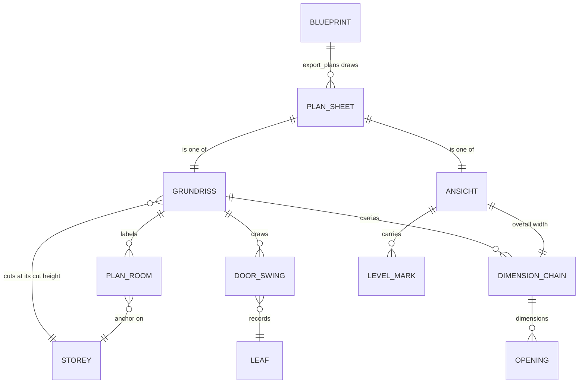

# Domain: 2D plan export

## Concepts

**Plan sheet (Planblatt).** One SVG page, A3 landscape at 1:100, sized in mm (1 m in the model is 10 mm on paper). It holds one drawing, dimension chains, a title block (Frechenlehen, sheet name, M 1:100, model state) and, on the floor plans, a north arrow. There are six sheets: Grundriss EG, Grundriss OG, Ansicht Nord, Ost, Süd and West.

**Grundriss.** This changes the system term, which until now meant only the architect's input plan. It now also means our generated floor plan: a horizontal section through one storey at its **cut height (Schnitthöhe)**, seen from above. Parts that the cut plane passes through are drawn as **cut**: walls are hatched inside a heavy outline round the whole wall, other parts get a thin outline (door leaves excepted: see Door swing). Parts below the plane are drawn as **projection** in thin lines. Parts above it are left out, and so is loose furniture (`FURNITURE`); the built-ins (kitchen, sanitary, stoves, Speis, cabinets, stairs) stay. The cut height of a storey lies above every sill and below every head of its openings, so every window and door shows as a gap in the cut.

**Ansicht.** This also changes a system term: it now also means our generated elevation. An Ansicht is named after the facade it shows. Ansicht Süd is the south facade, seen from the south, with x running left to right. It is an orthographic view with hidden lines removed. Glass is drawn opaque, so the interior never shows through. The ground below ±0,00 is a grey band.

**Door swing (Türaufschlag).** Every hinged door leaf records its hinge point, its width, the room side it opens into and the box of the leaf as built. The plan draws the conventional symbol from them: the leaf opened 90° and a quarter arc, however far the door stands open in the model; the leaf as built (in its box) is left out, so no door shows twice. A record never changes the geometry or the random sequence of the build.

**Plan room (Raumstempel).** Each room in the floor plans is named in the architect's words (Großeltern, Büro, Flur, Küche, Speis, Stube, WC, Schlafen, Hauswirtschaftsraum …). The core keeps a table of rooms, each with a name, a storey and an anchor point. The room's net area is computed, never typed. The room is the region that contains its anchor in a section just below the ceiling, where every door opening is closed by its lintel. Its area is the area of that region. Exactly one anchor may lie in each region.

**Dimension chain (Maßkette).** A row of dimension segments along one side of a drawing. Each segment has tick marks at its ends and its length written above the line. A floor plan has three chains per side, from the drawing outwards:

1. **openings:** the edges of the facade's openings;
2. **walls:** wall thicknesses and clear room widths, scanned along a line just inside the facade;
3. **overall:** the overall length.

Positions are rounded first and the lengths taken as differences, so the segments sum exactly to the overall length.

**Dimension notation.** Lengths of 1 m and more are written in metres with two decimals ("2.05"). Lengths under 1 m are written in centimetres ("31"). A remaining half centimetre is a superscript 5: 4.015 m is "4.01⁵" and 0.415 m is "41⁵".

**Level mark (Höhenkote).** A triangle with a level in metres relative to the EG finished floor: ±0,00 for OK FFB EG, +2,70 for OK FFB OG, then eaves and ridge. Elevations carry level marks, not chains.

**Model state.** A short hash of everything the sheets are drawn from (the Blueprint geometry, the door and room records, the object classes, the cut heights), printed in the title block. It identifies which model a sheet came from without a date, so the output stays deterministic.

## Vocabulary

| Term | Meaning |
|---|---|
| **Plan sheet** (Planblatt) | One A3 SVG at 1:100 in `plans/`: `eg`, `og`, `nord`, `ost`, `sued`, `west`. |
| **Cut height** (Schnitthöhe) | Height above a storey's floor where a Grundriss cuts. It lies between the storey's highest sill and its lowest head. |
| **Cut / projection** | Drawn as cut through (hatched walls, heavy outline) / seen below the cut (thin lines). |
| **Door swing** (Türaufschlag) | Hinge, width and side of a door leaf, plus the leaf's box as built. Drawn as the conventional symbol: the leaf at 90° and a quarter arc. |
| **Plan room** (Raumstempel) | The architect's room name and the computed net area ("Küche / 24,06 m²"). |
| **Dimension chain** (Maßkette) | Ticked row of lengths along a side: openings, walls, overall. |
| **Level mark** (Höhenkote) | Level marker in elevations relative to ±0,00 = OK FFB EG. |
| **Model state** | A hash of everything the sheets are drawn from, in the title block, used instead of a date. |
