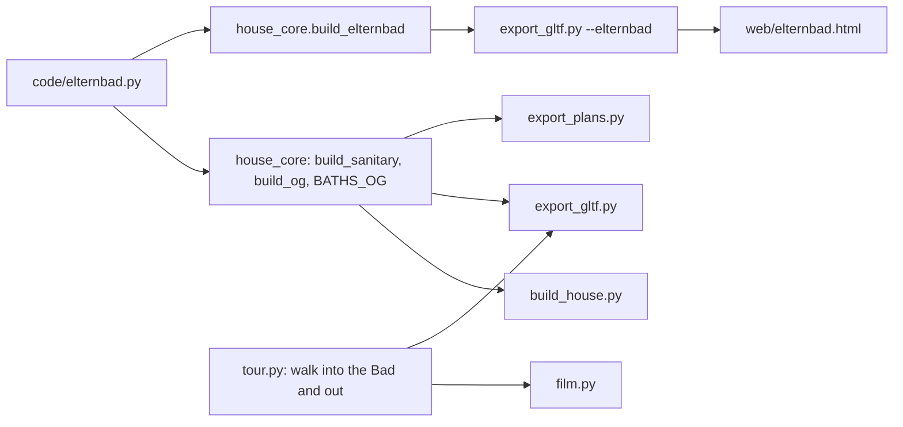

# Architecture: Bad Nadine & Till

## Approach

A new pure-Python module `code/elternbad.py` modelled on `code/gaestebad.py`: constants of the room
(`ELTERNBAD_AT = (5.59, 0.40)`, faces, `TUER`, shower, toilet, basin, mirror, lamp positions) and
`elternbad_neu(c, x0, y0, z=0, walls=False)` building shower, toilet, wainscot, basin, wood mirror and
six Wandlampen into collection `c`, returning the dimension lines; `waende()` builds the four wall
pieces for the sub-model. `house_core.build_sanitary()` calls it on the OG floor in place of today's
Bad S lines; `build_og()` takes the door span from `elternbad.TUER` (`flat=False`); `BATHS_OG` takes
the room rect from it. `house_core.build_elternbad()` wraps it at the origin for
`export_gltf.py --elternbad` → `web/public/elternbad.glb` → `web/elternbad.html` (`submodel.js`).

## Impact

- **Build scripts:** `build_sanitary()` (Bad S lines → `elternbad.elternbad_neu`), `build_og()` (door
  span, `flat=False`), `BATHS_OG`, new `build_elternbad()`; registries `LEAVES`, `DOORS`, `WALL_LIGHTS`
  (+6), `GEO` objects `OG_Sanitaer`, `OG_Spiegel`, `OG_Fliesen`, `OG_Wandlampen`, `OG_Innentueren`,
  `OG_Waende`. `build_house.py`, `film.py`, `fire.py`, `garden.py` reload `elternbad`. The global
  random stream changes (one panel draw, fewer/more boxes), so `rnd` of later parts shifts: parity
  golden churn outside the Bad is expected.
- **Materials:** none (Kiefer, Spiegel, Fliese, Fugengrau, Messing, Opalglas, Kalkstein, Fuge exist).
  `bad.stone()`'s slab layout becomes `house_core.limestone()`, used by both baths (Bad Großeltern unchanged).
- **Garden / film:** `tour.py` ROUTE: the peek becomes a walk through the new door (y 1.115) to the
  west wall, a right turn to face east, a pause, the walk back out; tour golden regenerated; camera
  clearance check.
- **Web viewer:** new page `web/elternbad.html` + `web/src/elternbad.js`, entries in `toolbar.js`,
  `vite.config.js`, `package.json` (`blueprint`), `shot.js`, `.gitignore`; `toolbar.js` `PAGES` get a
  storey and the Modell list groups them under `Erdgeschoss` / `1. Stock` headings; six more wall lights
  (no cap in `lighting.js`: one shared ranking pool).
- **Render / output:** Blender rebuild + save; plan sheets regenerated (door symbol moves); no film
  re-render in this change.

## Key decisions

| Decision | Alternatives considered | Why |
|---|---|---|
| Door 0.65..1.58, hinged south, open 90° inward | 0.44..1.37 (mirror of today); 0.60..1.53; outward into the Schlafzimmer; sliding | User chose inward 90°; at 0.44 the leaf (face y 0.465) runs through the window lamp (to y 0.61); at 0.60 the leaf clears it but `test_wandlampen_clear` (#19) checks the `DOORS` box with the levers' ±7 cm over the whole leaf (from y 0.575). 25 cm off the corner clears that box. |
| Mirror 110 wide, basin + mirror on axis 6.19 | 140 like the Gästebad; centred in the span (6.215); today's axis 6.14 | 140 does not fit the 125 span; centred, the basin comes 12.5 cm to the reveal (rule: 15); at 6.14 the mirror touches the west wall. |
| Shower entrance at the west wall, glass towards the toilet | gap at the toilet end | "Ausgang an der Wandseite"; the toilet side needs glass anyway. |
| Own sub-model module + page | lines in `build_sanitary()` | User's choice; same pattern as the Gästebad, reviewable alone. |
| Leaf static (no `leaf=`/`SWING`) | animated like the Büro door | Not asked. |

No ADR: the sub-model pattern is ADR-001-XEWL's module list, extended at archive.

## Integration points

- `house_core`: `wall`, `interior`, `panel_door(flat=False)`, `shower(tray=False)` (new option),
  `limestone()` (new, from `bad.stone()`), `tiles`, `toilet`, `wainscot`,
  `waschbecken`, `wood_mirror`, `wandlampe`, `WANDLAMPE_H`, `WANDLAMPE_SPIEGEL_H`, `WC_TILE_T`.
- Tests that pin today's Bad S or the lamp count, updated deliberately (plan step 2 and 3):
  `test_core.py` lamp count 29 (`test_*` at line 29, `test_wandlampen_og_placements`),
  `test_waschbecken_og_baeder` (Bad S basin axis, plain mirror, shower box), `test_gltf.py` 29,
  `test_tour.py` 29; page lists in `web/e2e/nav.spec.js`, `kueche.spec.js`, `shot.spec.js`,
  `e2e-preview/preview.spec.js` get the new page.
- ADR-001-XEWL (facts only in the core), ADR-002-MLQS (glTF writer), ADR-003-SKGB (viewer).
