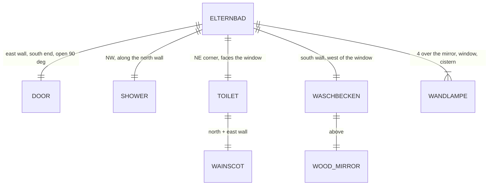

# Domain: Bad Nadine & Till

## Concepts

**Elternbad** (changes system term "Bad S"): the OG bathroom of Nadine & Till between Waschküche
and Schlafzimmer, now a sub-model of its own like the Gästebad. It holds a walk-in shower along
the north wall (entrance at the west wall), a toilet in the NE corner facing the south window with
tiles behind it, the Waschbecken doppelt under a wood-framed mirror with four Wandlampen, and two
more Wandlampen (left of the window, over the cistern). Its door to the Schlafzimmer is at the
south end of the east wall and stands open 90° into the room.

## Vocabulary

| Term | Meaning |
|---|---|
| Elternbad | The Bad of Nadine & Till in the OG (S, x 5.59..8.59, y 0.40..2.62); module `elternbad.py`, page `elternbad.html`. Replaces "Bad S". |
