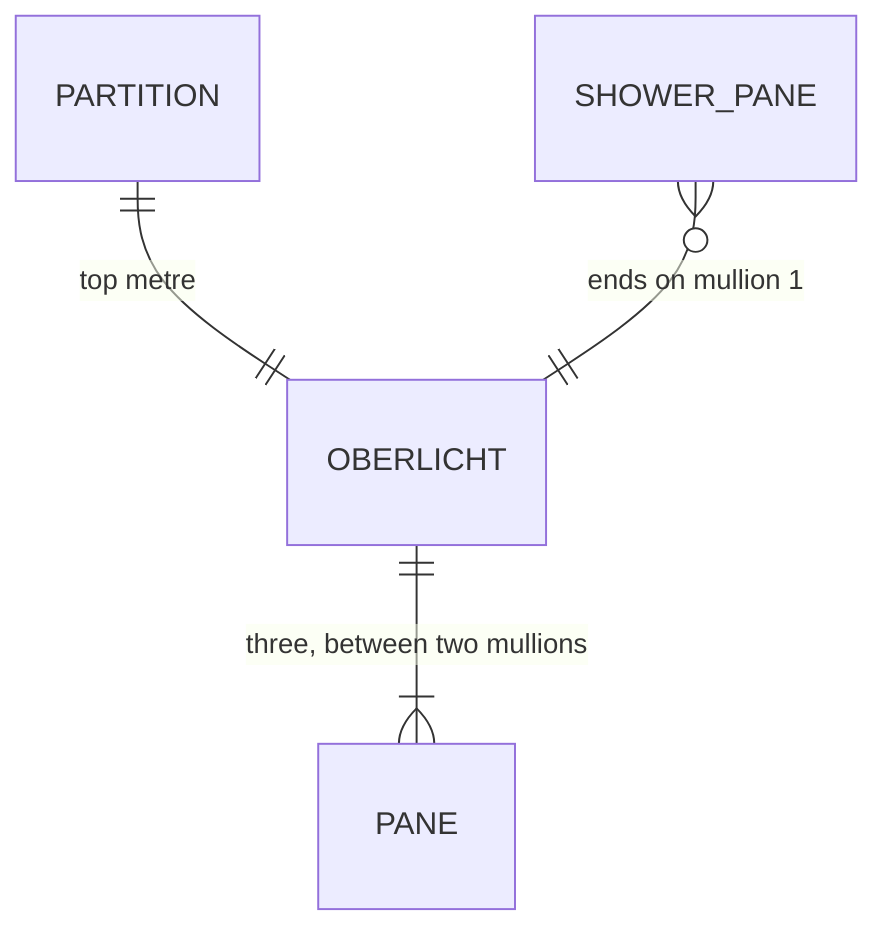

# Domain: glazed top metre in the Bad / Waschküche partition

## Concepts

**Oberlicht** (interior clerestory): a fixed glazed band at the top of an interior wall, here in the partition
between the Bad Nadine & Till and the Waschküche: sill 1.20, up to the ceiling, satin glass (Milchglas) so the
Bad's daylight reaches the windowless Waschküche without a view into the Bad.

## Vocabulary

| Term | Meaning |
|---|---|
| Oberlicht | The glazed band at the top of the Bad / Waschküche partition (sill 1.20 to the ceiling). |
| Pfosten | A mullion of the Oberlicht; the first stands on the shower glass line (x 6.49). |
