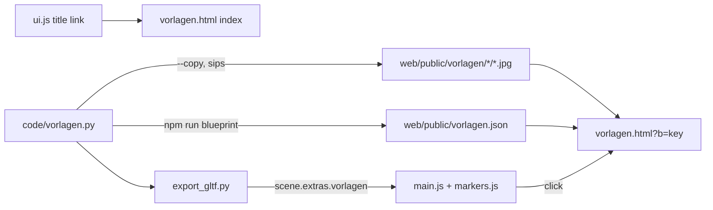

# Architecture: Vorlagen — the reference photos by place in the house

## Approach

The manifest is a model fact (where a reference belongs in the house), so it lives once in the core:
`code/vorlagen.py` (pure Python, data + two helpers): `BEREICHE`, a list of areas `(key, title,
anchor or None, [(source under input/, copy file name, caption)])`. It is not part of `GEO`: no
geometry, so plan sheets, goldens and the Rundgang clearance are untouched.

- `python3 code/vorlagen.py --copy` (once, macOS `sips`): every source → `web/public/vorlagen/<key>/<file>.jpg`,
  longest side ≤ 1600 px, JPEG quality 80. The copies are committed (the originals are large).
- `python3 code/vorlagen.py web/public/vorlagen.json` (in `npm run blueprint`, git-ignored): the
  manifest as JSON for the photo pages, which must not load the 39 MB `.glb`.
- `export_gltf.py` writes the anchored areas to `scene.extras.vorlagen` (`key`, `title`, `at`) plus
  `vorlagen_walls`, the names of the wall objects (the core's `PLAN` wall suffix), for the markers'
  occlusion.
- `web/vorlagen.html` + `web/src/vorlagen.js`: no `?b=` → index of all areas (cover photo, count);
  `?b=<key>` → the area's photos (figure with caption, click opens the full copy), links to the
  index, "Ganzes Haus" and the 3D house. Pure helpers in `web/src/vorlagen-data.js` (Vitest).
- `web/src/markers.js` (house viewer): one DOM `<a target="_blank">` per anchored area, projected
  from its anchor each drawn frame. Shown when `markerVisible()` (pure, Vitest) says so — not
  during a route, in `?hires=on` or on a plan sheet; indoor anchors only from inside on the same
  storey (≤ 8 m) or from above with that storey cut open; the outdoor anchor from outside — and no
  wall object lies between camera and anchor (one ray per candidate against the wall meshes).

## Impact

- **Build scripts:** new `code/vorlagen.py`; `export_gltf.py` adds `scene.extras.vorlagen` and `vorlagen_walls`; no builder, constant or registry of `house_core` changes.
- **Materials:** none.
- **Garden / film:** none (markers are DOM, hidden in the Rundgang and the film capture).
- **Web viewer:** new `vorlagen.html`, `src/vorlagen.js`, `src/vorlagen-data.js`, `src/markers.js`; `main.js` (markers), `ui.js` (title link), `vite.config.js` (input), `package.json` (`blueprint` writes the JSON); assets `public/vorlagen/` (committed).
- **Render / output:** none; plan sheets unchanged.

## Key decisions

| Decision | Alternatives considered | Why |
|---|---|---|
| Manifest in a pure-Python module beside the core, exported to glb extras and a small JSON | Hard-coded list in the web page; pages parse the glb | ADR-001-XEWL: one source; the glb is 39 MB |
| One page `vorlagen.html?b=<key>` (index without `b`) | One HTML per area | One build input, one script; adding an area needs no new file |
| DOM overlay markers with a wall-ray occlusion test | Sprites in the scene | Real links (href, new tab, cursor, locator in both Playwright projects), no click-vs-drag handling, no WebGPU sprite material |
| Every raster image assigned (plan renders → "Pläne", Werkstattofen → "Ganzes Haus" as it stands in three rooms) | Exclude plans / screen textures | The issue asks for all photos; a test can then say "every image" without an exclusion list |
| Copies downsized to ≤ 1600 px, JPEG 80, committed | Original files; generated at build | Originals sum to ~150 MB; `sips` is macOS-only, CI must not need it |

No ADR needed: reversible, contained, follows ADR-001-XEWL.

## Integration points

- `house_core.PLAN` (wall suffix) and `W_OUT`/`D_OUT`/`Z_OG` for the anchor test and the markers.
- `export_gltf.py` scene extras; `web/src/main.js` render loop (draw on demand: markers update where a frame is drawn and on resize); `tour.state`, `hires`, `plan`, `cut`.
- Tests: `tests/test_vorlagen.py` (new), `tests/test_gltf.py`, `web/src/*.test.js`, `web/e2e/vorlagen.spec.js` (new), `web/e2e-preview/preview.spec.js`.
- Live ADRs: ADR-001-XEWL (one core), ADR-002-MLQS (glTF extras), ADR-003-SKGB (viewer).
