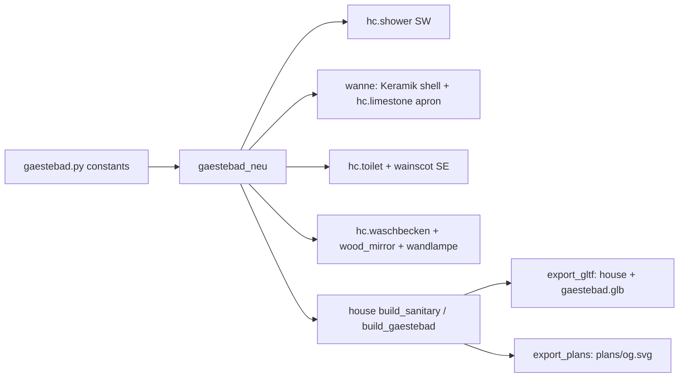

# Architecture: shower and bathtub in the Gästebad

## Approach

All in `code/gaestebad.py` (the core's sub-model module, ADR-001-XEWL): constants `YP` 6.15 (partition
end), `YT` 6.77 (tub south edge = shower north edge), `XT` (tub east face, 75 from the west wall),
toilet axis `TX` east of the partition, basin `BX`/`BW` 60, mirror `MW` 80. `hc.shower()` in the SW
(no glass, head on the south wall); a new local `wanne()` builds the tub from closed boxes into
`<c>_Sanitaer` (white `Keramik` shell: bottom, four rim walls; chrome deck mixer and drain via
`hc.turned`) and clads apron and south end with `hc.limestone()` into `<c>_Fliesen`, all from an own
`random.Random(32)`; `hc.toilet` + `hc.wainscot` in the SE niche; `hc.waschbecken` (single) +
`hc.wood_mirror` + 2 `hc.wandlampe` on the north wall, one lamp over the tub's head end, one over the
toilet. `BATHS_OG` follows `YP` unchanged in code. No core primitive changes.

After the user's addition (run-2026-11-15-1633-17): the partition box goes, `YP` becomes `YG` 6.24 (the
glass end), `hc.shower(..., [(PA, YS, PA, YG)], tray=False)` brings the glass; `hc.limestone()` three times on
the west wall (to the small window's sill `WS` over the full width, above only beside it) and once on the
south wall to the glass, from `Random(18)`; the head sits on the slabs; `YT` 6.87 (tub 170); `TX` centred
between glass and east wall; `wainscot(sides="se")`; `BATHS_OG` in `house_core.py` splits the Gästebad at
the glass line (one rectangle north of `YG`, shower and WC south of it). Second addition (-18): `YG` 6.34.

## Impact

- **Build scripts:** `gaestebad.py` only (constants, `gaestebad_neu`, new `wanne`, dims);
  `WALL_LIGHTS` OG 32 → 31; the global random stream: the toilet and shower calls stay, so later
  parts keep their rnd.
- **Materials:** none (Keramik, Metall, Kalkstein, Fuge reused).
- **Garden / film:** `tour.ROUTE` unchanged (it peeks in from the Flur at x 2.8); new clearance test.
- **Web viewer:** `web/src/gaestebad.js` header comment and the `door` view; e2e labels.
- **Render / output:** plan sheets re-exported; Blender dormant.

## Key decisions

| Decision | Alternatives considered | Why |
|---|---|---|
| Shower SW, tub along the west wall from the window's south edge, partition ends at 6.15 (run-2026-11-15-1633-15) | tub 170 from the north wall and a 42 cm throat; no partition | shower entrance ≥ 60 clear, window over the tub, WC still hidden from the door |
| Tub built in, limestone apron (run-2026-11-15-1633-16) | freestanding on feet | between two walls and the shower a freestanding tub wastes space and looks wrong |
| Basin single 60 on the north wall | double 120 (does not fit), east wall (door, leaf) | the only free wall piece |

No ADR needed.

## Integration points

`hc.shower`, `hc.limestone`, `hc.toilet`, `hc.waschbecken`, `hc.wood_mirror`, `hc.wandlampe`,
`hc.wainscot`, `hc.box`, `hc.turned`; `house_core.build_sanitary()` / `build_gaestebad()`; tests
`test_core.py` (`test_gaestebad_*`, wall-light counts), `test_gltf.py`, `test_tour.py`,
`web/src/lighting.test.js`, `web/e2e/stages.spec.js`, `web/e2e/gaestebad.spec.js`. ADR-001-XEWL.
