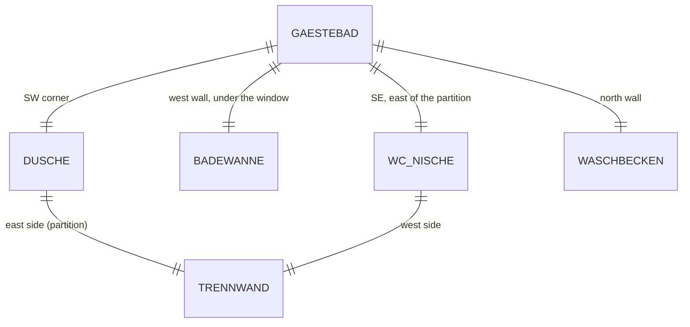

# Domain: shower and bathtub in the Gästebad

## Concepts

**Badewanne** (bathtub): built in along the back wall, a white ceramic shell (rim, bottom) in a
limestone-clad apron; back rest at the north end, mixer and drain at the south end.

**Back wall** (hintere Wand): the wall opposite the room's door; in the Gästebad the west wall (outer
wall with the big window).

**WC-Nische** changes side: it is now east of the partition (was west); the partition, still over the
EG Gäste-WC's, is shorter (to y 6.15) so the shower opens to the east.

## Vocabulary

| Term | Meaning |
|---|---|
| Badewanne | the built-in tub, 180 × 75 |
| Wannenschürze | the tub's limestone-clad apron |
