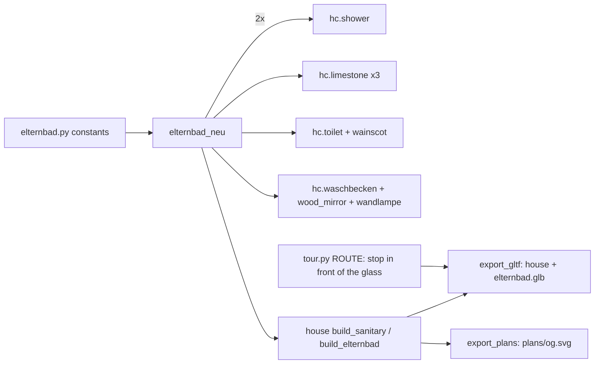

# Architecture: two showers in the Bad Nadine & Till

## Approach

All in `code/elternbad.py` (the core's sub-model module, ADR-001-XEWL): new constants for the strip
(`XG` glass line, `YM` middle, `PA`/`PB` pane ends, `HU` head offset from the corner), `hc.shower()`
called twice (one drain, one pane, one head each, `tray=False`), `hc.limestone()` on the west wall
(to 2.0), the south wall's strip piece (to 2.0) and the north wall's strip piece (to `SILL` = 1.20);
the toilet on the north wall at `TX`; the basin (`hc.waschbecken`, single 60 × 47, on the tiles),
the wood mirror 80 × 85 and two Wandlampen on the east wall north of the door; the existing
`wainscot(sides="ne")` from the glass to the east wall, down to the door. The lamp over the cistern
goes (north wall, above the sill). No core primitive changes.

## Impact

- **Build scripts:** `elternbad.py` only (constants, `elternbad_neu`, dims); `WALL_LIGHTS` loses 3
  lamps (OG 35 → 32); global random stream: one more shower call (rnd values of later parts shift).
- **Materials:** none.
- **Garden / film:** `tour.ROUTE`: the Bad stop moves from x 5.95 to in front of the glass (6.85);
  tour goldens regenerated.
- **Web viewer:** `web/src/elternbad.js` header comment and its `door` view target; no module change.
- **Render / output:** plan sheets re-exported; Blender dormant.

## Key decisions

| Decision | Alternatives considered | Why |
|---|---|---|
| Basin single 60 on the east wall north of the door (run-2026-11-15-1633-13) | double 100 on the north wall (mirror over the sill); south wall (35 cm left by the strip, rest behind the leaf) | the only wall piece with room for basin + mirror below/away from #30's glass |
| Toilet on the north wall between glass and basin | NE corner (basin then has no wall) | ≥ 20 cm free each side (as built: 44 to the glass, 69 to the basin's front), out of the passage's line |
| Strip 90 deep, passage centred on the wall | 100 deep | leaves 2.10 for toilet/basin; 90 × 111 per shower |
| Rundgang stops in front of the glass | walk through the 60 passage | a 60 opening leaves ±5 cm for the 0.25 m clearance; smoothing would risk it |

No ADR needed.

## Integration points

`hc.shower`, `hc.limestone`, `hc.toilet`, `hc.waschbecken`, `hc.wood_mirror`, `hc.wandlampe`,
`hc.wainscot`; `house_core.build_sanitary()` / `build_elternbad()`; tests `test_core.py`
(`test_elternbad_layout`, `test_elternbad_submodel`, the wall-light count), `test_tour.py`
(`test_route_walks_into_the_elternbad_and_back_out`, goldens). ADR-001-XEWL (model facts in the core).
