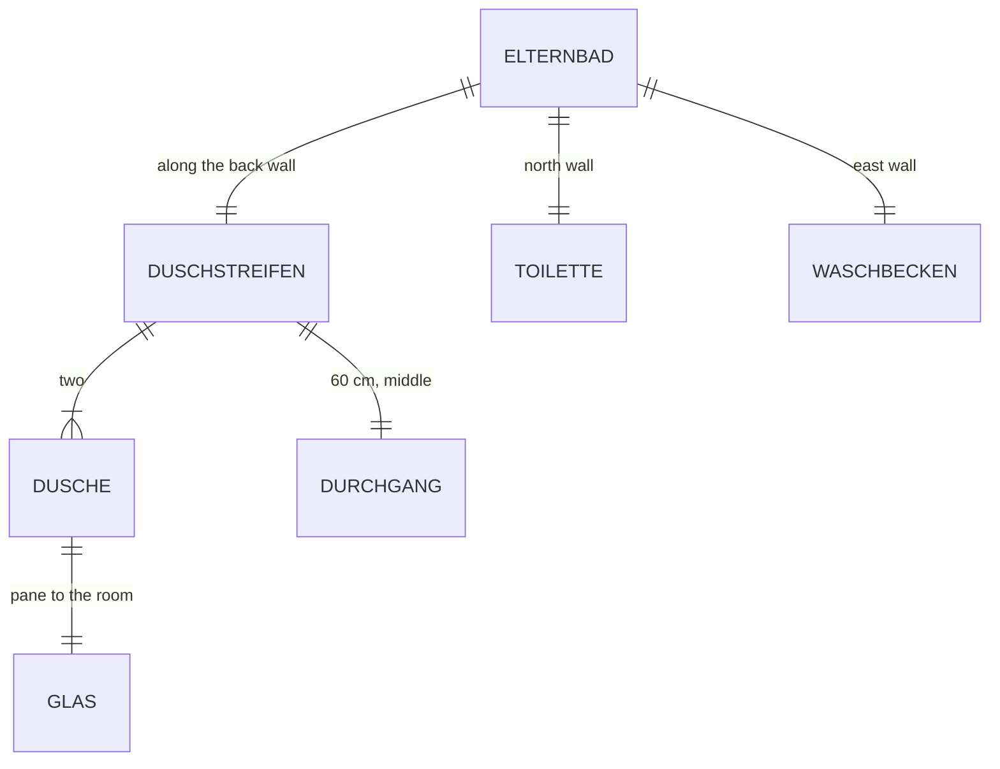

# Domain: two showers in the Bad Nadine & Till

## Concepts

**Duschstreifen** (shower strip): the band along the back wall of a bath holding two walk-in showers;
"virtual" because the whole floor is the same limestone, only glass marks it off. Each shower has its
own head (in a back corner), drain and pane; a passage (Durchgang) between the panes leads in.

**Back wall** (hintere Wand): the wall opposite the room's door; here the west wall.

**Waschküche partition**: the north wall of the Bad (y 2.62 .. 2.79). #30 will glaze its top metre
(sill 1.20 above the OG floor, ceiling 2.20); until then nothing on the Bad side goes above 1.20 there.

## Vocabulary

| Term | Meaning |
|---|---|
| Duschstreifen | the strip of the two showers along the back wall |
| Durchgang | the 60 cm opening between the two panes |
