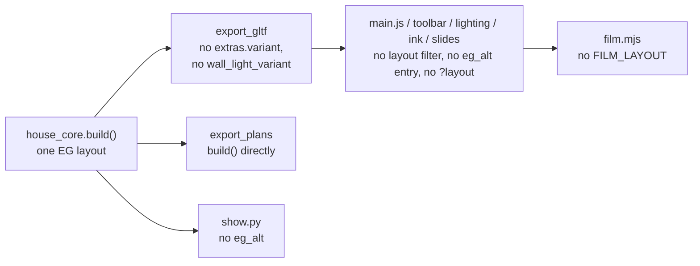

# Architecture: Alternativ becomes the EG layout

## Approach

Collapse the switch at its source. In the core, `speis()` loses cabinet C and the sliding leaf
(its own `random.Random(9)` draws the shelves first, so nothing else shifts), `build_eg()` loses
the wall stub, `speis_alt()` becomes plain built-ins with names without "Alt" (own
`random.Random(25)` unchanged), the Wandlampen table loses its layout column and lamps 11, 12;
lamps 13, 14 go into `EG_Wandlampen`. `VARIANT`, `WALL_LIGHT_VARIANT`, `WANDLAMPEN_EG_OBJ`,
`Blueprint.variant` / `.wall_variant` and `default_layout()` go. Every consumer of the switch then
just drops its branch.

## Impact

- **Build scripts:** `house_core.py` (`build_eg`, `speis`, `speis_alt` → `speis_essen`,
  `wandlampe`, `WANDLAMPEN_EG`, `build_wandlampen`, `Blueprint`, `build*()`), `kueche.py` (its hood
  light's tag), `export_gltf.py`, `export_plans.py`, `show.py`; dormant `build_house.py`, `film.py`
  (`default_layout()` call). Registries: `VARIANT`, `WALL_LIGHT_VARIANT` removed; `LEAVES` loses
  the sliding leaf; `PIVOT`/`SWING` keep the saloon leaves under new names.
- **Materials:** none.
- **Garden / film:** `ROUTE` unchanged (already clear of cabinet C on the west wall); `web/film.mjs`
  loses `FILM_LAYOUT`; `justfile`/README text.
- **Web viewer:** `main.js` (`forcedLayout`, `layoutOf`, `eg_alt`, `spotEntry`), `toolbar.js`
  (entry), `lighting.js` (`setLayout`, tags), `ink.js` (variant key), `slides.js` (saloon leaves keep
  their own clock, keyed by name); `web/e2e/variant.spec.js` removed.
- **Render / output:** plan sheets regenerated; `.glb` regenerated by `npm run blueprint`; no
  Blender re-render (dormant).

## Key decisions

| Decision | Alternatives considered | Why |
|---|---|---|
| Rename the former Alternativ objects: `EG_Essen_Schrank`, `EG_Speis_Rueckwand`, `EG_Pendeltuer_S`/`_N`; lamps 13, 14 into `EG_Wandlampen` | keep `EG_Alt_*`; reuse `EG_Speis_C` / `EG_Wandlampen_Essen` for the new objects | "Alt" would mean nothing any more; reusing old names for different geometry would mislead readers of history and tests. `EG_Schrank` is taken (`bad.py`). |
| The saloon leaves keep a door clock of their own (keyed by the name `_Pendeltuer`) | join the back hall's shared clock | five leaves on one clock would halve how often a back-hall door moves (and make the back-hall e2e wait flaky); behaviour stays as users saw it in Alternativ |
| Delete the switch's own tests, port the general ones | keep tests of the removed layout | the issue asks to delete that layout; details in `DECISIONS.md` |

## Integration points

`tests/test_core.py`, `test_gltf.py`, `test_plans.py`, `test_show.py`, `test_tour.py`;
`web/src/lighting.test.js`, `slides.test.js`; `web/e2e/nav.spec.js`, `kueche.spec.js`,
`gaeste_wc.spec.js`, `stages.spec.js`, `variant.spec.js`. Obeys ADR-001-XEWL (the change is made
in the core; backends and viewer only drop their copies of the switch).
