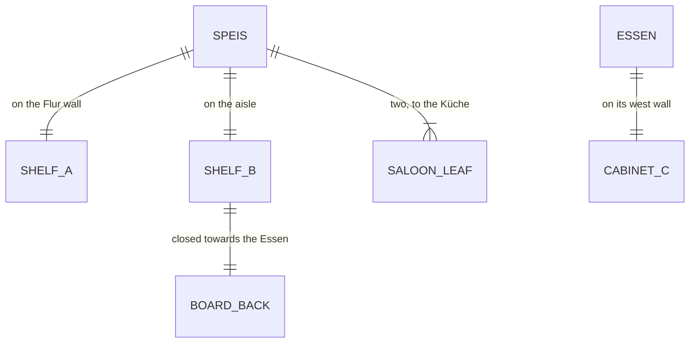

# Domain: Alternativ becomes the EG layout

## Concepts

- **Variante** — removed: there is one EG layout again; no object belongs to "one layout only".
- **Speis A / B / C** — changes system term: A and B stay open spruce shelves; B gets a closed back
  of vertical spruce boards towards the Essen; C is the painted cabinet on the Essen's west wall
  from the south wall to B's back (six leaf columns of Mallnitz fronts). The Speis opens to the
  Küche through two half-height saloon leaves without handles (no sliding leaf, no wall stub).
- **Modell** (drop-down) — changes system term: Ganzes Haus, Erdgeschoss, 1. Stock │ the
  sub-models.

## Vocabulary

| Term | Meaning |
|---|---|
| Pendeltür | The two half-height saloon leaves between Speis and Küche (`EG_Pendeltuer_S`/`_N`). |
