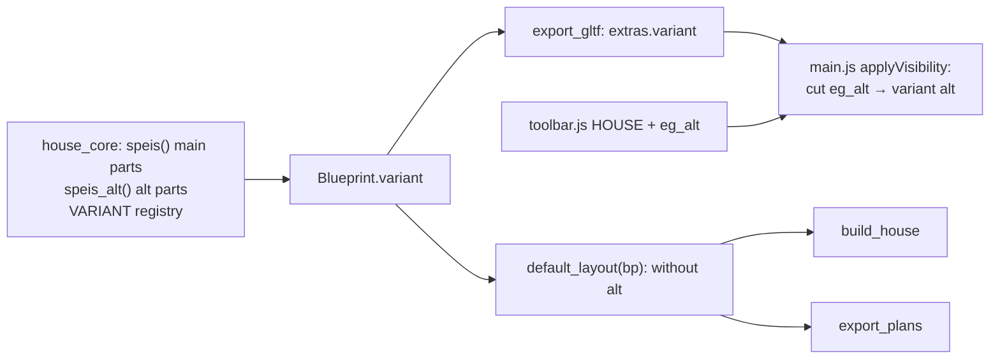

# Architecture: Küche – Variante mit Schrank an der hinteren Wand

## Approach

The variant is an **object-level flag in the core**: a registry `VARIANT = {object: "main" | "alt"}`
next to `FURNITURE`, snapshot into `Blueprint.variant`. Objects not in it are shared.

- **Core** (`house_core.py`, `speis()` and a new `speis_alt()`):
  - Default-only parts move into objects of their own, flagged `main`:
    - cabinet C → `EG_Speis_C`;
    - sliding leaf + rail → `EG_Speis_Schiebetuer`;
    - the 60 cm stub of the Speis/Küche wall (y 3.13–3.73) → `EG_Speis_Waende`. The suffix
      `_Waende` keeps it a wall on the plan sheets; it takes the wall's `rnd`, so there is no seam
      and no extra global draw. The shared `interior()` wall then runs only y 3.73–5.849.
  - Not registered: the saloon leaves are in neither `LEAVES` (every leaf there must carry levers)
    nor `DOORS` (plan sheets).
  - New `alt` objects:
    - `EG_Alt_Schrank`: C rebuilt on the Essen west wall (frame `y`, carcass x 2.774–3.352, fronts
      to x 3.372 facing east, y 0.417–3.712, six columns of ≈ 55 cm);
    - `EG_Alt_Speis`: B's closed back, vertical spruce boards (`FichteZ`) at y 3.715–3.731, 1 mm
      off B's uprights (no coplanar faces);
    - `EG_Alt_Pendeltuer_S` / `_N`: the two saloon leaves (`Innentuer`, like the interior doors;
      stiles, bottom rail, a top rail curving from 1.65 m at the hinge down to 1.50 m, four slats;
      bottom 0.35 m), in the wall's middle plane, 2 cm off the jambs, each with a `PIVOT` on its
      hinge line and a `SWING` (+90° / −90°, into the Speis), built closed.
  - Own `random.Random(25)`, so no later part shifts.
- **Backends.** `export_gltf.py` writes `extras.variant`. `house_core.default_layout(bp)` returns
  the Blueprint without the `alt` objects (and their pivots and swings); `build_house.py` (Blender)
  and `export_plans.py` build from it, so the Blender scene and the plan sheets (and their model
  hash) show exactly the default.
- **Viewer.** The new house entry is a cutaway value of its own: `eg_alt` (URL `cut=eg_alt`).
  - It hides what `eg` hides (`HIDE.eg_alt = ['roof', 'og']`), and the variant follows the cut:
    `variant = cut === 'eg_alt' ? 'alt' : 'main'`.
  - `applyVisibility` also hides a node whose `userData.variant` is set and differs from the
    current variant.
  - `toolbar.js` `HOUSE` gains `['eg_alt', 'Erdgeschoss - Alternativ', 'eg_alt']`, and `ENTRY`
    maps cut ↔ entry one-to-one as before.
  - The entry reuses the Erdgeschoss Standpunkte: the viewer resolves spots of `eg_alt` as `eg`,
    so `tour.py` and its goldens stay untouched.
  - The saloon leaves swing via the existing `swingingNodes` (`slides.js`).
  - `ink.js` keys the Skizze line groups by collection, level and variant (`Ink_EG_base_alt`), and
    `setCutaway` shows them by the same rule. New test hooks: `__fl.inks()`, `__fl.spot`.

## Impact

- **Build scripts:**
  - `house_core.py`: `speis()` is split into objects, new `speis_alt()`, the Speis/Küche wall is
    split, new `VARIANT` registry, new `Blueprint.variant`; `PIVOT`/`SWING` for the saloon leaves;
    `LEAVES` holds the saloon leaves (closed, in the opening).
  - `build_house.py`: filters out `alt` objects.
  - `export_plans.py`: filters out `alt` objects; the sheets change only in the model hash.
- **Materials:** none new. The saloon door uses `Innentuer`, cabinet C uses `Front`/`Fuge`, B's
  back uses `FichteX`.
- **Garden / film:** none (`NO_GRASS` from GEO bounding boxes: the alt objects are inside the
  house); `ROUTE` unchanged.
- **Web viewer:**
  - `toolbar.js` (`HOUSE`), `main.js` (`HIDE`, `ENTRY`, `applyVisibility`, spot lookup for
    `eg_alt`), `ui.js` (needs nothing beyond `HOUSE`);
  - e2e `nav.spec.js` (the drop-down list gains the entry) plus a new variant spec.
- **Render / output:** the Blender object set changes (three default objects split off), so the
  parity golden is regenerated and the `.blend` is rebuilt and saved. The look is unchanged; no
  film re-render.

## Key decisions

| Decision | Alternatives considered | Why |
|---|---|---|
| Variant = **object flag** in the core (`VARIANT`), one glb | Two glbs; a second full Blueprint; per-Part flags | One build, one file; the viewer only toggles visibility like `furniture`. Object granularity suffices because the variant's differences sit in a few self-contained pieces. |
| Default-only parts **split into objects of their own** | Keep them in `EG_Speis`/`EG_Innentueren` and duplicate the shared remainder for alt | No duplicated geometry; the cost is three more objects in Blender. |
| The entry is a **cutaway value** `eg_alt` | A separate `v=` URL parameter / state | `ENTRY`, `cutOf`, the URL and `show.py`/`shot.js` keep working unchanged; the variant is fully determined by the entry. |
| Blender, film, plans show **only the default** | Build the variant in Blender too (hidden collection) | The issue asks only for the viewer entry; the default stays the agreed plan. A variant plan sheet can follow on request. |
| Saloon leaves **built closed**, swung by the viewer | Built open | A saloon door falls back closed; the Rundgang doesn't pass it (default layout). |
| EG Standpunkte **reused** for `eg_alt` (viewer alias) | List `eg_alt` in every EG spot in `tour.py` | No change to `tour.py`, its goldens or the spot tests. |

No ADR: the flag is cheap to reverse and follows the `furniture` pattern.

## Integration points

- `speis()` and the Speis/Küche `interior()` call in `build_eg()`; `mallnitz_front()`;
  `PIVOT`/`SWING` (as `gaeste_wc.py`, `regal.tuer()`); `FURNITURE` as the model for `VARIANT`.
- `export_gltf.py` node extras; `build_house.py` `flush_geometry`; `export_plans.py` object loop.
- `web/src/main.js` (`HIDE`, `ENTRY`, `applyVisibility`, `standard()`/spot items), `toolbar.js`
  `HOUSE`, `slides.js` `swingingNodes`.
- Tests: `tests/test_core.py`, `tests/test_gltf.py`, `tests/test_plans.py` (slow; plans
  regenerated), the parity golden, `web/e2e/nav.spec.js` (entry list).
- Live ADRs:
  - ADR-001-XEWL: the variant is described once in the core; the backends only filter on the flag;
  - ADR-002-MLQS: a new node extra;
  - ADR-003-SKGB: visibility only, no new materials.
