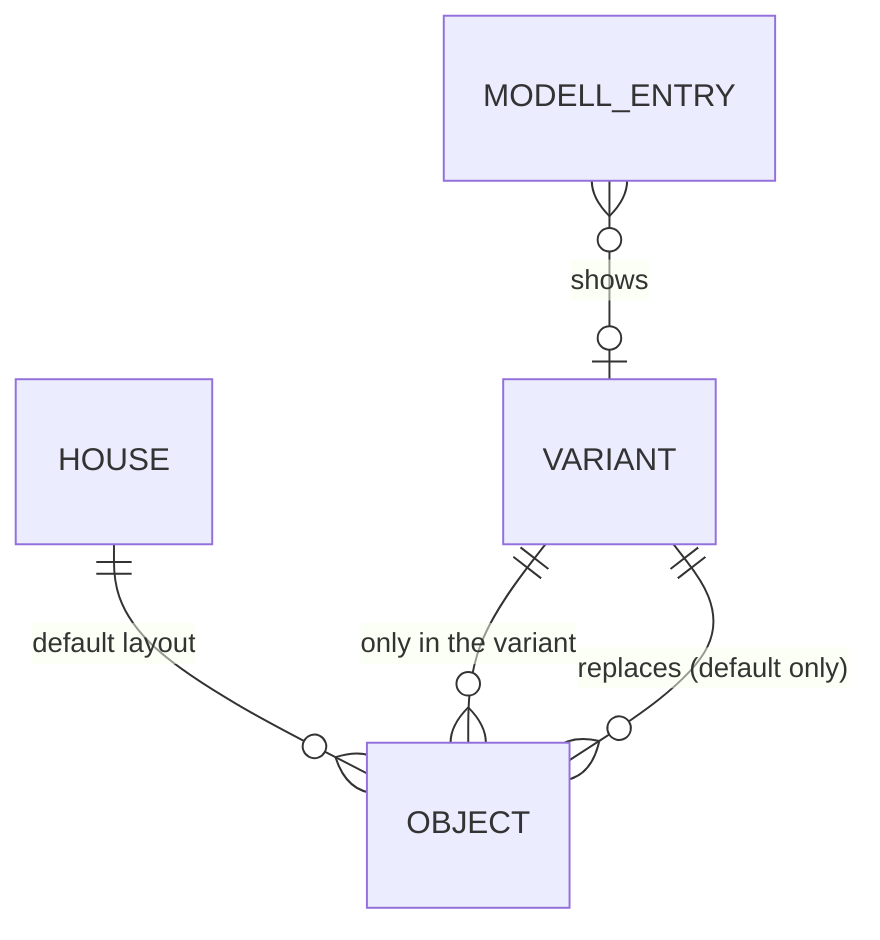

# Domain: Küche – Variante mit Schrank an der hinteren Wand

## Concepts

**Variante.** A named alternative to part of the house that the family wants to compare before
deciding. The house has one **default** layout (what Blender, the film, the plan sheets and every
Modell entry except the variant's show) and, for now, one variant: **Alternativ** (EG, issue #5).
A variant is a set of objects that exist only in it, plus a set of default objects it replaces.
Everything else is shared.

**Saloon door** (Pendeltür, "wie im Western-Saloon"). Two short wooden leaves on the jambs of an
opening, without handle or lock, that swing both ways and fall back closed.

Changes system term **Modell (drop-down)**: the house entries become Ganzes Haus, Erdgeschoss,
**Erdgeschoss - Alternativ**, 1. Stock. The new entry is the Erdgeschoss cutaway with the
Alternativ variant.

Changes system term **Speis A / B / C**: in the Alternativ variant, C stands against the Essen's
west wall over its full width, and B gets a closed back towards the Essen.

## Vocabulary

| Term | Meaning |
|---|---|
| Variante / variant | An alternative layout of part of the house, shown next to the default. |
| Alternativ | The EG variant of issue #5: C on the Essen west wall, saloon door to the Speis. |
| Default (layout) | The agreed layout; everything not in a variant. |
| Saloon door / Pendeltür | Two handle-less leaves swinging both ways, falling back closed. |
