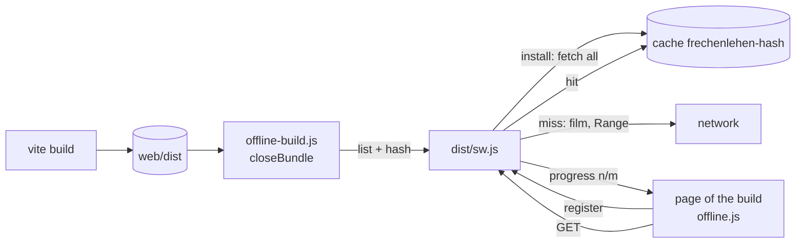

# Architecture: viewer offline on the iPad

## Approach

A Vite plugin (`web/offline-build.js`, `apply: 'build'`, `closeBundle`) walks `web/dist` after the
build and writes `web/dist/sw.js`: the file list and a content hash (pure helpers in
`web/src/precache.js`) prepended to the worker body `web/src/sw.js` (plain JS, not bundled). The
pages of the build register it through one shared module `web/src/offline.js`
(`import.meta.env.PROD` only), imported by `main.js`, `submodel.js` and `vorlagen.js`; it also
draws the progress badge from the worker's messages. `index.html` links a static
`public/manifest.webmanifest` and a home-screen icon.

## Impact

- **Build scripts:** none (no core change; plan sheets unchanged).
- **Materials:** none.
- **Garden / film:** none; the film stays online only.
- **Web viewer:** new `web/offline-build.js` (plugin, in `vite.config.js`), `web/src/precache.js`
  (+ test), `web/src/sw.js` (worker body), `web/src/offline.js` (registration + badge), imported by
  `main.js`, `submodel.js`, `vorlagen.js`; `markers.js` (no new window in standalone);
  `index.html` (manifest, icon, standalone metas); `public/manifest.webmanifest`,
  `public/icon-180.png`, `public/icon-192.png`, `public/icon-512.png`; `serve-build.js` (MIME types of the new files);
  Playwright: preview project blocks service workers except the new `e2e-preview/offline.spec.js`.
- **Render / output:** none.

## Key decisions

| Decision | Alternatives considered | Why |
|---|---|---|
| Precaching service worker generated from `dist` ([ADR-004-CTPY](../../architecture/adr-004-ctpy-offline-precache-service-worker.md)) | copy files to the iPad; local server app; Workbox | only way offline on iOS; list from the build, no hand list, no dependency |
| Cache-first, ignoring the query | network-first | offline works with deep links; online loads don't re-download |
| Update: new cache per build hash, old `frechenlehen-*` caches deleted on activate, `skipWaiting` + `clients.claim` | prompt the user to reload | simplest; one deploy is at most one load late |
| Progress badge from worker messages, shown only while a download runs and briefly on "Offline bereit" | no indicator; a permanent indicator | the user must know when the 62 MB are stored; nothing on screen once done |
| Preview tests block service workers except the offline spec | let every preview test precache | the other specs count responses and must not race a 62 MB download |
| Vorlagen markers open in the same window when `navigator.standalone` / `display-mode: standalone` | always same window | desktop keeps its new tab; in a home-screen app a new window would leave the offline store |

## Integration points

- `vite.config.js` (plugin), `serve-build.js` (serves `dist` under `/frechen_blender/` for the
  preview tests), `.github/workflows/pages.yml` (unchanged: the film is copied after the build, so
  it is never listed).
- Live ADRs: ADR-003-SKGB (viewer unchanged in rendering), ADR-001-XEWL (no model facts in the
  viewer); new ADR-004-CTPY.
