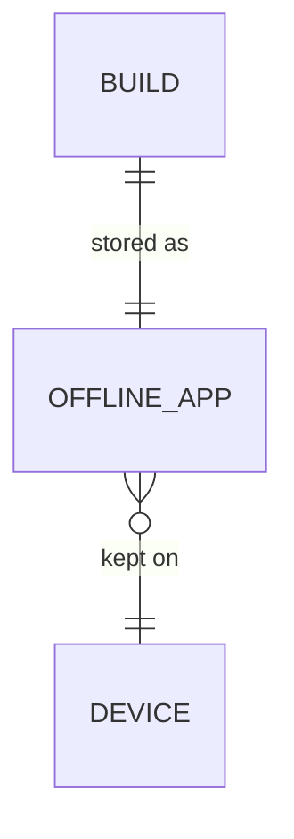

# Domain: viewer offline on the iPad

## Concepts

**Offline-App.** The production viewer stored on a device: every file of one build, kept by the
browser, so the pages open without network. It belongs to one build (one deploy); the next online
visit after a deploy fetches the new one.

## Vocabulary

| Term | Meaning |
|---|---|
| Offline-App | The viewer build stored on a device by its service worker; opens without network. |
| Offline bereit | The badge text once every file of the build is stored. |
