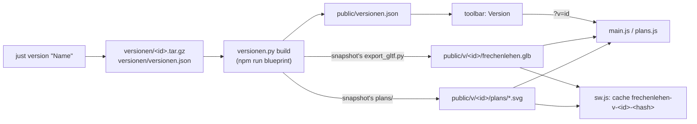

# Architecture: Planversionen im Viewer

## Approach

A version is a committed source snapshot; the build turns snapshots into static files next to the
live build; the viewer picks the files by `?v=`; the offline worker keeps one cache per version.

- **Freeze** — `code/versionen.py freeze <name> [--id YYYY-MM-DD]` (recipe `just version "<name>"`):
  refuses when `code/` or `plans/` differ from `HEAD` or the id exists; writes
  `versionen/<id>.tar.gz` (`git archive HEAD code plans`) and appends `{id, name}` to
  `versionen/versionen.json` (sorted by id).
- **Build** — `code/versionen.py build web/public` (stdlib; the last command of `npm run
  blueprint`): per entry, the cache `tmp/versionen/<id>-<sha12 of tar.gz>/` holds
  `frechenlehen.glb` (snapshot unpacked to a temp dir, `python3 <tmp>/code/export_gltf.py <out>`)
  and `plans/*.svg`; copied to `web/public/v/<id>/`. It also writes `web/public/versionen.json`
  (`[{id, name}]`, newest first). `web/public/v/` and `web/public/versionen.json` are git-ignored.
  Vite copies `public/` into `dist/` before `closeBundle`, so the precache list sees them.
- **Viewer** — `web/src/versions.js` (pure): `pick(list, search)` → the chosen entry or `null`
  (Aktuell; an unknown id is Aktuell), `dataBase(base, entry)` → `base` or `base + 'v/<id>/'`,
  `versionHref(search, id)` → the query with `v` set or removed, the rest kept. `main.js` fetches
  `versionen.json` (missing → no versions), loads `<dataBase>frechenlehen.glb`, gives
  `createPlanView(<dataBase>)` and passes the list to `createUI`. The URL the page writes keeps `v`.
  The title box of the house page gets a drop-down "Version" (`toolbar.js`'s `dropdown()`, under
  "Vom Strich zum Haus"; only when the list is not empty): it names the version shown, so it doubles
  as the label of a frozen version, and the toolbar (~750 px) does not grow on the iPad. Choosing
  navigates to `versionHref(...)` (a reload: a new `.glb`, GPU memory freed). A frozen version tints
  the title box, so it is not taken for Aktuell.
- **Compatibility** — the viewer reads extras a version may lack with defaults (the first version is
  today's format, so nothing is missing yet); the e2e spec opens every listed version.
- **Offline** — `precache.js` groups dist's files: `v/<id>/…` per version, the rest the live build.
  `sw.js` gets `CACHES = {name: [files]}` instead of one `FILES` list: the live cache
  `frechenlehen-<hash of live files>`, each version `frechenlehen-v-<id>-<hash of its files>`.
  Install fills every cache, skipping files already in it (the existing resume), so a stored version
  is not fetched again; activate deletes `frechenlehen-*` caches not in `CACHES`; fetch answers from
  the cache of the URL's group. The badge counts all files.
- **Update button** — texts in `offline.js`: "↻ Update laden", "↻ Update bereit – neu laden",
  "Suche Update …", "Lade Update …", "Schon aktuell ✓".

## Impact

- **Build scripts:** none in the core; new `code/versionen.py` (freeze, build); `npm run blueprint`
  runs its build; `justfile` recipe `version`.
- **Materials:** none.
- **Garden / film:** none (the film stays Aktuell only).
- **Web viewer:** new `versions.js`; `main.js` (data base, URL keeps `v`), `ui.js` + `ui.css`
  (drop-down Version in the title box), `plans.js` unchanged (takes the base), `offline.js` (button texts),
  `precache.js` + `sw.js` (caches per group); new assets `public/v/<id>/…`, `public/versionen.json`.
- **Render / output:** none; Pages deploys the versions with the build (CI unchanged: the snapshots
  are in the checkout).

## Key decisions

| Decision | Alternatives considered | Why |
|---|---|---|
| Source snapshot in the repo, built by its own exporter: ADR-005-JXWL | SHA + CI rebuild; built `.glb` committed; whole frozen web build | survives the film's history rewrite, 0.7 MB, no full-depth checkout |
| One cache per version in the worker (ADR-004-CTPY changed) | one cache for everything (today) | a deploy would re-download ~43 MB per version |
| Switching version reloads the page | swap the `.glb` in place | the page is built around one Blueprint at load; reload frees GPU memory; the view lives in the URL |
| id = date, unique | date + slug | short URLs; two versions a day are not expected; `freeze --id` allows another id |
| Version drop-down only on the house page, in the title box | on every page; in the toolbar | sub-models are not versioned; the toolbar is full on the iPad; the title box is where one reads what is shown |

## Integration points

- `web/package.json` `blueprint`, `.gitignore`, `justfile`.
- `web/src/main.js` (load, URL write), `ui.js`, `toolbar.js`, `offline.js`, `precache.js`, `sw.js`,
  `web/offline-build.js`.
- Tests: `tests/test_versionen.py` (new), `web/src/versions.test.js` (new), `precache.test.js`,
  `web/e2e/versions.spec.js` (new), `web/e2e-preview/offline.spec.js` (texts, a version offline).
- ADRs: ADR-002-MLQS (the `.glb` stays generated, never committed: the snapshot holds sources),
  ADR-004-CTPY (changed: caches per version), ADR-005-JXWL (new).
