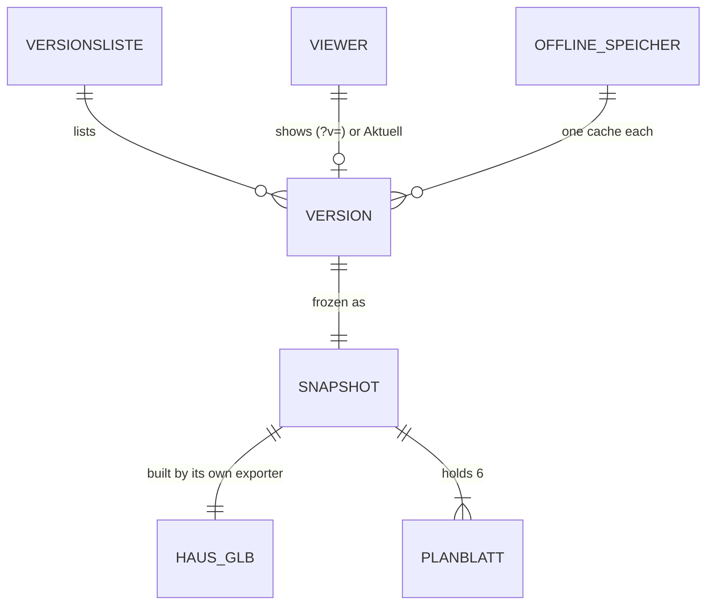

# Domain: Planversionen im Viewer

## Concepts

**Version (Planversion).** A frozen state of the plan on one timeline: a date (its id, `YYYY-MM-DD`,
unique), a name, and a snapshot of the sources that described the house that day (`code/` +
`plans/`). It never changes after it was frozen. It covers the house (3D, Standpunkte, Rundgang,
Vorlagen anchors) and the six plan sheets; sub-models, Fotos & Vorlagen and the film exist only in
the live state.

**Aktuell.** The live model of `main`, not a version; the default in the viewer. Freezing makes a
copy of it a version, Aktuell goes on changing.

**Update** (changes system term "Neue Version nachladen", issue #56). A new deploy of the web app,
fetched by the button "Update laden". It is not a version: an update may bring new versions.

## Vocabulary

| Term | Meaning |
|---|---|
| Version | A frozen plan state: id (date), name, source snapshot `versionen/<id>.tar.gz`. |
| Aktuell | The live model; no `?v=` in the URL. |
| Einfrieren | `just version "<name>"`: snapshot of the committed `code/` + `plans/`, entry in `versionen/versionen.json`. |
| Update | A new deploy; the button "Update laden" (formerly "Neue Version nachladen"). |
