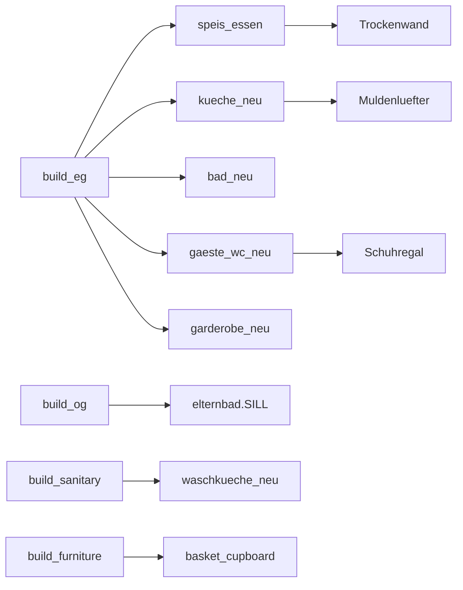

# Architecture: Umbauten EG/OG

## Approach

All in the core (ADR-001-XEWL); the backends and the viewer only follow renamed objects. Each item changes
its own module. The Flur-Garderobe gets a small module `code/garderobe.py` (hook board, hooks, hat shelf,
coats), moved out of `gaeste_wc.py`, which keeps the shoe rack and shoes. Removed parts consumed random
draws; each rebuilt builder restores the global stream afterwards and burns the old count
(`house_core.restream(state, n)`), so every later part keeps its `rnd` (the project's idiom, as `build_eg()`
does for the former second table).

## Impact

- **Build scripts**: `speis_essen()` (drywall `TROCKENWAND`, two boxes in `EG_Waende`); `kueche.py` (no `_Haube`, vent in `_Kueche`, one `WALL_LIGHTS` entry less); `bad.py` (no niche wall `NW`/`HALF`, one leaf `_Schiebetuer` in `SLIDE`, `_Schrank` with doors); `elternbad.SILL` 1.70; `waschkueche.py` (no `dusche()`, no `DUSCHE`); `gaeste_wc.py` (new `YN`/`YF`, shower, basin inside, shoe rack; no partition `PA`/`PB`, no Garderobe); new `garderobe.py`; `WANDLAMPEN_EG` (13/14 onto the drywall, 18/19 up, 31–34 gone or moved); `GAESTE_WC_EG`, `TRENNWAND_EG` (gone), `CORRIDOR_EG`, `PLAN_ROOMS`, `FURNITURE` (+ `EG_Schuhregal`; `EG_Kleidung` holds coats and shoes; `EG_Garderobe` is now the Flur one, a built-in); `gaestebad.PA` becomes its own literal.
- **Materials**: none new.
- **Garden / film**: none; `ROUTE` unchanged; `test_routes_and_spots_clear_the_garderobe` now covers the Flur Garderobe and the shoe rack.
- **Web viewer**: `web/src/kueche.js`, `gaeste_wc.js` colours/comments; e2e specs for Bad (one leaf) and Gäste-WC (new dimension labels); vorlagen anchor.
- **Render / output**: plan sheets regenerated; no film re-render.

## Key decisions

| Decision | Alternatives considered | Why |
|---|---|---|
| Drywall starts at C's front (x 3.372) | through C | C stays unchanged |
| Bad Großeltern: opening (102.4) over the WC in the west, front wall in front of the Einbauschrank (50 deep, 58 clear before it), the leaf parks open in front of that wall | front wall over the WC | a wall in front of the toilet left only 37 cm knee room (niche 108 inside, toilet 70); confirmed by the user 2026-11-27 |
| Duschbad: plan room name `Duschbad`; door hinged east; basin 40 + mirror 40 × 60 north of the window | keep `WC`; hinged west | the room has a shower now; hinged west the open leaf would sweep the back door's path |
| Shoe rack 80 × 33 on the Duschbad's north wall, east of its door; furniture (`EG_Schuhregal`) | on the hall's east wall piece (48 cm) | the only wall long enough; the open leaves of back and Windfang door lie along the north wall |
| Flur lamps 18, 19 move up to 2.20 over the hat shelf, x unchanged | lamps beside the board | no room west of the board; one height for both |
| Waschküche: basket cupboard back to 5.95, three baskets (pre-#29) | leave it short | the 20 cm gap only served the shower |
| Tests pinning removed features are rewritten, not deleted | ask per test | the user asked for the removals and approved the rewrites (2026-11-27) |
| Hintereingang variant B | variant A | user's choice 2026-11-27 |
| Garderobe in a new `garderobe.py` | in `house_core` / `gaeste_wc` | not part of the Gäste-WC; `house_core` is already large |
| Burn old draw counts | let later `rnd` shift | project idiom: untouched parts keep their look |

No ADR needed.

## Integration points

`build_eg()`, `build_og()`, `build_sanitary()`, `build_furniture()`, `WANDLAMPEN_EG`, `PLAN_ROOMS`, `vorlagen.py`
(Garderobe Bereich), `tests/test_core.py`, `test_gltf.py`, `test_plans.py`, `test_tour.py`, `test_show.py`,
`web/e2e/bad.spec.js`, `gaeste_wc.spec.js`, `shot.spec.js`, `vorlagen.spec.js`. ADR-001-XEWL (one core),
ADR-005-JXWL (frozen versions stay loadable: names only change in the current core).
