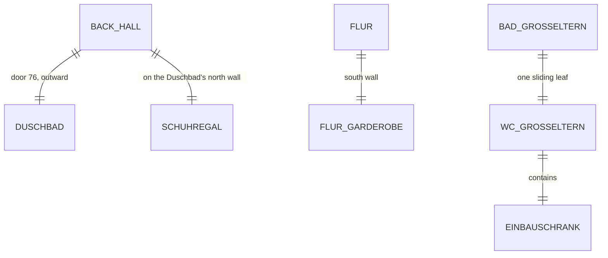

# Domain: Umbauten EG/OG

## Concepts

- **Duschbad am Hintereingang** changes system term *Gäste-WC*: one room with toilet, basin and walk-in shower; the Garderobe there and the Flur basin are gone. Plan room name `Duschbad` (was `WC`); the plan room `Garderobe` is gone.
- **Schuhregal**: open spruce rack in the back hall on the Duschbad's north wall, with shoes (furniture).
- **Flur-Garderobe**: hook board with hat shelf and coats on the big Flur's south wall (house only).
- **WC Großeltern** changes: one room (WC + Einbauschrank) behind one sliding leaf.
- **Muldenlüfter**: the downdraft vent in the Halbinsel's cooktop; the hood is gone.
- **Trockenwand Speis**: a drywall on the Essen side of shelf B.

## Vocabulary

| Term | Meaning |
|---|---|
| Duschbad | the former Gäste-WC by the back hall: WC, basin, shower |
| Muldenlüfter | downdraft extractor in the cooktop |
| Trockenwand | the drywall between Speis (shelf B) and Essen |
