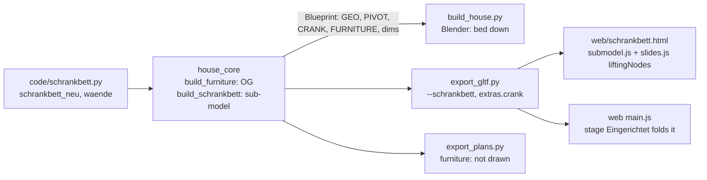

# Architecture: Schrankbett im Yoga-Zimmer

## Approach

A new pure-Python sub-model module `code/schrankbett.py`, built like `regal.py`:
`schrankbett_neu(c, x0, y0, walls=False)` builds into collection `c` with the Yoga room's inner SW
corner (west wall × south wall) at (x0, y0). House: `OG` at `SCHRANKBETT_AT = (0.31, 8.86)` on
floor `Z_OG`; sub-model: collection `Schrankbett` at the origin, `walls=True` adds the pieces of the
south wall (with the door opening) and the west wall (with the window). `house_core.build_schrankbett()`
wraps it as a Blueprint with dimension lines (`dims`), like `build_regal()`.

Objects (house names; sub-model `Schrankbett_*`):

- `OG_Moebel` (house) / `Schrankbett_Moebel`: carcass, two side cabinets (one door each, handle),
  Blende up to the ceiling, plinth.
- `OG_Klappbett` / `Schrankbett_Klappbett`: the folding part — wooden underside panel with a grip,
  frame, mattress, duvet, pillows, a fold-out foot board. Built **down** (as built), `PIVOT` on the
  hinge axis, `CRANK = ((1, 0, 0), 90)`: the viewer turns it 90° about x to folded up on the lift
  clock (`liftingNodes`, 3 s fold, rest, 3 s back). In `FURNITURE` (stage Eingerichtet).

Geometry (house coordinates, floor `Z_OG`, room 0.31 … 6.05 × 8.86 … 12.485, 2.20 m high):

- unit x 0.31 → east end just west of the Yoga door's casing (door opening 3.17 … 4.15; the casing
  width is read from the code, ~3.10), y 8.86 → 9.31 (45 deep), z up to the ceiling minus 3 mm.
- niche ≈ 2.06 wide (bed 2.04 = lying area 2.00 + 2 × 2 cm frame), the rest split into two side
  cabinets (≈ 0.36 each).
- pivot: on the hinge axis inside the carcass near the head end; place and body thickness chosen so
  the sweep 0 → 90° clears the wall (y 8.86), the floor, the Blende underside and the ceiling, and
  folded up lies inside the carcass. Expected: body ≈ 0.38 thick, Blende ≈ 3–5 cm, the bed down at
  y ≈ 9.3 … 11.3, mattress top ≈ 0.5 m.

## Impact

- **Build scripts**: new `code/schrankbett.py`; `house_core.py`: `import schrankbett`, the Yoga
  `bed()` call replaced by `schrankbett.schrankbett_neu("OG", …)`, `build_schrankbett()`,
  `FURNITURE` + `OG_Klappbett`; `PIVOT`, `CRANK` get the bed. `build_house.py`, `garden.py`
  reload `schrankbett`. `export_gltf.py --schrankbett`, `show.py --page schrankbett`. Removing the
  global-stream `bed()` call shifts later `rnd` values (shading only): parity golden diff expected.
- **Materials**: none new (spruce `FichteZ`/`FichteX`, `Leinen`, `Bettwaesche`, `Metall`).
- **Garden / film**: none to `ROUTE`; the Rundgang passes (3.66, 8.3 → 9.2), ~0.55 m from the unit's
  east end: clearance check. Film keeps the bed down.
- **Web viewer**: new page `schrankbett.html` + `src/schrankbett.js`, vite input, `package.json`
  blueprint script, toolbar Modell entry, `shot.js`, e2e spec, preview build test. `slides.js`
  unchanged (CRANK without LIFT already works: nodes with `lift || crank`).
- **Render / output**: `.blend` rebuilt and saved; plan sheets re-exported (OG: the old bed was
  furniture, so only the carcass may show if it is cut — it is furniture, not drawn); film
  re-render not needed now.

## Key decisions

| Decision | Alternatives considered | Why |
|---|---|---|
| Fold via existing `CRANK` (axis x, 90°) about `PIVOT` on the lift clock | new `FOLD` registry; an axis on `SWING` | `CRANK` already carries axis + angle through core → glTF → `slides.js`; no new mechanism. The bed then folds in step with the Büro desk in the house — acceptable. |
| Built down (as built) | built up | Matches the request ("ausgeklappt steht es da, wo das Bett jetzt steht"), film, Rundgang and plans. |
| Simple pivot, sizes found by a sweep test | 4-bar linkage animation | One rotation is what the viewer can do; the test proves it clears under the 2.20 m ceiling. |
| Lying area 2.00 × 2.00 (frame 2.04) | outer 2.00 × 2.00 | "Bett 200 × 200" means the mattress size. |
| Own module + own `random.Random` | builder in `house_core` | ADR-001-XEWL sub-model pattern; own stream keeps other parts' `rnd` stable later. |

No ADR needed.

## Integration points

- `house_core`: `build_furniture()`, `FURNITURE`, `PIVOT`, `CRANK`, `Blueprint`, `build_regal()` as
  the pattern; the Yoga door (`interior(c, 0.31, 14.575, 8.57, 8.86, [(3.17, 4.15, 1, "b"), …])`,
  its casing and `LEAVES`), the west window `(8.96, 9.95, z0 + 0.75, z1, "W")`.
- Tests: `tests/test_core.py`, `test_gltf.py`, `test_show.py`, `test_blender_parity.py` (golden),
  `test_plans.py`, `test_tour.py` (route unchanged); `web/e2e/*.spec.js`, `web/e2e-preview/preview.spec.js`,
  `web/e2e/nav.spec.js` (Modell entries).
- Docs: README (component list, script table), CLAUDE.md, `.claude/skills/spec/reference/project.md`
  (`--page` list), ADR-001-XEWL's module list (at archive).
- Live ADRs: ADR-001-XEWL (core only, backends repeat nothing), ADR-002-MLQS (glTF extras),
  ADR-003-SKGB (viewer).
