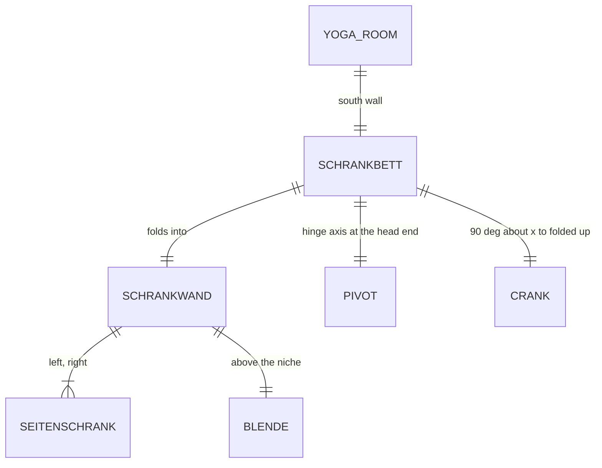

# Domain: Schrankbett im Yoga-Zimmer

## Concepts

**Schrankbett** (wall bed): a bed that folds up about a horizontal axis along its head end into a
carcass on the wall. Down it is a bed (lying area 2.00 × 2.00); up its wooden underside closes the
niche. It belongs to the Yoga room (OG, NW). New sub-model, alongside Ofen, Schreibtisch, Bad Oma &
Opa, Küche, Gäste-WC, Schrank im Büro.

**Schrankwand** (wall of cabinets): the carcass around the bed: a side cabinet left and right
(as deep as the bed is thick, up to the ceiling, one door each) and a **Blende** (closed fascia)
across the top of the niche up to the ceiling.

Changes system term **Lift / Crank**: `CRANK` (an object turning about its `PIVOT` on the lift
clock) is also used without a `LIFT`: the Schrankbett's folding part turns 90° about x.

## Vocabulary

| Term | Meaning |
|---|---|
| Schrankbett | The folding bed with its carcass; sub-model and furniture in the Yoga room. |
| Schrankwand | The carcass: side cabinets + Blende; with the bed up a closed front. |
| Blende | Closed fascia board between the top of the niche and the ceiling. |
| Liegefläche | The mattress area, 2.00 × 2.00 m. |
| hochgeklappt / ausgeklappt | Folded up (closed Schrankwand) / folded down (bed, as built). |
