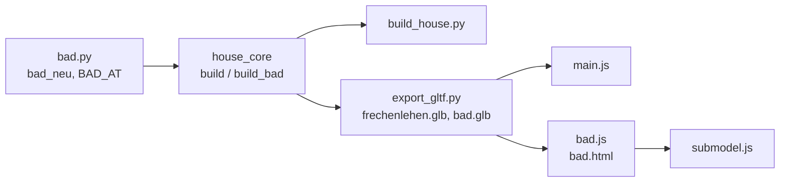

# Architecture: Bad Großeltern as a sub-model

## Approach

`code/bad.py` mirrors `code/desk.py`: pure Python, `import house_core as hc`, everything
axis-aligned and built straight into a collection. `bad_neu(c="Bad", x0=0.0, y0=0.0)` builds into
`c` at (x0, y0) = the room's inner SW corner and returns the dimension lines (sub-model
coordinates). The sub-model is `Bad` at the origin (`house_core.build_bad()`, twin of
`build_desk()`); the house calls `bad.bad_neu("EG", *bad.BAD_AT)` with `BAD_AT = (0.31, 8.656)`.

Measures from the agreed drawing `input/2026-11-08 input/grosseltern_v4.svg` (170 px/m), checked at apply
time; it still labels the basin "Doppelwaschbecken" (two bowls), the user's later choice of one
trough stands.

Local frame (u = x − 0.31, v = y − 8.656; room 2.048 × 3.817, ceiling `Z_EG_TOP` 2.40):

| Part | u | v | z | Object (`c` + …) / material |
|---|---|---|---|---|
| Niche wall | 0.964–1.084 | 0–1.20 | 0–2.40 | `_Waende` / Putz |
| Lintel over the niche (two pieces beside the niche wall, no coplanar faces) | 0–0.964, 1.084–2.048 | 1.08–1.20 | 2.05–2.40 | `_Waende` / Putz |
| WC leaf (rear track), open: slid behind the Schrank leaf | 0.964–2.048 | 1.21–1.25 | 0–2.0 | `_Innentueren` / six-panel leaf (closed it spans 0–1.084, SVG v4) |
| Schrank leaf (front track), closed | 0.964–2.048 | 1.26–1.30 | 0–2.0 | `_Innentueren` |
| Rail | 0–2.048 | 1.20–1.31 | 2.0–2.045 | `_Innentueren` / Metall |
| Cabinets: white (`Rahmen`, RAL 9010 like the window frames) — "white" as agreed; `Innentuer` is brown pine | | | | `_Schrank` |
| Toilet (`hc.toilet`), green tiles (`hc.wainscot`) | WC half | | | `_Sanitaer`, `_Fliesen` |
| Back cabinet, open shelves | 1.084–2.048 | 0–0.60 | 0–2.05 | `_Schrank` |
| Hanging wardrobe, hat shelf; rail front-to-back at u 1.384, v 0.62–1.18 (SVG v4) | 1.084–1.684 | 0.60–1.20 | 0–2.05 | `_Schrank` |
| Shower: rain head 0.30 on an arm from the north wall (centre u 0.40, v 3.494), drain Ø16 at u 0.40, v 3.294 (SVG v4) | 0–0.80 | 2.267–3.817 | | `_Sanitaer` |
| Shower cladding (west, north to 2.0; low wall's west face to 1.0) | | | 0–2.0 | `_Fliesen` / Kalkstein |
| Glass panel | 0.80–0.81 | 3.467–3.817 | 0–2.40 | `_Sanitaer` / Glas |
| Low wall | 0.80–0.92 | 2.267–3.467 | 0–1.00 | `_Waende` / Putz |
| Glass on the low wall | 0.854–0.866 | 2.267–3.467 | 1.00–2.40 | `_Sanitaer` / Glas |
| Waschtrog: one trough bowl, wall-hung, two deck mixers at v 2.617 / 3.117 (the SVG's two bowl centres) | 0.92–1.42 | 2.367–3.367 | top 0.85 | `_Sanitaer` / Keramik, Metall |

The parts draw their `rnd` from their own `random.Random`, so nothing built after them shifts
(as in `desk.py`). Overlapping parts of one piece share an `rnd`. The leaves get `LEAVES` entries
(clash check).

House side (`house_core`):

- `build_eg()`: drop `interior(c, 0.31, 2.358, 10.10, 10.25, …)` and `sliding_door(c, 0.56, 1.25,
  10.25)`; the wall `interior(c, 2.358, 2.657, 6.349, 12.473, …)` gets the opening
  `(9.856, 12.33)` instead of `(10.33, 12.33)`; call `bad.bad_neu("EG", *bad.BAD_AT)`.
  `sliding_door()` is then unused and goes.
- `build_sanitary()`: drop today's Bad Großeltern shower and basin and the WC's toilet and
  `wc_basin` at (2.358, 9.12); the `WCS` entry for the WC Großeltern goes (the niche tiles come
  from `bad_neu` calling `wainscot` with the WC half and the whole north side as "door").
- `floor_cover("EG", …)`: limestone also for `BATH_EG = (0.31, 2.358, 9.856, 12.473)` (same list
  mechanism as `CORRIDOR_EG` / `BATHS_OG`); the former wall strip x 2.358–2.657 gets oak like the
  bedroom.

## Impact

- **Build scripts**: new `code/bad.py`; `house_core`: `import bad`, `build_bad()`, `BATH_EG`,
  changes in `build_eg()` and `build_sanitary()`, `WCS` loses the WC Großeltern, `sliding_door()`
  removed; `LEAVES` gains the two leaves. `reload(bad)` next to every `reload(desk)`
  (`build_house.py`, `garden.py`, `fire.py`, `film.py` — wherever `desk` is reloaded).
- **Materials**: none new (Putz, Glas, Keramik, Metall, Kalkstein, Innentuer, Fliese, Fugengrau,
  Eiche/Fichte exist).
- **Randomness**: removing today's wall, door and fixtures removes global `random` draws, so the
  `rnd` of every part built after them in `build()` shifts (different board/slab shades, same
  geometry). The parity golden is regenerated anyway.
- **Garden / film**: `NO_GRASS` unchanged (inside); `ROUTE` unchanged (the Großeltern segment stays
  at x ≥ 3.3, ≥ 0.9 m from the new parts) — clearance re-checked.
- **Web viewer**: `bad.html`, `bad.js` (configures `submodel.js`), `vite.config.js` input, `ui.js`
  link "Bad Oma & Opa", `package.json` blueprint (`--bad`), `.gitignore` (`bad.glb`), e2e
  `bad.spec.js`, preview spec.
- **Render / output**: parity golden regenerated; `.blend` rebuilt and saved; film not re-rendered.

## Key decisions

| Decision | Alternatives considered | Why |
|---|---|---|
| `bad.py` builds its own walls (niche wall, low wall, lintel) | Walls in `build_eg()`, only fixtures in `bad.py` | The sub-model must show them; one place describes the room (ADR-001-XEWL). The outer walls and the shortened bedroom wall stay in `build_eg()`. |
| Origin = room's inner SW corner (0.31, 8.656) | Bad's NW corner | All dimensions in the sketch run from the south and west walls. |
| WC leaf open (behind the Schrank leaf), in house and sub-model | Both closed | User, 2026-11-08: open the door to the Bad's WC. Same parts in both (sub-model = house, translated). |
| Waschtrog: one 1.00 m trough, no mirror | Two bowls; mirror | User, 2026-11-08. |
| Shower walls clad with the floor's limestone to 2.0 m; cabinets open and white (`Innentuer`); lintel 2.05 m to the ceiling | Tiles; cabinet doors; open to the ceiling | User confirmed the proposal's assumptions, 2026-11-08. |
| Accept the `rnd` shift of later parts | Dummy draws to keep today's random sequence | Removing parts is inherent; dummy draws would be code that only exists to imitate deleted code. |
| Limestone only in the Bad; WC and Schrank oak; boundary at x 2.358 | Limestone under the whole room | As agreed: "Kalkstein wie OG-Bäder" for the Bad; the WC keeps its tiles and oak like the other WCs. |
| Hanging wardrobe against the 12 cm wall | Against the outer wall x 2.358 | "Links" in the drawing; confirmed by the user 2026-11-08. |

No ADR: the decisions are local and easy to reverse.

## Integration points

- Obeys ADR-001-XEWL (room described once in the core's sub-model module; `bad.js` only configures
  views and context walls like `desk.js`), ADR-002-MLQS (stdlib writer, material extras), ADR-003-SKGB.
- Reuses `hc.toilet`, `hc.wainscot`, `hc.six_panel_leaf`, `hc.box`/`lbox`/`turned`/`xy_prism`.
- Tests touched: `tests/test_core.py` (`WCS` table, `test_bathrooms_have_limestone_like_the_eg_corridor`,
  `test_wc_fixtures_after_the_photo` — changes need the user's agreement), `tests/test_gltf.py`,
  `tests/golden/blender_snapshot.json`, `web/e2e-preview/preview.spec.js`.
- The north french door of the Bad (x 1.109–2.008) opens over the washbasin area: its leaves must
  clear the basin (y ≤ 12.023) — checked in the still.
