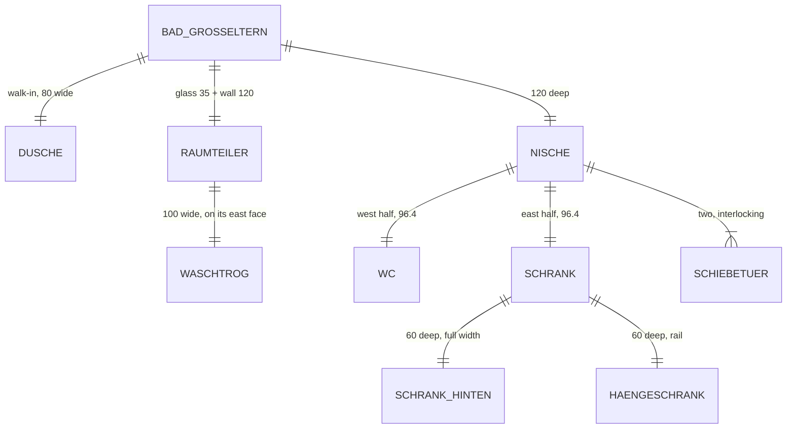

# Domain: Bad Großeltern as a sub-model

## Concepts

**Bad Großeltern (sub-model).** Changes system term **Sub-model**: a third one besides Ofen and
Schreibtisch. The grandparents' bathroom with WC niche and closet, modelled at its own origin (the
room's inner SW corner) and placed into the house unrotated at `BAD_AT`. Unlike the other two it
also brings walls (the 12 cm niche wall, the low wall), not only objects standing in a room.

**Nische (niche).** The southern 1.20 m of the room, split into **WC** and **Schrank** by a 12 cm
wall and closed by two **interlocking sliding doors** (verschränkte Schiebetüren): two leaves on two
offset tracks, each covering one half; one can slide over the other, so at most one half is open.

**Raumteiler (partition).** East edge of the walk-in shower: a 35 cm thin glass panel from the
north wall, then a 1.00 m high wall with clear glass above it to the ceiling. The **Waschtrog**
(one 1.00 m trough basin with two mixers) hangs on its east face.

**Rooms.** Changes the room boundaries of Oma & Opa: the Bad is open to the bedroom from the
niche front to the north wall; the separate "WC Großeltern" room of today becomes the WC half of
the niche.

## Vocabulary

| Term | Meaning |
|---|---|
| Bad Großeltern | The bathroom sub-model (`code/bad.py`, `web/bad.html`) and its place in the house |
| Nische | The 1.20 m deep WC + Schrank strip at the south of the Bad Großeltern |
| Verschränkte Schiebetüren | The two sliding leaves on offset tracks that close the Nische |
| Raumteiler | Glass panel + 1 m wall with glass above, between shower and washbasin |
| Hängeschrank | Hanging wardrobe (rail) in the Schrank, 60 cm deep |
| Waschtrog | The one large trough washbasin, 1.00 m wide, two mixers |
