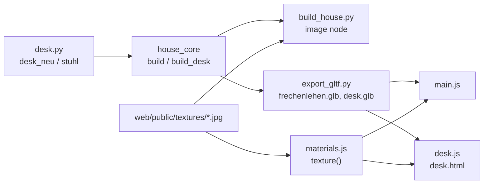

# Architecture: Desk sub-model with monitors, MacBook, keyboard and trackpad

## Approach

`code/desk.py` mirrors `code/ofen.py`: pure Python, `import house_core as hc`, builds into
`desk_neu(c, x0, y0)` builds straight into collection `c` at (x0, y0): the sub-model as `Desk` at
the origin, the house as `EG` at `DESK_AT` in the table's old place in the build order (the table
stays in `EG_Moebel`, the chair via `stuhl()` in `EG_Stuehle` at its old place, so the house's
existing parts and random draws are unchanged). `house_core.build_desk()` is the twin of
`build_ofen()`; `export_gltf.py --desk` writes `web/public/desk.glb`; `web/src/submodel.js` is the
sub-model page factored out of `ofen.js`, `ofen.js` and `desk.js` only configure it.
The generic `desk()` table builder moves to `desk.py` unchanged (the OG laundry table uses it too).

Screen images: each monitor pane is its own object (`Desk_Bildschirm_L/_R`) whose `PIVOT` is the
pane's lower-left corner and whose new `TURN` entry is its yaw (±5°: the monitors stand at 170°);
both backends store the mesh unturned (`house_core.local()`) and turn the object. Its material carries `image` (path under `web/public/`) and `size`
(w, h in metres); both backends map object-space x/w, z/h to the image (Blender: Texture
Coordinate › Object; viewer: `positionLocal`, which is relative to the node's pivot translation).
No UVs in the accumulator, mesh_ops or the glTF writer.

## Impact

- **Build scripts**: new `code/desk.py`; `house_core`: `import desk`, `build_desk()`, `desk()` moved
  out, `build_furniture()` calls `desk.desk_neu("EG", *DESK_AT)`, `desk.stuhl()` and `desk.desk()`
  (OG); `FURNITURE` gains `EG_Geraete`, `EG_Bildschirm_L/_R`; `PIVOT`/`TURN` gain the two panes (cleared in
  `build_desk()` too). `reload(desk)` next to every `reload(ofen)`.
- **Materials**: new `Bildschirm_A12`, `Bildschirm_Pilcrow` (image, emit 0.8), `Alu` (MacBook,
  keyboard base, monitor stands; metal 0.15: fully metallic reads black without an environment
  in the viewer), `Tasten` (white keys and trackpad), `Apfel` (logo, emit 0.5).
- **Back door**: lever handles in `back_door()` (fixed rnd, no shift).
- **Garden / film**: none (furniture is inside); camera clearance re-checked since the monitors
  stand 0.6 m above the desk.
- **Web viewer**: `materials.js` (image materials), `desk.html`/`desk.js`, `vite.config.js` input,
  `ui.js` link, `package.json` blueprint, `.gitignore` (`desk.glb`), e2e `desk.spec.js`, preview
  spec. Textures `web/public/textures/screen_*.jpg` are committed.
- **Render / output**: parity golden regenerated; `.blend` rebuilt; film not re-rendered.

## Key decisions

| Decision | Alternatives considered | Why |
|---|---|---|
| Monitors: LG UltraFine 6K 32" (32U990A), panel 714 × 420 mm (assumed from the data sheet), flat on tilt stands | LG 40" 5K2K curved (two = 1.92 m: no room for the MacBook on the 1.948 m desk); 27" UltraFine 5K (not "the very big ones") | Largest LG 16:9 that fits twice beside a 16" MacBook Pro (2 × 0.714 + 0.356 = 1.78 m) |
| a12 left (next to the MacBook), pilcrow right | the reverse | no hint in the input; alphabetical |
| Image mapping in object space around a pivot | UVs through accumulator, mesh_ops, writer | the project already maps textures in object space; no new vertex attribute in three code paths |
| Screenshots downscaled once (`sips`, 2560 × 1440 JPEG, alpha flattened, padded to 16:9 with dark grey) and committed under `web/public/textures/` | embed the 8.6 MB PNGs in the .glb; convert at build time | CI is ubuntu + stdlib (no `sips`, no Pillow); the house page should not load 8.6 MB more |
| Chair at the desk is part of the sub-model | leave it in `EG_Stuehle` | the desk is remodelled with its chair; the dining chairs stay |

No ADR: the decisions are local and easy to reverse.

## Integration points

- Obeys ADR-001-XEWL (desk described once in the core; backends and viewer repeat nothing — the
  image path and size come from `MAT_DEF`), ADR-002-MLQS (material parameters in extras, stdlib
  writer), ADR-003-SKGB (TSL `texture()` node).
- Tests touched: `tests/test_core.py` (desk-in-Bibliothek assertion moves to the new objects),
  `tests/golden/blender_snapshot.json`, `web/e2e-preview/preview.spec.js`.
