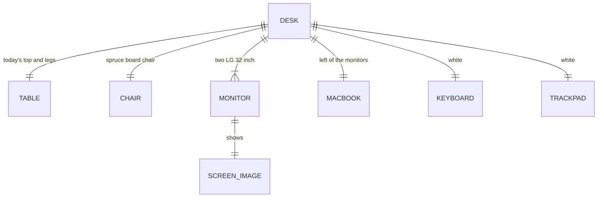

# Domain: Desk sub-model with monitors, MacBook, keyboard and trackpad

## Concepts

**Schreibtisch (desk sub-model).** The Büro desk in the Bibliothek with its chair and devices,
modelled at its own origin (desk's SW corner) and placed into the house unrotated. Like the Ofen,
it has its own page with dimension lines.

**Screen image.** A material that shows a picture (a screenshot) on a monitor pane instead of a
colour or a procedural texture.

## Vocabulary

| Term | Meaning |
|---|---|
| Schreibtisch | The desk sub-model (`code/desk.py`, `web/desk.html`) |
| Bildschirm | A monitor pane with a screen image |
