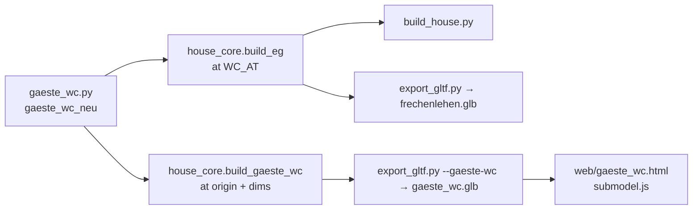

# Architecture: Gäste-WC und Garderobe am Hintereingang

## Approach

A new pure-Python module `code/gaeste_wc.py` (like `bad.py` / `kueche.py`):
`gaeste_wc_neu(c, x0, y0)` builds everything into collection `c` with the WC room's inner SW corner
(the Bestand room: x 0.31, y 5.475 = `WC_AT`) at (x0, y0). Positions are written in house
coordinates (those of the drawing) and shifted, because the basin lies outside the room, in the
Flur. `build_eg()` calls it at `WC_AT` in place of the north wall's `interior()` call;
`house_core.build_gaeste_wc()` wraps it at the origin for `web/gaeste_wc.html`. It draws `rnd` from
its own `random.Random` where it calls primitives directly; `interior()`, `toilet()` keep using the
global stream (as in the Bad).

## Impact

- **Build scripts**: new `gaeste_wc.py`; `build_eg()` (north wall moved into the module, new
  opening 0.48–1.24 with `panel_door` swing +1, hinge "b", `flat=False`; old opening 1.419–2.218 an
  open passage); `WCS` loses the EG back-hall entry (its tiles and toilet move into the module);
  `build_sanitary()` no longer places that toilet; `floor_cover()` takes a list of holes (no slabs
  under the partition) and still lays limestone over WC and Garderobe; `wc_basin()` gets
  `mirror=True`, `wainscot()` gets `sides="snwe"` (defaults keep the OG WCs and the Bad unchanged);
  `LEAVES` gets the WC leaf. Reload lists in `build_house.py`, `film.py`, `fire.py`, `garden.py`.
  Swinging doors: new registry `SWING` (object → degrees about its `PIVOT` to the other state) →
  `Blueprint.swing`; `panel_door(..., leaf=)` puts a single 90° leaf in its own object, hinged and
  swinging closed; `back_door(c, dx, dy)` and the Windfang door's `panel_door` are called by
  `gaeste_wc_neu` (the long wall keeps an open passage there); leaves `EG_Hintertuer`, `EG_WC_Tuer`,
  `EG_Windfangtuer`. `export_gltf.py` writes `extras.swing` (radians about glTF y).
- **Materials**: none new (Putz, Keramik, Metall, Fliese, Fugengrau, Spiegel, Eisen, Kiefer, Innentuer).
- **Garden / film**: `NO_GRASS` none; `ROUTE` unchanged; camera clearance re-checked (the open WC
  leaf stands in the back hall near the route's back-door stop).
- **Web viewer**: new `gaeste_wc.html`, `src/gaeste_wc.js` (submodel.js), `nav.js` entry,
  `vite.config.js` input, `package.json` blueprint, `.gitignore` for the `.glb`, `shot.js` hook;
  e2e `gaeste_wc.spec.js`, drop-down lists in `kueche.spec.js` / `preview.spec.js`. `slides.js`
  `swingingNodes()` (createSlides with period/duration 3 s), used by `submodel.js` (edge lines turn
  in a group about the hinge) and `main.js` (Eingerichtet, not touring; boxes for drawing in view).
- **Render / output**: parity golden regenerated, `.blend` rebuilt and saved, one still; film not
  re-rendered.

## Key decisions

| Decision | Alternatives considered | Why |
|---|---|---|
| The WC's north wall (Bestand) belongs to the sub-model | keep it in `build_eg()` (as the Küche's walls) | The new door opening and the outward leaf are the core of v3; the page must show them. |
| Basin on the Flur wall is part of the sub-model, coordinates in house terms | separate Flur builder | One drawing, one module; the Küche already writes house coordinates and shifts. |
| Windfang door and Hintertür hinged north, opening into the back hall (user, 2026-11-10) | hinged south (as modelled before); Windfang door into the Gang (plan) | Open, both lie along the back hall's north wall, out of the way of basin, mirror and WC door. |
| Doors swing in the house only in Eingerichtet and not in the Rundgang | every stage and the Rundgang too | As the Bad's sliding leaves; the Skizze lines don't follow moving parts; the Rundgang plays the film's route, the film shows them as built. |
| Hintertür and Windfang door built by the sub-model | animate them only in the house | The request asks for all three on the page too; one builder, the house and page stay identical. |
| Floor stays one limestone surface from `floor_cover()` | own floor like the Bad | The room is stone today and joins the Flur's stone; only the partition is cut out. |

No ADR needed; obeys ADR-001-XEWL (one core, both backends) and ADR-002-MLQS (glTF extras).

## Integration points

`house_core.build_eg()`, `build_sanitary()`, `build_slabs()`/`floor_cover()`, `WCS`, `wc_basin()`,
`wainscot()`, `toilet()`, `interior()`/`panel_door()`; `export_gltf.py` flags; `show.py` `PAGES`;
`web/src/submodel.js`, `nav.js`, `shot.js`; tests `test_core.py` (its `WCS` list pins the old WC:
its EG back-hall entry changes coordinates only, assertions stay), `test_gltf.py`, `test_show.py`,
`tests/golden/blender_snapshot.json`; README (Teilmodelle, `--page`), `CLAUDE.md`,
`.claude/skills/spec/reference/project.md`.
