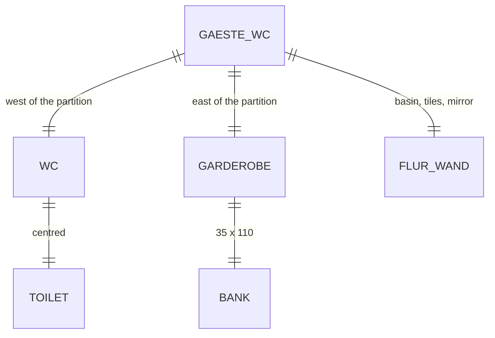

# Domain: Gäste-WC und Garderobe am Hintereingang

## Concepts

Changes system term **Sub-model**: a fifth one, the **Gäste-WC** (`gaeste_wc.py`,
`gaeste_wc.html`; like the Bad it brings walls of its own: the new partition and the WC's north
wall with both openings).

The former WC by the back hall is split into **WC** (west, door to the Flur, leaf opens outward)
and **Garderobe** (east, open, bench along the east wall). The **Handwaschbecken** of the WC hangs
outside it, on the Flur east wall.

## Vocabulary

| Term | Meaning |
|---|---|
| Trennwand | The new 10 cm partition between WC and Garderobe, its east face flush with the old door's west jamb. |
| Garderobe | The east part (94 × 110), open to the Flur through the old 80 opening: Bank, Hakenbrett, Hutablage. |
| Handwaschbecken (HWB) | The WC's 40/28 hand basin on the Flur east wall, with Taubenblau tiles and a wood-framed mirror. |
| Schwenkende Türen | Hintertür, WC-Tür and Windfangtür: in the viewer one of them, at random, swings to its other state every 3 s (shows where they collide); the film shows them as built. |
