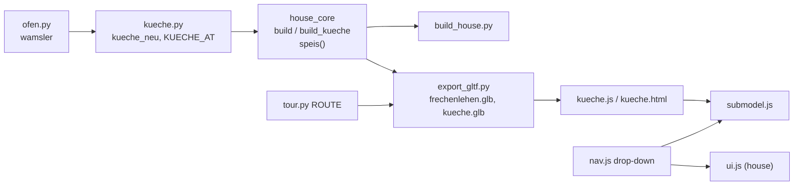

# Architecture: Küche as a sub-model, new Speis, sub-model drop-down

## Approach

`code/kueche.py` mirrors `bad.py`/`desk.py`: pure Python, `import house_core as hc`, its own
`random.Random`, everything built straight into collection `c`. `kueche_neu(c="Kueche", x0=0.0,
y0=0.0)` takes over today's `house_core.kitchen()` body with the v6 positions and returns the
dimension lines; the house calls `kueche.kueche_neu("EG", *kueche.KUECHE_AT)` with
`KUECHE_AT = (5.49, 5.849)` (inner NW corner). Object names keep `c + "_Kueche" / "_Herd" /
"_Haube"` (house: `EG_Kueche`, `EG_Herd`, `EG_Haube` as today), the flue box goes to
`c + "_Waende"`. `ofen.wamsler()` is reused unchanged.

Positions (house coordinates; from `input/2026-11-09 input/speis_kueche_v6.svg`):

| Part | x | y | z |
|---|---|---|---|
| Kitchen door opening (Flur wall), hinge west, swing into the Küche, 90° | 6.10–6.96 (architraves 6.03–7.03, clear 0.81) | 5.849–6.349 | 0–2.0 |
| Besenschrank (carcass + door south, plinth) | 5.492–6.002 | 5.297–5.847 | 0–2.20 |
| Sink run carcass, fronts south at 5.249, granite 5.229–5.847 | 7.05–8.555 | 5.269–5.847 | 0–0.90 |
| Sink (centre 7.46, at today's water connection), tap | 7.23–7.69 | 5.30–5.76 | |
| Ostzeile (one 60 door from the peninsula's front 3.66) | 7.977–8.555 | 3.64–4.26 | 0–0.90 |
| Wamsler (`ofen.wamsler(c, 7.972, 4.30, rng)`), hood centred on it | 7.977–8.555 | 4.30–5.10 | |
| Peninsula + cooktop | unchanged | unchanged | |
| Wall cabinets north (sink run) / east (Ostzeile → hood) | 7.05–8.207 / east wall | north wall / 3.05–4.24 | 1.45–2.20 |
| Abzug (Putz) | 8.227–8.555 | 5.55–5.847 | 1.80–2.40 |

Speis (`house_core`, new `speis()` in `build_eg()`, object `EG_Speis`, own `random.Random`):
wall `interior(c, 5.240, 5.490, 3.13, 5.849, [(4.33, 5.249)])`; `interior(c, 2.772, 5.240, 3.13,
3.29)` removed; A x 2.774–5.238 × y 5.249–5.847, B y 3.732–4.33, C carcass 3.15–3.728 with doors
3.13–3.15 (4 columns, tall door + top door); uprights and boards to 2.397 (ceiling 2.40). Sliding
leaf (`six_panel_leaf`, 1.00 wide, 4 cm) on the kitchen face x 5.50–5.54, open at y 3.28–4.28,
rail 3.26–5.29 above it; one `LEAVES` entry. The three `shelf("EG", …)` calls in
`build_furniture()` go.

## Impact

- **Build scripts**: new `code/kueche.py`; `house_core`: `import kueche`, `build_kueche()`,
  `kitchen()` removed, new `speis()`, `build_eg()` walls/doors (Flur door, Speis wall, Speis/Essen
  wall gone), `build_furniture()` loses three shelves; `LEAVES` gains the sliding leaf.
  `reload(kueche)` wherever `reload(bad)` is (`build_house.py`, `garden.py`, `fire.py`,
  `film.py`). `FIRES`: the Wamsler's fire moves with it.
- **Materials**: none new (FichteZ/X, Granit, Metall, Eisen, Fuge, Putz, Innentuer).
- **Randomness**: `kitchen()` drew from the global `random`; moving it to its own generator and
  removing walls/shelves shifts later `rnd` values (same geometry). Golden regenerated.
- **Garden / film**: `NO_GRASS` unchanged; `ROUTE` changes (Speis look, Küche → Flur door);
  tour golden regenerated; film not re-rendered.
- **Web viewer**: `kueche.html`, `src/kueche.js`, new `src/nav.js` (drop-down) used by `ui.js`
  and the sub-model pages (replaces their links), `vite.config.js` input, `package.json` blueprint
  `--kueche`, `.gitignore` `kueche.glb`, e2e `kueche.spec.js`, existing e2e/preview specs that
  click the old links switch to the drop-down (the requested UI change).
- **Render / output**: parity golden regenerated; `.blend` rebuilt and saved; stills of Küche and
  Speis.

## Key decisions

| Decision | Alternatives considered | Why |
|---|---|---|
| One change for Küche, Speis and drop-down | Three changes | They share the Speis/Küche wall, the sliding door, the door-leaf space and the tour; the 4th page triggers the drop-down. |
| Ostzeile exactly 60 from the peninsula front; Herd directly south of it (4.30–5.10), 15 cm gap to the sink run | Herd stays 4.34, 4 cm filler | User: 60 is the standard size; Herd close to the run as before. |
| Kitchen door leaf at 90° (`flat=False`) | Flat against the wall | Flat it would run through the Besenschrank; at 90° it stands 12 cm east of it. |
| Besenschrank 55 deep, 2.20 high, in the kitchen sub-model | 60 deep; to the ceiling; in the house | 55 lets the sliding door's rail end clear of it; 2.20 = top of the wall cabinets; it is kitchen furniture. |
| Speis A/B/C as built-ins in `EG_Speis` (stage "Gebaut") | `EG_Moebel` furniture | C replaces a wall; floor-to-ceiling joinery belongs to the house like the kitchen. |
| Sliding leaf shown open (slid south) | Closed | Like every other leaf: the Rundgang looks into the Speis. |
| Flue box modelled, depth 30 cm (assumed) | Not modelled | The wall cabinets must stop at it; depth not visible in the photo. |
| Wamsler pipe unchanged (into the east wall) | Pipe to the flue box | User: the pipe *can* be led there — no need to model the routing now; noted. |
| Sub-model origin = inner NW corner | Inner SW corner like the Bad | Every v6 measure runs from the Speis wall and the Flur wall. |
| Drop-down as a shared module `nav.js` | Copy the `<select>` into each page | One list of pages, one place (ADR-001-XEWL spirit for the viewer). |

No ADR: local, easy to reverse.

## Integration points

- Obeys ADR-001-XEWL (kitchen described once in the core's module; `kueche.js` only configures
  views/context walls), ADR-002-MLQS, ADR-003-SKGB.
- Tests touched (user agreed 2026-11-09 to update the positions): `tests/test_core.py`
  `test_kueche_wamsler_herd_at_the_north_end_of_the_east_run` (Herd y range),
  `test_kueche_wall_cabinets_over_the_rest_of_the_run` (north range 7.05–8.207),
  `test_kueche_old_steel_hood_above_the_herd` (unchanged logic); `tests/test_gltf.py`,
  `tests/golden/blender_snapshot.json`, `tests/golden/tour.json`, web e2e/preview specs using the
  old links.
