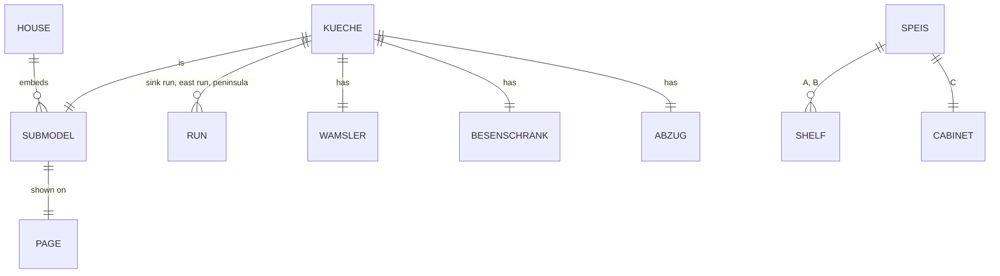

# Domain: Küche as a sub-model, new Speis, sub-model drop-down

## Concepts

**Küche (sub-model).** changes system term *sub-model*: a fourth one besides Ofen, desk and Bad.
It holds the kitchen's furnishings and the flue box; the room's walls and doors stay in the house.
Origin: the room's inner NW corner (Speis wall × Flur wall), so the sub-model lies at y ≤ 0.

**Speis fit-out.** Built-ins of the pantry, part of the house (stage "Gebaut", not "Eingerichtet"):
open shelves A and B either side of an aisle, cabinet C with doors towards the Essen, back to back
with B, replacing the former Speis/Essen wall.

**Flue box (Abzug).** The chimney connection in the Küche's NE corner, a plastered box from
≈ 1.80 m to the ceiling; worktops run under it.

**Sub-model navigation.** One drop-down lists the house and every sub-model page.

## Vocabulary

| Term | Meaning |
|---|---|
| Spülzeile | Sink run on the north wall, door frame → NE corner |
| Ostzeile | Base units on the east wall between peninsula and Herd, 60 cm |
| Halbinsel | Peninsula with the induction cooktop, towards the dining table |
| Besenschrank | Tall broom cupboard in the NW corner, behind the open kitchen door |
| Abzug | Flue box in the NE corner, from 1.80 m up |
| Speis A / B / C | North shelf / aisle-side shelf / cabinet towards the Essen |
