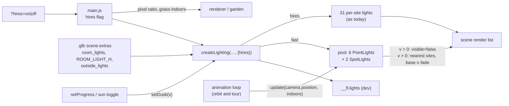

# Architecture: lights off by day, only the nearest at dusk

## Approach

Two modes, chosen once per page load by the URL switch `hires` (`?hires=on`; missing or `off` =
the default, fast mode):

**Fast (`hires=off`, default — also in the Rundgang).** `createLighting(scene, extras, target,
uDetail, { hires })` no longer makes one light per site. It makes a **fixed pool**: `ROOM_N` (6)
warm `PointLight`s and `OUTSIDE_N` (2) `SpotLight`s (with their targets, also in the scene),
created once, and keeps the sites (`extras.room_lights` + `ROOM_LIGHT_H`, `extras.outside_lights`)
as y-up vectors.

- `setDusk(v)` sets the stage value as today and `visible = v > 0` on every pooled light (and spot
  target). By day the pool is out of the render list.
- A new `update(cameraPos, inside)` ranks each kind's sites by distance to the camera and moves
  pooled light *i* to the *i*-th nearest site (spot: target 1 m below). Distance is
  `hypot(dx, dy, 3·dz)` while the camera is `inside` (`indoors()` from `garden.js`: house
  footprint, below the ridge), else plain 3D distance. Intensity
  `= base · v · clamp((d_cut − d_i) / FADE, 0, 1)`, `base` = 9 (room) / 14 (outside) as today,
  `d_cut` = distance of the nearest site left out, `FADE` = 1.0 m. It returns at once while the
  pool is off. `main.js` calls it in the animation loop right before `renderer.render` (after the
  on-demand early returns, so it costs nothing while idle).
- Why a pool: three.js `LightsNode.customCacheKey()` hashes the id of every light in the render
  list. Toggling `visible` on the 31 per-site lights as the camera moves would give a new key per
  set → every material's pipeline rebuilt → hitches. With the pool the key changes only at the
  day ↔ dusk boundary (two variants, each compiled once per page load; the first dusk stalls once,
  measured in e2e).

**Full quality (`hires=on`, for the film capture).** No speed shortcut that changes the picture:

- lights exactly as today: one light per site (23 room + 8 outside), always in the render list,
  intensity `base · v`; `update()` is a no-op;
- pixel ratio = `devicePixelRatio` (fast mode keeps the cap at 1.5, `main.js:17`);
- grass stays visible indoors (fast mode hides it indoors, now also in the Rundgang: the
  `!touring` exception at `main.js:150` is replaced by `!hires`).

The drawing on demand and the 30 fps cap in the tour/fire stay in both modes (the capture drives a
fake clock with `seek()`, so they don't change its frames). `hires` is kept in the URL by
`saveView()` like `fov`. `lampLights` (above the Ofen bed) stay as they are in both modes. The Ofen
page (`ofen.js`) is untouched.

## Impact

- **Build scripts:** none (`ROOM_LIGHTS`, `OUTSIDE_LIGHTS`, `export_gltf.py` unchanged).
- **Materials:** none.
- **Garden / film:** no Blender change (`film.py` `Innenlicht` unchanged, no `ROUTE` change). The
  viewer's grass is hidden indoors in the browser Rundgang too, unless `hires=on`.
- **Web viewer:** `web/src/lighting.js` (pool, `hires` per-site path, `setDusk` visibility, new
  `update()`, constants `ROOM_N`, `OUTSIDE_N`, `FADE`, `STOREY_W`); `web/src/main.js` (`hires`
  from the URL and in `saveView()`, pixel ratio, grass `!hires` instead of `!touring`,
  `lights.update(…)` in the loop, dev hooks `__fl.lights`, `__fl.hires`, `__fl.pixelRatio`);
  `web/src/lighting.test.js` (three cases rewritten for the pool, hires cases added);
  `web/e2e/stages.spec.js` (new light checks; "no grass while the camera is indoors, except in the
  Rundgang" rewritten for `hires`; "Gebaut is darker outside, with warm windows" kept).
- **Docs / tools:** `README.md` (Gebaut line, `hires=` in the URL list);
  `.claude/skills/film-render/SKILL.md` (capture URL with `&hires=on`); the capture memory
  (`film-capture-full-quality`) updated to the `hires` rule.
- **Render / output:** no Blender re-render; the viewer's Gebaut/Eingerichtet look changes (far
  rooms dark); the web film must be captured with `hires=on`.

## Key decisions

| Decision | Alternatives considered | Why |
|---|---|---|
| Fixed pool of lights moved to the nearest sites | Keep 31 lights, toggle `visible` on the nearest N | Light ids are part of the material cache key in three.js 0.187; a changing set recompiles every material while the camera moves. |
| Separate pools: 6 room lights, 2 outside lamps; `FADE` = 1.0 m (grill R2) | 4 + 2 with `FADE` 1.5 m; one ranking over all 31 sites | Point vs. spot cannot share a pooled object, and from outside the lamps would starve the rooms. With 4 + 1.5 m the 4th light was nearly always dim (0.03–0.42: sites lie only cm apart in distance), so effectively 3; 6 lights the own room plus the neighbours seen through doors — still 8 instead of 31. |
| Rank by distance to the camera (grill R1: confirmed) | Distance to the orbit target | The request says camera; inside the Rundgang both are close anyway. |
| Storey-aware ranking: while the camera is `indoors()` (garden.js: house footprint, below the ridge), rank by `hypot(dx, dy, 3·dz)`; outside by plain 3D distance (grill R1) | Plain 3D distance everywhere; same-storey filter | Plain 3D fills slots with rooms through floor/ceiling (OG at frame 4172: 2 of 4 are EG rooms), whose light only leaks (no shadows). Outside, a vertical penalty would drop every EG site from the overview and the Stube windows would go dark. |
| The pool also applies in the Rundgang; full quality only with an explicit switch `hires=on` (grill R1) | Full lights whenever `tour.state ≠ off`; a capture-only flag | The Rundgang in the browser should get the speed-up too; the film capture asks for full quality by name. Supersedes the "shortcuts off while touring" rule of the capture memory. |
| `hires=on` switches off all three picture-changing shortcuts: light pool, pixel-ratio cap, grass hidden indoors; it replaces the `!touring` grass exception (grill R2) | `hires` for the lights only | One switch that means what it says ("full quality"); nothing else tied to the tour state. Drawing on demand and the 30 fps cap stay: they don't change captured frames. |
| `hires` is a URL parameter only (`?hires=on`, default off), kept in the URL by `saveView()`; no toolbar button (grill R2) | URL + toolbar button | A capture/power-user switch; a reload keeps it, like `fov`. |
| `hires=on` lights = exactly today's per-site lights (always in the render list, intensity `base · v`) | Per-site lights off by day | Unchanged film look; the capture is the only user and runs at dusk. |
| Accept the one-time pipeline compile at the first dusk; measure it in e2e (grill R1) | Prewarm with `renderer.compileAsync` at load | By day the pool is out of the render list, so the first dusk recompiles every material once per page load. Prewarm only if the stall is noticeable (> ~300 ms), as a later `tweak`. |
| Cut-off fade on intensity | Pop on change; hysteresis | One line, composes with the existing `base · v` stage blend, and a light leaves the pool already dark. |
| Day = `visible = false` on the pool (switch at `v > 0`) | Intensity 0 (today) | The request: "ganz ab"; out of the render list costs nothing per fragment. |
| No ADR | ADR for the pool rule | Local to `lighting.js`, easily reversed; a code comment states the cache-key reason. |

## Integration points

- `main.js`: `setProgress()` → `lights.setDusk(w.built)`, sun toggle → `setDusk(0|1)`; the
  animation loop (orbit and tour) gets `lights.update(camera.position, indoors(…))` before
  `renderer.render`; `hires` read once from `query`, written by `saveView()`.
- `garden.js`: `indoors()` reused for the ranking; `setIndoors()` unchanged, called with
  `!hires && indoors(…)`.
- `materials.js` reads `lights.uDusk` — unchanged.
- Capture: `tmp/threejs_film.mjs` is given a URL with `&hires=on` (documented in the
  `film-render` skill).
- Tests: `web/src/lighting.test.js`, `web/e2e/stages.spec.js` › "Gebaut is darker outside, with
  warm windows" (Stube light is 2nd nearest from the default camera, so it stays lit), › "no grass
  while the camera is indoors…" (rewritten: the Rundgang part now depends on `hires`, not the tour).
- Live ADRs obeyed: ADR-001-XEWL (sites stay core facts, the viewer adds only a rendering
  policy), ADR-003-SKGB (WebGPURenderer, node-material cache behaviour is why the pool exists).
