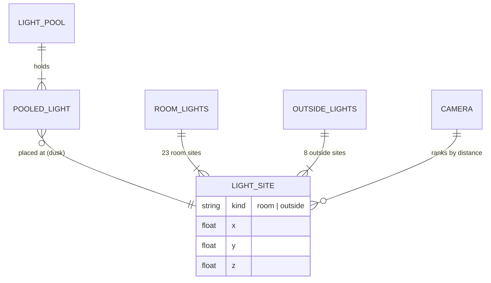

# Domain: lights off by day, only the nearest at dusk

## Concepts

**Room light** — changes system term: the 23 `ROOM_LIGHTS` stay the *sites* of room lights (film
fill lights in Blender, unchanged). In the viewer (fast mode) they are no longer one light each: by
day none is on; at dusk the `ROOM_N` sites nearest the camera are lit. With `hires=on` each site
keeps its own light, as before.

**Outside lamp light** — new term for the viewer side of `OUTSIDE_LIGHTS` (the bulbs of the
gooseneck wall lamps): off by day, at dusk the `OUTSIDE_N` nearest the camera are lit.

**Light pool** — new: the fixed set of `ROOM_N` + `OUTSIDE_N` viewer lights. Its members never
change; at dusk each is moved to one of the nearest sites, by day the whole pool is switched off.

**Cut-off fade** — new: a pooled light dims to 0 as its site's distance approaches that of the
nearest site *not* in the pool, so a light leaves the pool already dark.

**Site distance** — new: how far a light site is from the camera for the ranking. Inside the
house (`indoors()`) the height difference counts three times (`hypot(dx, dy, 3·dz)`), so the
rooms of the camera's own storey come first; outside it is the plain 3D distance.

**Full quality (`hires=on`)** — new: the viewer mode for the film capture, set by the URL switch
`?hires=on`. It turns off every speed shortcut that changes the picture: the light pool (lights
are per site, as before this change), the pixel-ratio cap and hiding the grass indoors. The
default, **fast mode** (`hires` missing or `off`), uses all of them, the Rundgang included.

## Vocabulary

| Term | Meaning |
|---|---|
| Light site | A position a light can sit at: one `ROOM_LIGHTS` entry + `ROOM_LIGHT_H`, or one `OUTSIDE_LIGHTS` bulb. |
| Light pool | The fixed `ROOM_N` room `PointLight`s + `OUTSIDE_N` outside `SpotLight`s of the viewer. |
| `ROOM_N` / `OUTSIDE_N` | Pool sizes: 6 and 2. |
| Off (ganz ab) | `visible = false`: the light is not in the render list, not just at intensity 0. |
| Cut-off fade | Intensity factor `clamp((d_cut − d) / FADE, 0, 1)`, `d_cut` = distance of the first site outside the pool, `FADE` = 1.0 m. |
| Site distance | `hypot(dx, dy, 3·dz)` while the camera is `indoors()`, else plain 3D distance. |
| `hires` | URL switch: `on` = full quality (per-site lights, full pixel ratio, grass indoors); missing/`off` = fast mode. Kept in the URL. |
| Fast mode | The default: light pool, pixel ratio ≤ 1.5, no grass while indoors — also in the Rundgang. |
